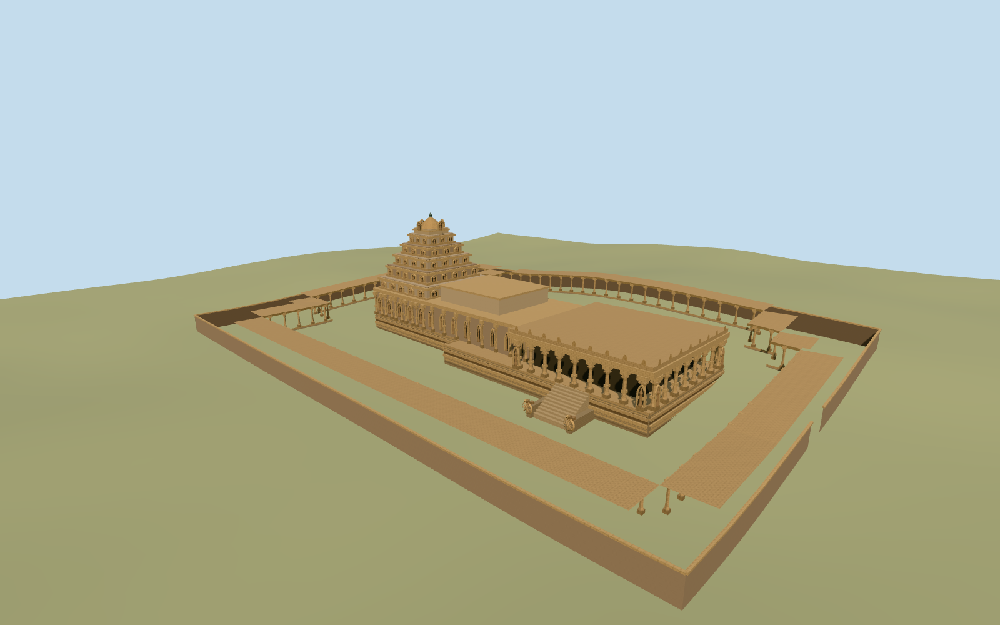

# Airavatesvara Temple

The standing Chola temple at Darasuram with a richly tiered 24 m stone vimana, pillared mandapa, south chariot-shaped stair, open court and perimeter galleries.

Authoring state: **review-in-qa.json**. Current completion evidence is in [qa.json](qa.json) and the [completion ledger](../../../../qualla-structures/batches/qualla-003.PROGRESS.md).

- [Airavatesvara Temple](https://qualla.com/airavatesvara-temple/)

Tier and hall proportions are based on the measured compound and dated source views. Stone carving, individual deities, inscriptions, columns away from the pictured run and the horse ornaments are modeled as simplified relief.

The interior shrine, later ramps and utilities, detached east gopuram and neighboring Devanayaki Temple are beyond the selected compound.

Build: `node content/worldgen/source/places/tc/tcb/airavatesvara_temple/models/generate-airavatesvara-temple.mjs`. Add `--check` to verify exact regeneration. 51151 triangles; 6 materials; no embedded photographs.
