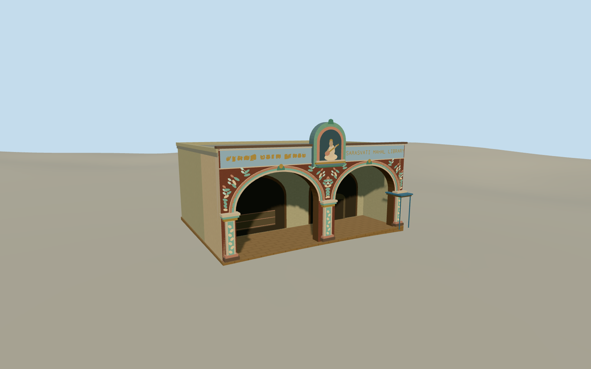

# Saraswathi Mahal Library

Saraswathi Mahal Library’s recessed two-arch entrance, painted spandrels, blue sign band and raised Saraswati niche.

Authoring state: **review-in-qa.json**. Current completion evidence is in [qa.json](qa.json) and the [completion ledger](../../../../qualla-structures/batches/qualla-003.PROGRESS.md).

- [Saraswathi Mahal Library](https://qualla.com/saraswathi-mahal-library/)

The single photograph records the November 2024 public entrance. The rear wall, roof, side returns and depth are approximated. The scope covers the public entrance wing and immediate porch.

The open arches, powder-blue sign band, muted painted relief and raised niche follow the photographed façade. Small text and figurative detail are simplified.

Camera position, its recorded pointing direction and photograph-derived scale locate the wing within the mapped palace compound. Width, center and bearing remain approximate. The original independent elevation field is preserved.

Build: `node content/worldgen/source/places/tc/tcb/saraswathi_mahal_library/models/generate-saraswathi-mahal-library.mjs`. Add `--check` to verify exact regeneration. 2584 triangles; 5 materials; no embedded photographs.
