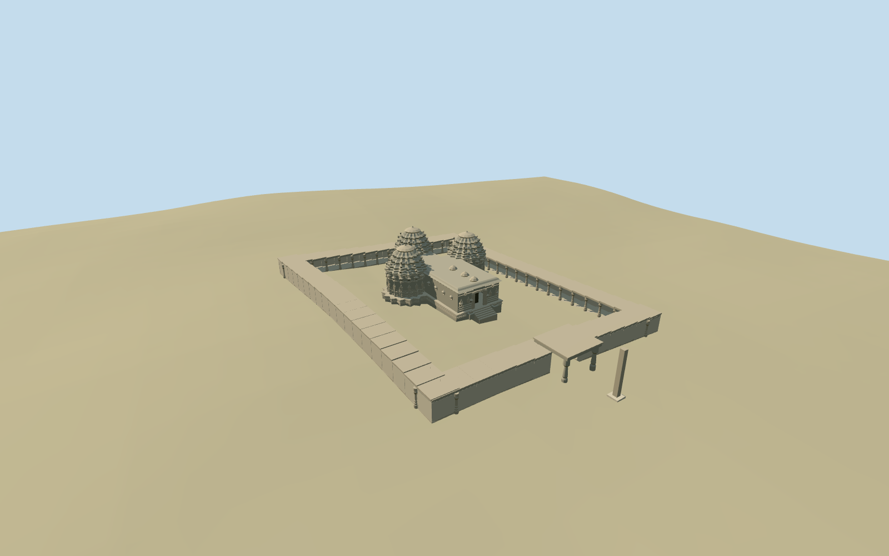

# chennakesava_temple_at_somanathapura_mysore — Chennakesava Temple at Somanathapura Mysore

Reviewed 2026-10-19 in one continuous author/build/inspect/fix round.

## Appearance

Inspected48 current source/shared/medium-fi/native/fallback views in one continuous ordinary-picture/map brief, construction and concrete correction round. Specific west/north/south stellate shrine walls/towers, star-following horizontal mouldings, receding patterned registers with domical caps/finials, original simplified figure/niche/miniature-shrine/animal relief vocabulary and stepped jagati. Low east mandapa has layered carved doorway, real recessed dark entrance, front bands/figures and small roof crests. Approximate open enclosing corridor, turned gate-pavilion shafts, true through-passage and separate plain pillar. Same-round renders exposed buried tower ornaments and an overly plain entrance; their visible offsets and facade details were corrected. No copied narrative/deity/text panels or full ritual interior.

## Shared materials and browser levels

Four existing shared256-square graphs: stone_basalt_raw for muted warm-grey temple masonry, stone_limestone_raw for carved mouldings/figures/columns, stone_ashlar for the enclosure wall/plain pillar footing and metal_painted for tinted dark recesses. Four roles/at most four draws; each graph read once. Metric UVs/linear tints, zero embedded images and no unique photographic atlas. Separate GPU streams and matching CPU/GPU accounting. Four levels958/3776/15200/63168triangles; initial geometry452,412bytes. The close-up geometry is optional and carries finer turned-column/relief detail. Eviction releases all model geometry.

| Level | Triangles | Bytes | Draws |
| --- | ---: | ---: | ---: |
| skyline | 958 | 99952 | 1 |
| district | 3776 | 352460 | 4 |
| street | 15200 | 1440700 | 4 |
| closeup | 63168 | 6461284 | 4 |

Inspected noon/late, economy/high, whole silhouette, east entrance/three towers, west stellate relief, gate/corridor, all four levels and transitions. Skyline retains all three shrine caps, mandapa, jagati, enclosing ranges/open sparse supports, true east door/gate passage and separate pillar. District restores the receding tower bands/mouldings and denser pillars. Street adds the main figures/niches/entrance carving and selected tower aedicules; close adds fuller star contours, finer turned shafts and original animal/miniature-shrine registers. Shared flat stages expose terrain-relative plinth bottoms, and some detail crops omit the whole precinct/plain pillar top; whole views carry full silhouette. Some sun-facing distant shared views wash out in the bright Earth lighting; the native-site/other-angle views retain material and depth judgment. Green ground and the remote procedural building/path are host context, not actual paved courts or landscaping.

## Approximate map fit

Named standard PMTiles Keshava Temple archaeological-site point35184523899922 correlates main lobed building35184523899920/way151811088. No exact-QID footprint claim. Anchor76.88155573,12.27573677; heading0, internal angle-.13rad, entrance east/local+x. Three lobe stations establish the west/north/south shrines. Standard map does not resolve the enclosing corridor: its68x52m extent, gate and pillar are explicitly picture-led approximations fitted to open surroundings/east footway, not mapped dimensions. Replace only the temple shell with2cm tolerance; zero authored residual. The independent in-tile building, all original6m ground/water and native footway remain unchanged. Loaded levels retain one native building; failed load restores both full originals. Main level jagati has buried bottom edges/short stairs, enclosure footings/ranges follow grade, court stays native ground. No broad slab, flattening or ground/water cutout. Unload releases geometry.

## Limits

Accepted medium-fi temple and approximate enclosure from three inspected ordinary front/outside/shrine photographs plus standard PMTiles/Mapzen. The outside view resolved three tower caps and gate/plain pillar, while the close shrine view filled its obscured star/carving coverage gap; no bespoke research. Main lobed shell controls placement. Star radii, height ratios, hidden connectors/roofs, corridor dimensions/bay counts, sculpture/animal inventory, weathering, enclosure/gate/pillar stations and exact thresholds remain explicit picture/map approximations. Original simplified geometric relief conveys the carved vocabulary; no copied deity/story/text images or full ritual interior. Native coarse rural DEM cannot resolve stone paving or actual court levels: locally level temple bases can expose more footing on the lower side of this coarse slope. Trees/gardens, independent building, ground and paths remain host context. Physical-device/dense-city timings remain pending.

## Selected checks

Six Khronos files: zero errors/warnings.500 actual mesh/map-envelope probes; 48 current inspected views. Scene validation/sim30 and strict selected medium-fi audit pass. Source and runtime hashes/material bindings/LOD caps verified.

Rebuild: node packages/worldgen/scripts/generate-additional-landmarks.mjs --ids=chennakesava_temple_at_somanathapura_mysore; node packages/worldgen/scripts/import-structure-models.mjs --ids=chennakesava_temple_at_somanathapura_mysore; node packages/tooling/scripts/generate-landmark-lods.mjs --ids=chennakesava_temple_at_somanathapura_mysore --force.

Source: sha256:257f588f7fb596f8a6514c512d34b635086a93027447edbec284e4ed017aba5a

Runtime: sha256:a2c921cc8ae179898fcfd73361e0eddd47e6f2d972e28a87c279a124c75168cc

Input: sha256:b6df2a93326d945281add0a3b8f6e3c55966f230ac9ad9e9ad301abddfb81c07

## Viewed ordinary pictures

https://commons.wikimedia.org/wiki/File:Front_View_of_Chennakesava_Temple,_Somanathapura.jpg — Jmadhu; CC-BY-SA-4.0. Viewed only; no pixels copied.

https://commons.wikimedia.org/wiki/File:View_of_trikuta_(three_towers)_from_outside_the_Chennakeshava_temple_at_Somanathapura.jpg — Dinesh Kannambadi; CC-BY-SA-3.0. Viewed only; no pixels copied.

https://commons.wikimedia.org/wiki/File:Stellate_plan_of_the_shrine_and_sikhara_(tower)_in_the_Chennakeshava_temple_at_Somanathapura.JPG — Dinesh Kannambadi; CC-BY-SA-3.0. Viewed only; no pixels copied.
