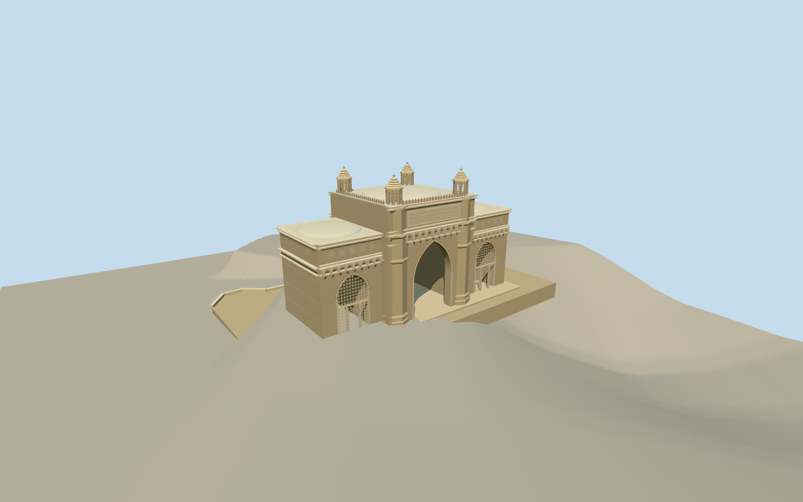

# Gateway of India

Three-bay yellow basalt waterfront gateway: tall open pointed central arch, jali-framed side doorways, four octagonal tiered turret crowns, carved piers/cornices/rosettes, upper inscription panel and lotus parapet, three shallow roof domes and own stepped base. Temporary objects and nearby buildings excluded.

Authoring state: **review-in-qa.json**. Current completion evidence is in [qa.json](qa.json) and the [local 100 ledger](../../../../qualla-structures/batches/PROGRESS.md).

- [Gateway of India](https://qualla.com/gateway-of-india/)

Current exterior uses three inspected exact creator-released CC0 originals:DarshanRane2012front,AroundTheGlobe2011arch detail and Darshula2023harbor elevation. Earlier FAL/CC photographs and rights-unverified aerial imagery are excluded. Nominal26m monument scale retained;facade heights,shallow cap profiles,vaults,rear details and hidden joins are estimates. Map height tags are not measured elevations.

Official48ft central-dome diameter used for the central roof control; the prose83ft apex datum is not reconciled with the shallow exterior cap seen in aerial context. Exterior cap height remains an estimate. Fine inscriptions, motifs and jali patterns are simplified native geometry.

Own monument,physical immediate waterfront quay and sea stair only. Quay/stair horizontal plan follows original OSM coastline206817494. Fixed paving0,submerged masonry base-3.4,and20sea-stair risers descending to-2.65are bounded exterior estimates,not civil or tidal survey. Wider city plaza,ferry buildings/jetty,boats,people,barriers,temporary scaffolding and roof flagpole excluded. No photo pixels redistributed.

Independent Terrarium terrain is unmodified and mixes coastal land/bathymetry. Physical deck/stair surfaces replace only their own modeled volumes;buried/submerged foundations are estimates and are not fitted to terrain cells. Host ocean at mean sea level is scene-owned;portable/native-ground fixtures without ocean expose submerged geometry as a diagnostic. Footprint replacement disabled. No survey,tidal-stage,exact seabed-contact or physical-device performance claim.

Build: `node packages/worldgen/scripts/generate-authored-places.mjs --ids=gateway_of_india`. Add `--check` to verify exact regeneration. 21872 triangles; 4 materials; no embedded photographs.
