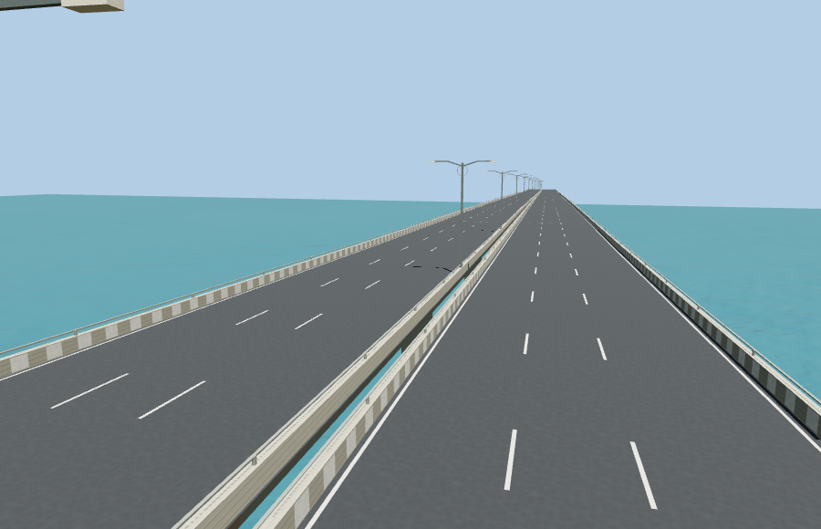

# Atal Setu (Mumbai Trans Harbour Link)

The two viaduct carriageways and sixteen mapped elevated ramps use 24 independently streamable sections. Three ramps merge into the middle of the viaduct and stream with the adjoining decks. The detailed source assembly preserves the geometry in a common east/south frame. The terrain-level road between the marine landing and the Chirle viaduct stays native to the viewer.

Run `node packages/worldgen/scripts/generate-mumbai-trans-harbour-link.mjs` to rebuild the detailed source. The standard landmark LOD pipeline builds the four authored viewer levels. Each section references the same shared materials.

The plan follows OpenStreetMap via Protomaps PMTiles. Elevation samples come from Terrarium. Deck profiles, steel-span stations and the individual pier locations are visualization estimates.

The viewer review covered all four detail levels for every section. The largest sampled inland approach height difference was 0.164 m. Native roads remained available on model load failure. See [the native fit report](native-fit-report.json).
