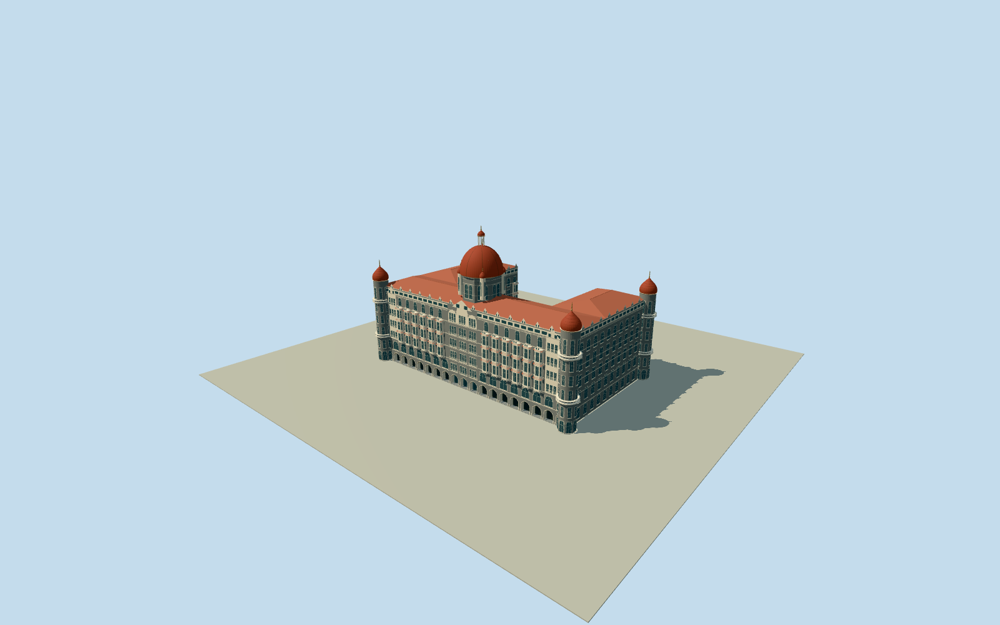

# Taj Mahal Palace Hotel

Historic Palace U around open courtyard: dark basalt and cream trim,continuous stone floor inside19recessed waterfront ground bays with3central entrance doors,12three-level projecting oriel stacks,round corner towers and onion roofs,white roof gables and attic strip,hipped tiled roofs,octagonal main drum and ribbed red dome with open lantern. Low courtyard terrace retained; modern Tower and connector wings,public road/quay,Gateway,harbor,pool/garden/furnishings and interiors excluded.

Authoring state: **owner-accepted-medium-fi-preview**. Current completion evidence is in [qa.json](qa.json) and the [local 100 ledger](../../../../qualla-structures/batches/PROGRESS.md).

- [Taj Mahal Palace Hotel](https://qualla.com/taj-mahal-palace-hotel/)

Photographic medium-fi surviving Palace exterior, not a scan or navigable interior. Fine tracery,balustrades,carving,roof junctions and unseen rear details are estimates.

Native parent combines Palace/Tower. Historic5243.7m²U uses retained parent vertices and explicit inferred northern interface;low courtyard terrace and projecting upper bays/turrets are photo-directed extensions. Courtyard remains open; no whole-parent replacement.

Published Tata240ft dome description interpreted as approximate73.152m overall finial envelope. Exact crown/ground datum and floor heights are not surveyed;39.5m main eave and52.25m red-dome base follow photographic massing estimates. Generic20m map height retained as a conflicting tag.

Owner accepted the geographic preview on 2026-10-19 with known coastal/urban host-terrain contact artifacts. Source ground and model geometry are unmodified; activation and completed story coverage use this explicit acceptance.

Modern76mTowerpart,connector wings,neighboring buildings,Gateway of India,pool,garden,furniture,harbor scenery and interiors excluded. Original photo pixels are inspection controls, not redistributed textures; ordinary shared material graphs.

Build: `node packages/worldgen/scripts/generate-authored-places.mjs --ids=taj_mahal_palace_hotel`. Add `--check` to verify exact regeneration. 61729 triangles; 6 materials; no embedded photographs.
