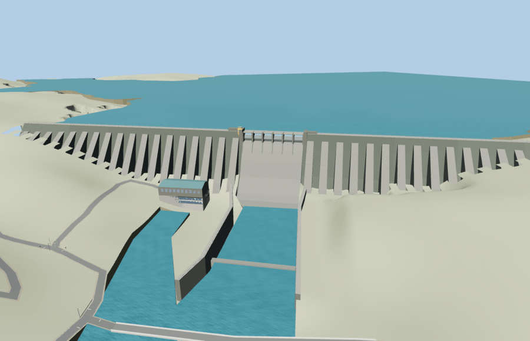

# Koyna Dam

The model reproduces the 807.72 m buttressed gravity dam, six radial gates below the crest deck, striped crest tower, mapped powerhouse and the retaining walls and apron of the stilling basin.

The viewer renders Shivsagar Reservoir at the representative 659.43 m full-pool stage and the downstream stilling basin at 581 m. Bounded grades expose the eastern retaining wall and buttresses. The six gate bays, striped crest tower and powerhouse remain visible, and the mapped downstream bridge keeps its own deck above the basin.

The Earth fixture retains 33 native road records and two nearby building features. The ground opening follows the dam, buttresses, spillway apron and powerhouse. Failed loading preserves the native layers. Eviction restores the ground and releases the model geometry.

| Detail level | Triangles | Download bytes | Draws |
| --- | ---: | ---: | ---: |
| skyline | 888 | 68,928 | 4 |
| district | 1,138 | 88,140 | 4 |
| street | 1,694 | 132,556 | 5 |
| closeup | 7,430 | 579,988 | 5 |

Skyline and district total 157,068 bytes. Six GLBs pass Khronos validation and contain zero embedded images. Five shared material graphs bind in the viewer. The review covers 72 renders and 345 geographic samples.

The basin stage, bank grades and subsurface sections are representative exterior estimates. Some outer shoreline edges remain sharp in the coarse terrain. The model depicts closed gates.

The host supplies the matching Protomaps feature IDs and terrain samples fine enough to resolve the graded banks.

[Mapped site frame](map-frame.json) · [Terrain and water fit](site-fit.json) · [QA evidence](qa.json)
