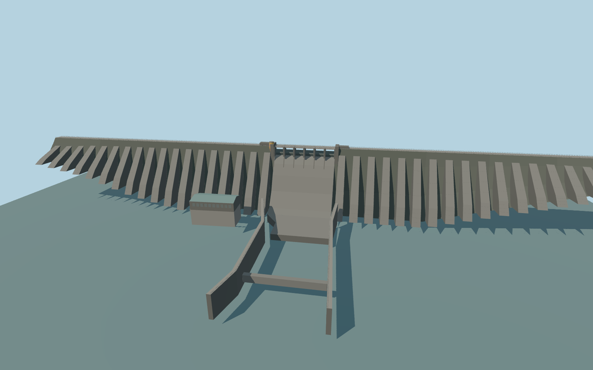

# Koyna Dam

Koyna Dam’s straight 807.72 m gravity crest, repeated reinforcing buttresses, six radial gates and ogee spillway, striped crest tower, powerhouse and walled stilling basin.

Rebuild: `node packages/worldgen/scripts/generate-koyna-dam.mjs`;append `--check` for exact source bytes. Select import/LOD/placement with `--ids=koyna_dam`. Detailed source and four browser tiers are separate ignored GLB outputs.

The fixed vertical origin is 642.044658375 m. The crest is at 664.45 m. The review water fixture uses the 659.43 m full-pool design stage and an illustrative 581 m stilling basin.

The crest frame follows 669.82 m of mapped reservoir shoreline and includes 68.95 m modeled land ties at both ends to reach the documented length. Buttress sections, crest houses and unmarked power station elevations are exterior approximations.

The standard sampled reservoir stage is about 17 m below full pool. Near-bank terrain includes spurious low samples. The design fixture and sampled-stage comparison record this difference.

Gates are shown dry and closed. The approach bridge and roads remain native. Underground generating works are outside the model.

Original geometry:repository license. Map:© OpenStreetMap contributors,ODbL-1.0;Protomaps. Standard terrain:terrain-grid.json. Ordinary pictures stay local and are not redistributed or used as textures. Current acceptance:qa.json.
