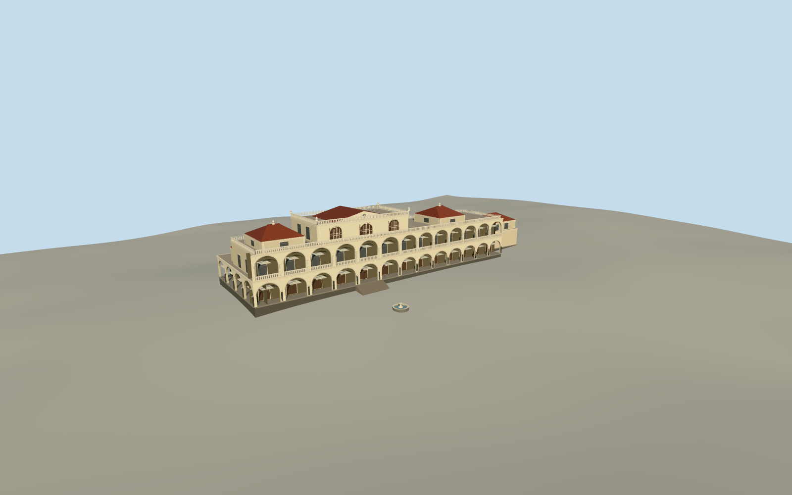

# Aga Khan Palace

Standing Aga Khan Palace in Pune, with deep Italianate arcades above a dark stone plinth, an embellished entrance, terracotta pavilion roofs and the mapped forecourt fountain.

Authoring state: **review-in-qa.json**. Current completion evidence is in [qa.json](qa.json) and the [completion ledger](../../../../qualla-structures/batches/qualla-003.PROGRESS.md).

- [Aga Khan Palace](https://qualla.com/aga-khan-palace/)

The model covers the present mapped palace exterior, deep arcades, entrance hall, receding upper floor, hipped tiled pavilions and east forecourt fountain. Heights, bay counts outside the three documented porch arches, range roof outlines and rear details are estimates.

The unaltered elevation field fixes the east stair and footprint grade. The stone plinth and stair lengths are approximated within that slope. The ground map and published gross floor areas describe different measurement boundaries.

Carved jali, badges, balusters and finials use simplified original geometry. Written architectural records and the named outline establish the exterior; the historical photograph’s current record leaves its release unresolved.

Build: `node content/worldgen/source/places/te/tek/aga_khan_palace/models/generate-aga-khan-palace.mjs`. Add `--check` to verify exact regeneration. 18083 triangles; 6 materials; no embedded photographs.
