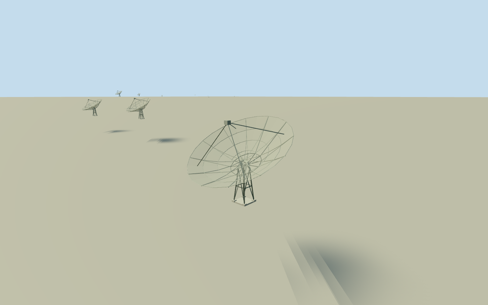

# Giant Metrewave Radio Telescope

Build the complete 30-antenna GMRT array at the operator’s named station coordinates. Each antenna has a 45 m parabolic wire-mesh reflector, an 18.54 m focal length, a quadrupod feed, open rear bracing and an altitude-azimuth mount on a splayed steel tower. Use a representative static elevation of 60 degrees toward the south. Preserve all 14 central and 16 outlying stations and their relative elevations. Fine mesh, mounts, fixtures and hidden connections are simplified medium-fi interpretations of the cleared photograph and operator dimensions. Exclude administration buildings, electronics, roads, farms, vegetation, fences, signs, people and vehicles.

Authoring state: **review-in-qa.json**. Current completion evidence is in [qa.json](qa.json) and the [completion ledger](../../../../qualla-structures/batches/qualla-002.PROGRESS.md).

- [Giant Metrewave Radio Telescope](https://qualla.com/giant-metrewave-radio-telescope/)

NativeC02node5773281557exactanchor[74.0504627,19.093107], heading0east/south. PrimaryoperatorTable3suppliesall30relativebx/by/bzvectorsaboutC02, orthonormallyconvertedtoEast/North/Upatanchorlatitude; localZ=-North. MissingC07/E01/S05stationnumbersintentional,notmissingantennas. NamednativeC03/C06crosscheckswithinabout4moftransformedoperatorpositions; no fittedrotation/scale. Earthcurvature/localmapprojectionandrawDEMdatumarenotcertifiedsiteground; primaryrelativeUppreservedwithoutfitting. 45mdiameterand18.54mfocallengthmeasuredoperatorfacts; bases/forks/trusssections/pointingestimatedfromclearbutblurryoriginal. All30stationsretained, noone-dishsubstitute.

Full30stationarrayfromprimary2025-12-15operatornumericTable3andnativeC02identity; 14centralstations/16outerstations,nofabricatedregularrows. AllrelativeUpvaluespreserved. Coarselocalcartographicprojection/EarthcurvatureandrawDEMdiffer; exactlivehostcontactunverified. No whole25kmground/roads/farmsmesh.

Exactpublished640x480SankashidownmobilePDoriginalindividuallyinspected/nativeSHA1matched; correctcase-sensitivefilenameGMRT.jpgisdistinctfromattributionGmrt.JPG. Selectionbugfixedwithfocusedregressionswithoutalteringsiblingmedia. Allattributionimages/NASAcelestialphotosunused. No externalphotographneeded/copiedor generatedbitmaptextures.

45mdiameter,18.54mfocallengthandfourfeedsupportlegsareoperatorfacts. Realparabolicwiremeshusescanonicalalpha-coverageperforatedsquaregraph,8.5cmrepeatcoarserthanactual10/15/20mmwirecellsasanexplicitmedium-fiapproximation. Palephysicalconcentric/radialsteelmembers,openrearlatticeandfork/fourlegs/feedhousingareoriginalboundedforms. No opaqueparabolicdishsubstituteintheworldmaterials.

Sourcephotographisblurry; fineconnections/actualpedestal/fork/rearsection/census/servocoversandpaint/currentequipmentchangesestimated. 18mvertex/14mmountheight,60degreeelevation/southwardstaticpointingareboundedrepresentativeparameterswithintheoperatorrange, notcurrenttrackingstate orsurvey. Templateconsistentacross30stations.

LowerLODsreducereflectorsegments/ribs/mountdetailsbutretainall30actualstationlocations,theentire45mspan/parabolicprofile,quadrupodfeeds/supporttower. Administration/control/guesthouse/labs/canteen/electronics/fibercables/fences/landscape/signs/vehicles/peopleexcluded.

Independent30km250mgrid/14641values/20originalTerrariumtilesfrozenbeforegeometry. Pixelspacingabout36mdoesnotimplysurveyaccuracy; fieldincludesurban/vegetationheightreturns. FrozenC02datumpointnotfittedtoprimarytable. Portable/sharedflatgroundonlygeometryfixture, remainingstationbasesnaturallyshowrelativeheightoffsetsagainstflatplane; nothost-groundproof. PreviewreplaceFootprint=false.

Build: `node packages/worldgen/scripts/generate-authored-places.mjs --ids=giant_metrewave_radio_telescope`. Add `--check` to verify exact regeneration. 43380 triangles; 4 materials; no embedded photographs.
