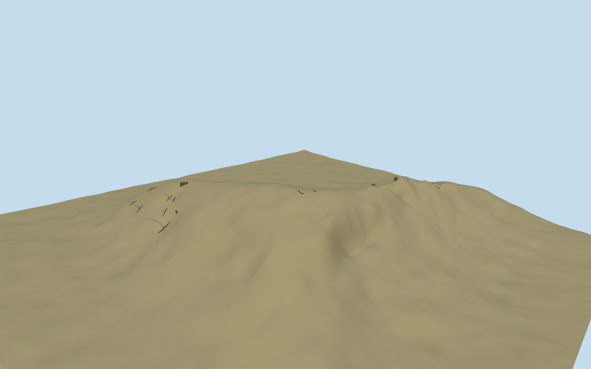

# Shivneri Fort

The surviving basalt fortress at Shivneri on its original triangular hill, with the seven ascending gates, shrine, old granary and birthplace structures.

Authoring state: **review-in-qa.json**. Current completion evidence is in [qa.json](qa.json) and the [completion ledger](../../../../qualla-structures/batches/qualla-003.PROGRESS.md).

- [Shivneri Fort](https://qualla.com/shivneri-fort/)

The seven masonry gates are located using visitor-stop coordinates and mapped paths. Orientations, immediate walls, heights and ornaments are approximate.

The modern birthplace mass is placed at the Archaeological Survey coordinate. Its unmapped footprint and roof construction are estimates.

The Badami reservoir has a visual edging only. Its water depth, rock-cut spring interiors and terrain drainage are outside the model. The original elevation grid is unchanged.

The open terrain cannot resolve every small terrace. The model uses estimated local retaining plinths where needed to keep standing structures above the original hillside.

The 2007 public-domain photograph is a distant landscape reference. Present close architectural details are interpreted from factual records and observed footprints.

Build: `node content/worldgen/source/places/te/tek/shivneri_fort/models/generate-shivneri-fort.mjs`. Add `--check` to verify exact regeneration. 4918 triangles; 6 materials; no embedded photographs.
