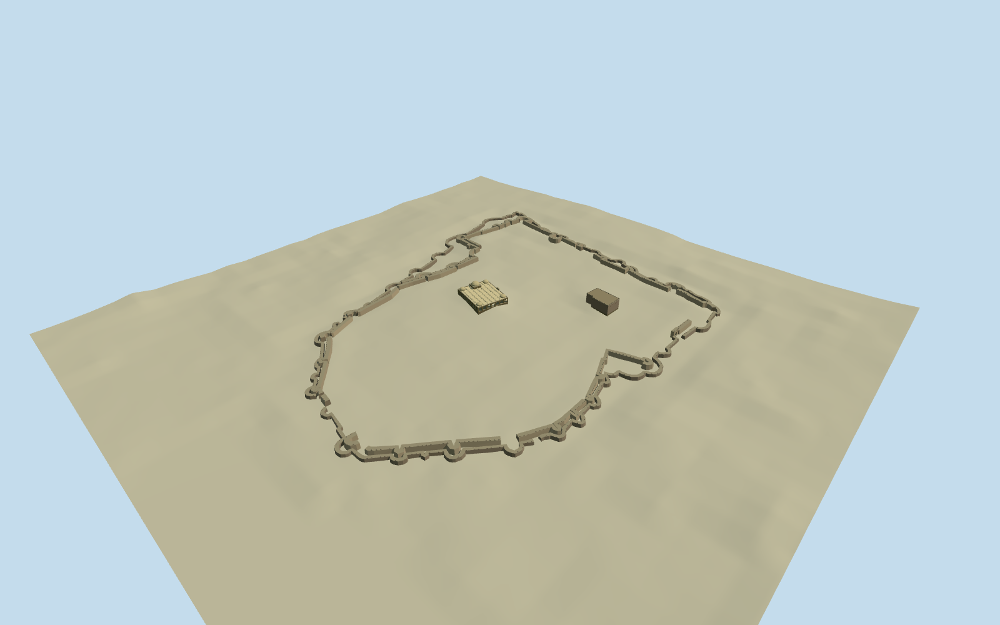

# Gulbarga Fort

The surviving double ramparts of Gulbarga Fort, with the mapped east portal, Bala Qila and the covered domes and arcades of Jama Masjid.

Authoring state: **review-in-qa.json**. Current completion evidence is in [qa.json](qa.json) and the [completion ledger](../../../../qualla-structures/batches/qualla-004.PROGRESS.md).

- [Gulbarga Fort](https://qualla.com/gulbarga-fort/)

Wall crests, details of damaged western outworks, dome heights and material hues are estimates from the mapped fabric and historical views.

The model depicts the surviving exterior and the roofed mosque arcades. It omits later uses of the precinct, the unverified western outwork, and interiors beyond the arcades.

Build: `node content/worldgen/source/places/te/ten/gulbarga_fort/models/generate-gulbarga-fort.mjs`. Add `--check` to verify exact regeneration. 30150 triangles; 4 materials; no embedded photographs.
