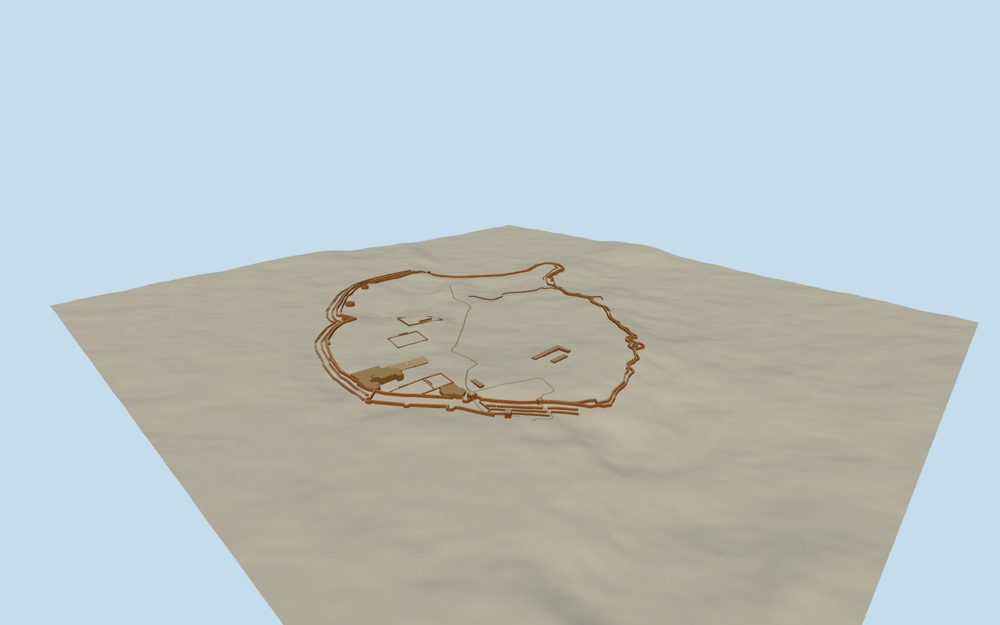

# Bidar Fort

Bidar Fort with mapped laterite fortifications and moat walls, four arched gateways, the sixteen-column mosque, the palace ruins and round bastions.

Authoring state: **review-in-qa.json**. Current completion evidence is in [qa.json](qa.json) and the [completion ledger](../../../../qualla-structures/batches/qualla-003.PROGRESS.md).

- [Bidar Fort](https://qualla.com/bidar-fort/)

The named OSM enclosure represents the full fort precinct. Supplementary lines and polygons establish numerous standing walls, bastions and monuments. Unmapped wall sectors and gate plans are estimated.

Both published photographs establish the character of the south-eastern approach. Gate passage depths, unphotographed palaces, stone banding and crenellation dimensions are approximate.

The original elevation layer is retained. Fine archaeological cuts in the laterite and dry moat cross-sections may be coarser than the published composite elevation data.

Build: `node content/worldgen/source/places/te/tep/bidar_fort/models/generate-bidar-fort.mjs`. Add `--check` to verify exact regeneration. 56043 triangles; 5 materials; no embedded photographs.
