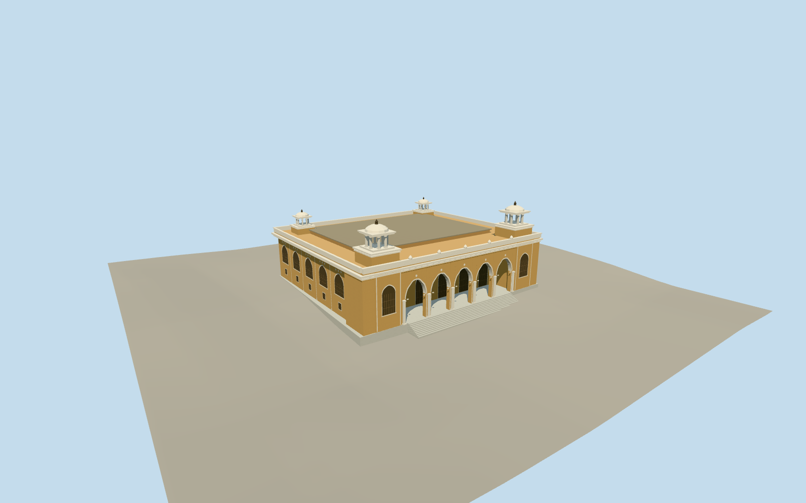

# Khilwat Mubarak, Chowmahalla Palace

The ochre Durbar Hall with five cusped court arches, pale marble stairs, layered cornices and open rooftop pavilions.

Authoring state: **review-in-qa.json**. Current completion evidence is in [qa.json](qa.json) and the [completion ledger](../../../../qualla-structures/batches/qualla-003.PROGRESS.md).

- [Chowmahalla Palace](https://qualla.com/chowmahalla-palace/)

May 2020 exterior of the Khilwat Mubarak Durbar Hall. The clock tower, other palace buildings and interiors are separate.

The mapped footprint fixes the exterior envelope. The roof heights, rear elevations and ornamental relief are photographic estimates.

Original elevation samples are preserved. The north stair apron and plinth heights are approximations.

Build: `node content/worldgen/source/places/te/tep/chowmahalla_palace/models/generate-khilwat.mjs`. Add `--check` to verify exact regeneration. 7552 triangles; 6 materials; no embedded photographs.
