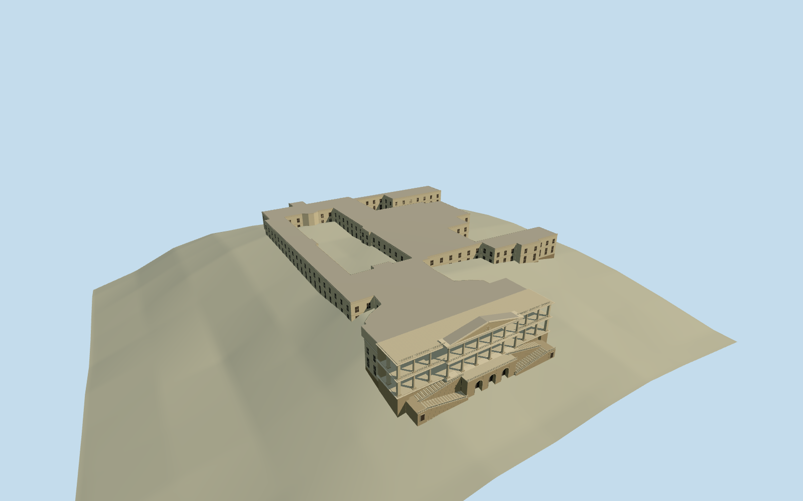

# Falaknuma Palace

Falaknuma Palace in Hyderabad, with a two-storey classical portico above twin north stairs and connected ranges around an open court.

Authoring state: **review-in-qa.json**. Current completion evidence is in [qa.json](qa.json) and the [completion ledger](../../../../qualla-structures/batches/qualla-004.PROGRESS.md).

- [Falaknuma Palace](https://qualla.com/falaknuma-palace/)

Draft exterior: approximate photographic proportions and simplified ornament. It is not a survey, photogrammetric reconstruction or approved current geographic replacement.

The 1898 view shows open two-storey columns, the central classical pediment and low balustrades above a three-arch podium and paired stairs.

Terrain sampling/contact, geographic alignment and site activation remain pending. Runtime LODs are produced by the registered after-import pipeline and require visual review.

Reference photos remain in the local Qualla corpus; only provenance, paths and hashes are retained here.

Build: `node content/worldgen/source/places/te/tep/falaknuma_palace/models/generate-falaknuma-palace.mjs`. Add `--check` to verify exact regeneration. 33078 triangles; 4 materials; no embedded photographs.
