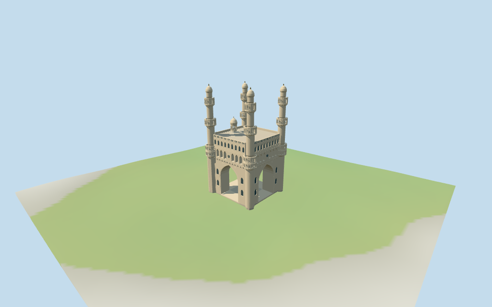

# N0430 — Charminar

Reviewed2026-10-17 against current bytes. Accepted for the stated medium-fi exterior and approximate horizontal fit. The48.7m retained height fact differs from current53m map tags;working geometry follows the map and preserves the conflict. Unseen roofs/terrace plans,current finish,interiors and precise street/ground joins remain unverified.

## Exterior and shared surfaces

Inspected all11 current portable views including the1024×640 summary. Four cream-stucco minarets with paired lower gallery tiers,two higher projecting open balconies/bulb caps and bronze finials;deep four-way crossing arches/transverse vault,first facade gallery and four clocks,closed lower fields/clerestory,sparse brackets/parapet lattice and western roof cupola. Inset end gallery bays to avoid collision with corner minarets. Lower gallery inner quadrants join the main building;open probes use the exposed outer half. Unseen roofs and all untagged dimensions remain estimates,current finish/exact street joins unverified.

Inspected all11 current shared/geographic-flat views. Four existing256² lime-plaster,limestone,sandstone and neutral bronze graphs;five merged groups. Pale plaster shafts and walls,cream limestone cornices/arch trim,coursed sandstone roof/paving and sparse bronze finials;panes local blue-grey. Metric UVs/linear tints,zero embedded images,baked shadows/weathering or copied stucco art. Four graphs read once;unload leaves zero live model geometries. Geographic fixture is flat;portable/medium-fi use retained standard DEM. Nearby market buildings and streets stay host content;exact altitude/site contacts unverified.

## Browser levels

| Level | Triangles | Bytes | Draws |
| --- | ---: | ---: | ---: |
| skyline | 986 | 100,808 | 1 |
| district | 3,884 | 359,724 | 5 |
| street | 15,813 | 1,574,552 | 5 |
| closeup | 38,749 | 3,879,420 | 5 |

Initial skyline plus district: **460,532 bytes**. Master **6,256,392 bytes /52,109 triangles**;runtime **6,255,900 bytes**. Four shared256² graphs,five groups,zero embedded images;shared runtime textures are additional.

Inspected all27 current medium-fi frames:Economy/High,noon/late,three distances,silhouette,six details,four matched LODs and four transitions. Skyline986 keeps four tower/cap silhouette with sharper projecting balcony bands,four genuine crossing arches,main room/clock proxies and western cupola;minaret bands and main gallery use distant solid/closed approximations. District3884 opens main gallery and coarse four-post minaret stages;small lower fields omit and clerestory proxies close. Street15813 adds pointed gallery openings,selected arch trim and closed lower fields;close38749 adds finer facets,clock marks/hands,bracket rhythm and broad parapet cross-lattice. One/five draws,initial460532bytes plus shared textures. POSITION/NORMAL separate;CPU/GPU reservations equal. Exact ground/threshold joins,terrace layout,synthetic neighborhood and physical-device timings unverified.

## Placement and scope

Retained exact way/238186115 /Q1771696 matches current PMTiles lower building part35184610274947 (2^45+238186115). Earlier retained curved outer outline and current27-point lower outline are preserved separately. Seven current building/part controls locate lower structure,four minarets and the24–25m/25–29m upper plates. Anchor[78.47463907,17.361600401] and heading−0.187322426164rad unchanged. Native+X approximately east-southeast eastern market/clock facade,−X west-northwest mosque/cupola side;+Z south-southwest/opposite north-northeast. Four arch passages cross beneath the gallery. Native axes follow the mapped facades rather than exact cardinal directions. Four tower centers retain mapped footprints;other openings/gallery subdivision/roof cupola are picture-led estimates within about1.5m/facing about3°. Nearby market buildings,roads and public realm remain host content. Retained facts give48.7m height and20m nominal width/length;current map gives19m lower base,minaret parts min_height19m/height53m,and upper parts24–25m/25–29m. Preserve the4.3m height disagreement and nominal20m core dimension separately from current~28.46×28.05m overall tower footprint;no rescale to force agreement. Working model uses mapped53m tower tips and19m lower structure;large crossing vault apex17.3m,first open facade gallery19.4–24m,upper closed clerestory25–28.4m and parapet29–30.1m. Twin lower minaret galleries19.5–24.4m,higher galleries34.5–37.1m and44–46.7m,drums46.7–49.1m,caps49.1–52.2m/finials53m;western roof cupola30.1–37m. All untagged levels,profiles,clock/opening/bracket sizes,roof divisions and gallery layouts are picture estimates,not surveys. Current finish and enclosed interiors remain unverified. Standard viewer DEM datum507.946465m;outer perimeter-0.66..0.01m relative to anchor. Working floor0.276m is maximum bilinear sample across the lower footprint at1m spacing plus0.25m;not surveyed pavement. Raw DEM retained without cutout/flattening;foundations extend below it and crossY=0. Paving is restricted to the monument footprint. Through arches remain exterior voids;exact street/threshold/terrain joins,walking and absolute altitude unverified. Surrounding roads/market buildings remain host content. All126 actual viewer-footprint checks cover seven selected control polygons and preserve14 separate nearby host buildings across source,runtime and four LODs. Current raw polygons/properties independently reunited from PMTiles;earlier38-point outer outline kept separately from current27-point lower outline. Bilinear raw DEM and684 footprint samples independently checked. Approximate horizontal fit accepted within these limits.

Individual medium-fi Charminar exterior:four cream-stucco minarets with stacked open galleries/corbels/bulb caps,deep four-way pointed crossing arches,open upper facade gallery/four clock faces,closed small lower fields and clerestory,sparse parapet lattice/balcony bracket rhythm and western roof cupola. Four existing shared256² graphs,five merged groups,four browser levels. Exact current controls and conflicting height/dimension facts remain distinct. Unseen roofs,interiors,precise terrace/street joins,current finish and engineering omitted or unverified. Retained facts give48.7m height and20m nominal width/length;current map gives19m lower base,minaret parts min_height19m/height53m,and upper parts24–25m/25–29m. Preserve the4.3m height disagreement and nominal20m core dimension separately from current~28.46×28.05m overall tower footprint;no rescale to force agreement. Working model uses mapped53m tower tips and19m lower structure;large crossing vault apex17.3m,first open facade gallery19.4–24m,upper closed clerestory25–28.4m and parapet29–30.1m. Twin lower minaret galleries19.5–24.4m,higher galleries34.5–37.1m and44–46.7m,drums46.7–49.1m,caps49.1–52.2m/finials53m;western roof cupola30.1–37m. All untagged levels,profiles,clock/opening/bracket sizes,roof divisions and gallery layouts are picture estimates,not surveys. Current finish and enclosed interiors remain unverified. Standard viewer DEM datum507.946465m;outer perimeter-0.66..0.01m relative to anchor. Working floor0.276m is maximum bilinear sample across the lower footprint at1m spacing plus0.25m;not surveyed pavement. Raw DEM retained without cutout/flattening;foundations extend below it and crossY=0. Paving is restricted to the monument footprint. Through arches remain exterior voids;exact street/threshold/terrain joins,walking and absolute altitude unverified. Surrounding roads/market buildings remain host content. Four actually inspected2012/2013/2026 exterior pictures guide individual minarets/galleries/caps,pointed crossing vault,clock facade and western cupola. Seven current controls/78 raw points retain exact properties;earlier38-point outline and48.7m/20m/20m facts remain separate. Current53m minaret tags take precedence for working visualization,with4.3m height disagreement explicit. No horizontal scale change to force nominal20m into the~28.46×28.05m mapped tower envelope. Untagged gallery/cupola/roof/opening/cornice proportions are estimates within about1.5m/facing about3°. Working floor0.276298m is a standard DEM clearance plane,not surveyed paving;no terrain cutout/flattening. Four crossing arches and exposed gallery voids are real geometry;closed side fields/clerestory are exterior approximations. Lower gallery inner sides legitimately join the main building. Fine stucco rosettes/lattice,precise upper mosque/court plans,interior stairs/rooms,engineering,current finish/fixtures,exact altitude/threshold/terrain joins/free walking and physical-device performance unverified or omitted. Market buildings,streets,wires,signs,vehicles and pedestrians remain host content. No bespoke surveys or redistributed photographs.

## Verification

**49 current frames inspected;1,070 geometry probes;126 footprint checks.** Six Khronos validations:zero errors/warnings/images. Targeted byte reproduction,scene validation,30-tick simulation and current input/recipe/model/LOD/capture/report/material bindings pass. Four graphs read once;unload leaves zero live model geometries. Next routine full source checkpoint N0428–N0445.

Source: sha256:6749aadddd555a2fb7e5f8f138ec5deef2a9c47cc49473e4689489d96c08bb26

Runtime: sha256:0eee4798683e9fc04011a1e5b6750f6d7a5939a1a633da9e0f7e77d228e51d0d

Input: sha256:ca9e0ad5456146bd00a9eabfb5565e6f752ef1341e8652d7ee1e8258e6c535d0

Simulation: sha256:2cb13b4083f71a099463b58caa9ad8ccbbbcd28899126c80d210a8aba560fdd6

Commands:targeted generate/import/LOD/register --ids=N0430;generate --check;portable reflections/antialias/fitted shadows;shared reflections/adaptive clipping/bounded placement;medium-fi reflections;scene validate/sim30. Bulk captures remain ignored.

## Inspected pictures

[Ahirnish — 2013-07-07](https://commons.wikimedia.org/wiki/File:Charminar_(Four_Minarets).jpg). CC-BY-SA-3.0. Oblique close view shows the paired lower minaret arcades, upper projecting balconies, faceted shafts, bulb caps and stepped upper facade galleries with clock. Dark weathering in the photograph is not baked into materials.

[Dev Jadiya — 2026-07-09](https://commons.wikimedia.org/wiki/File:Charminar_in_Hyderabad,_Telangana,_India,_photographed_on_9_July_2026_01.jpg). CC-BY-SA-4.0. Low full facade view confirms cream stucco, deep pointed crossing arch with visible transverse vault, lower paired minaret gallery stages, arched upper facade gallery, clerestory and rectangular parapet fields.

[iMahesh — 2026-09-29](https://commons.wikimedia.org/wiki/File:Charminar_-_Distant_view_of_the_main_facade_framed_by_bustling_historic_market_streets.jpg). CC-BY-SA-4.0. Eastern street view confirms four tower composition, two higher projecting minaret balcony bands, bulb caps, central facade clock and western roof cupola visible above the main roof. Market buildings, wires, signs, vehicles and pedestrians remain host content.

[Rishi Gupta — 2012-09-02](https://commons.wikimedia.org/wiki/File:Charminar-front.jpg). CC-BY-SA-3.0. Frontal full view shows the large through arch and opposite exit, lower square supports/corner shafts, balcony bracket rhythm, small closed side fields, open main gallery and upper parapet. File-page camera geotag is flagged ambiguous and is not used as a placement control.
