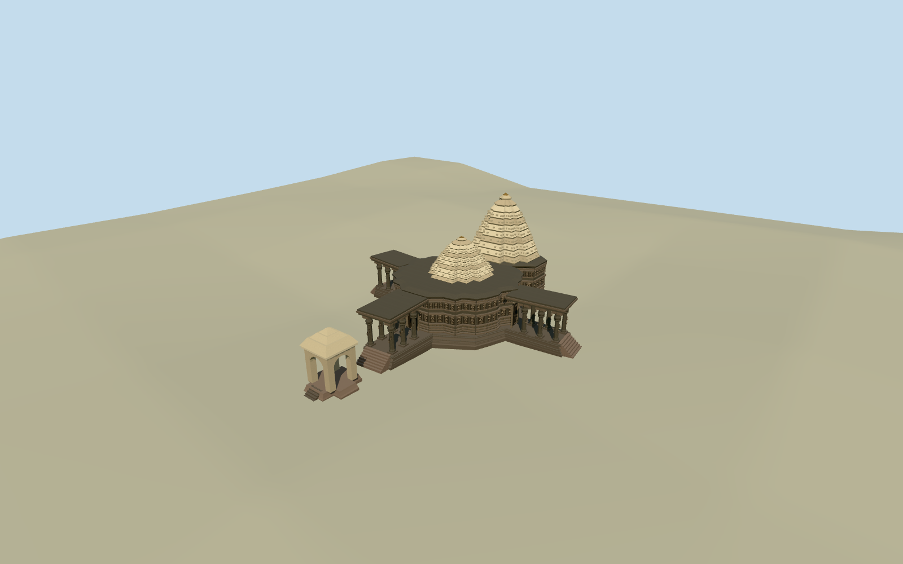

# Aundha Nagnath Temple

Aundha Nagnath Temple’s incised dark basalt plinth, three pillared porches, two pale stepped shikharas and detached west pavilion.

Authoring state: **review-in-qa.json**. Current completion evidence is in [qa.json](qa.json) and the [completion ledger](../../../../qualla-structures/batches/qualla-004.PROGRESS.md).

- [Aundha Nagnath Temple](https://qualla.com/aundha-nagnath-temple/)

Draft exterior: approximate photographic proportions and simplified ornament. It is not a survey, photogrammetric reconstruction or approved current geographic replacement.

The exact 1918 photographs define the dark stone courses, entry piers and white shikhara. The current district survey records the later tower at about sixty feet.

Terrain sampling/contact, geographic alignment and site activation remain pending. Runtime LODs are produced by the registered after-import pipeline and require visual review.

Reference photos remain in the local Qualla corpus; only provenance, paths and hashes are retained here.

Build: `node content/worldgen/source/places/te/teq/aundha_nagnath_temple/models/generate-aundha-nagnath-temple.mjs`. Add `--check` to verify exact regeneration. 28193 triangles; 6 materials; no embedded photographs.
