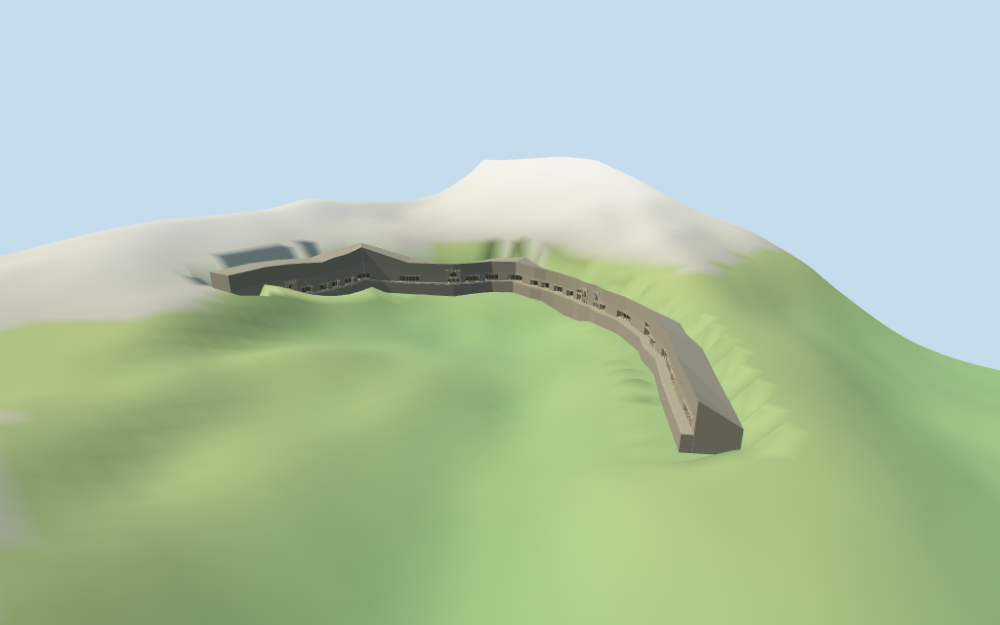

# Ajanta Caves

Ajanta Caves main horseshoe-cliff exterior,with28 numbered frontage reconstructions:23 current map-controlled entrances,three interpolated gaps and two estimated endpoints. Includes open recessed porticos,selected double-height galleries,picture-guided chaitya facades9/10/19/26 with large arched windows and door groups,a connecting ledge and layered basalt rock shell. The archaeological boundary is retained only as evidence. Upper excavations29/30,fine sculpture,paintings,deep/navigable interiors,trees,river,bridges,modern visitor buildings and engineering are excluded.

## Evidence and reconstruction

Published dimensions and reconstructed details are separated in spec.json. Primary references:

- [Reference](https://commons.wikimedia.org/wiki/File:Panoramic_view_of_Ajanta.jpg)
- [Reference](https://commons.wikimedia.org/wiki/File:Facade,_Cave_19,_Ajanta.jpg)
- [Reference](https://commons.wikimedia.org/wiki/File:079_Cave_26,_Exterior_of_Chaitya_Hall_(33535465394).jpg)

Three existing shared256² basalt,concrete and painted-metal graphs across five roles. Metric UVs,linear tints,no embedded images or unique atlas. Original coarse arch,portico and frieze abstractions;no historic artwork or sculptures copied.

## Model and axes

12,826 triangles; 38,478 vertices; 4 material groups; 1,542,068 bytes. Native bounds: -212.393, 0.000, -140.235 to 167.500, 51.209, 108.388. Source hash: `sha256:7ebea24836d23e67be735b7d524ce67f8ed30a1a494136f7882edb2b56036480`.

{"x":"retained eastward long axis","y":"up","z":"approximately south/open valley"}

Standard Protomaps20261014/Mapzen-USGS viewer extractN0486;datum 439.8989605384872 m (original DEM datum 437.06629439875877 m;model origin rebased by 2.832666139728417 m so the lowest cliff base is Y=0). Source grid161²/6 m is retained. The source preview carves only the occupied cliff ribbon below its floor/bottom and uses a12 m fixture margin for its6 m height grid. The open valley and neighboring buildings remain independent. Finished grades,cliff stability,depth of real caves and host terrain accuracy are unverified.

## Reproduce

Run `node packages/worldgen/scripts/generate-additional-landmarks.mjs --ids=ajanta_caves` (or add `--check`). The generator preserves manually edited masters by checking their baseline hashes. Import through the standard authored-model workflow with optimization disabled; then capture all QA cameras, including shared-surface views.

## Pending work

- Retained Q184427 way/115567314 preserves its archaeological-site boundary,anchor,undirected axis,original tags and empty dimensions. That boundary is not extruded. Standard PMTiles supplies23 coherent numbered entrance points on the horseshoe cliff,plus two valley-displaced labels27/28 retained as rejected controls. Caves3/18/20 are interpolated gaps and27/28 are estimated endpoint continuations. The frontage is one connected rock-cut landform;not a collection of separate buildings or a surveyed cave plan.
- No architectural height facts or entrance elevations are supplied. Raw standard DEM heights at the23 mapped and five inferred frontage positions are retained. The review ledge uses their median plus15 percent of local deviation to avoid treating the coarse sloping DEM as surveyed cave thresholds. Cliff bottoms extend to sampled valley-side grade or10 m below the ledge;tops meet sampled rear grade or18 m above the ledge. Cave widths,depths,opening heights,chaitya proportions,upper galleries and rock strata are original picture-guided estimates. Unverified upper excavations29/30,exact sculptures,paintings and interiors are not reconstructed.
- Standard Protomaps20261014/Mapzen-USGS viewer extractN0486;datum 439.8989605384872 m (original DEM datum 437.06629439875877 m;model origin rebased by 2.832666139728417 m so the lowest cliff base is Y=0). Source grid161²/6 m is retained. The source preview carves only the occupied cliff ribbon below its floor/bottom and uses a12 m fixture margin for its6 m height grid. The open valley and neighboring buildings remain independent. Finished grades,cliff stability,depth of real caves and host terrain accuracy are unverified.
- The main connected horseshoe frontage is a medium-fi exterior reconstruction. Inferred gap/end positions,terrain grades,cave proportions,rock profiles and present condition remain approximate;upper excavations29/30 and deep/interior artwork are not reconstructed. Physical-device/full-city performance remains pending.

This bundle follows the medium-fi standard. Medium-fi appearance and geographic fit are reviewed separately. Hash-bound visual acceptance is recorded separately after capture inspection.

## Additional geographic data

©OpenStreetMap contributors;Protomaps;Mapzen/USGS terrain.
