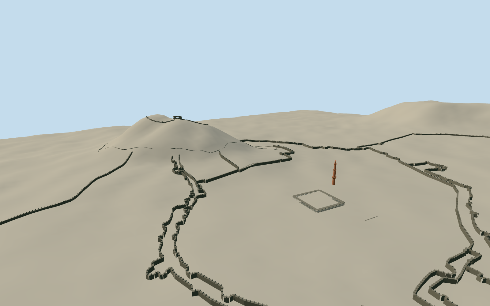

# Daulatabad Fort

Whole surviving Daulatabad architectural ensemble: all twelve selected native castle/city-defense wall traces and upper-citadel perimeter, their intrinsic bastions/crenellations and mapped gates; complete three-balcony red Chand Minar; summit Baradari white open gallery/dark flanking blocks; Chini Mahal palace-prison gateway; Bharat Mata/Jami Masjid courtyard colonnade and intrinsic Hathi Houz tank; artificial moat retaining/cut-rock edges and its own short crossing. Natural monolith is supplied by an independent frozen terrain field, not a generic cone or invented site slab. Exclude modern town buildings, unrelated temples, standalone cannons/exhibits, vegetation/paths/public landscape, signs/people/vehicles and reconstructed demolished historic wings. Retain full native wall courses/bastion protrusions instead of invented repeating round towers. Real openings at mapped gate points, pointed gate surrounds and dark basalt ramparts. Three balcony minaret with flared supports, serrated parapets and domed crown/finial. Real open pointed arches on projecting white Baradari gallery; ornate Chini gateway with true lower passage and surviving asymmetric crown towers. Open temple courtyard/colonnades and tank/moat voids. Freeze independent whole-site terrain first; natural hill comes from that raw field, never a generic cone. Concealed sections/census/provisional pavilion-palace positions bounded.

Authoring state: **review-in-qa.json**. Current completion evidence is in [qa.json](qa.json) and the [completion ledger](../../../../qualla-structures/batches/qualla-002.PROGRESS.md).

- [Daulatabad Fort](https://qualla.com/daulatabad-fort/)

Named native Daulatabad Fort way1246827867/Q88667786 identifies only the upper citadel. Full ensemble also retains twelve mapped historic defensive wall paths, named minaret node3306484871, original moat relation7842082 inner/outer lines, temple courtyard323874969 and Hathi Houz323874974, four exact gate points and short intrinsic crossing549229790. Original axes remain east/south at the named minaret. Baradari and Chini Mahal shapes/registrations are explicit bounded photo/native-path/enclosure inferences, not falsely named exact building polygons. Unrelated town/unnamed buildings and ambiguous Landsat wall670314738 are not adopted.

Ten exact published Qualla public-domain originals individually inspected and native-SHA1 matched. Two omitted PD categories recovered by exact existing primary-grant binding. No attribution photo pixels, engineering diagram, AI image or photographic texture used.

Full selected native defensive traces/upper citadel, named minaret, temple courtyard/tank and moat retained. Source plans do not measure vertical wall/census/corbel sections. Gate surrounds and bastion drums, crenellation/column counts, hidden rooms, roofs/ruin edges and current cosmetic changes are bounded photo reconstructions.

Chini Mahal facade is a small estimated registration on actual palace enclosure wall1028089778; unnamed building670314739 is not misidentified as the palace. Baradari footprint is an explicit estimated registration beside native summit path within upper citadel, not a falsely exact building polygon.

Minaret64m is a chosen approximate interpretation from native/current official63/64m statements; other tourism text gives30m or30ft. Shape and three flared balcony/dome proportions follow the cleared full-height photograph; no surveyed engineering height claim. Natural hill shape/height comes only from the independent raw field, never a generic cone fitted to the200m tourism statement.

Source/runtime GLBs contain architecture and intrinsic moat/tank/crossing only. Natural hill is supplied by the independent terrain review descriptor, not embedded landscape. No modern town/standalone cannon/vegetation/people/signs or interiors. Source portable terrain does not apply Earth-owned openings; shared/context terrain cutout views must establish visible intrinsic moat/tank voids.

Independent2800m129x129 field/16641samples/12rawTerrariumtiles unchanged. Output pixels4.49m and21.875m grid do not imply native survey resolution; urban/vegetation returns and deep cut-rock/moat depth are approximate. Preview replaceFootprint=false; actual compatible live host terrain and threshold contact unverified.

Build: `node packages/worldgen/scripts/generate-authored-places.mjs --ids=daulatabad_fort`. Add `--check` to verify exact regeneration. 62416 triangles; 5 materials; no embedded photographs.
