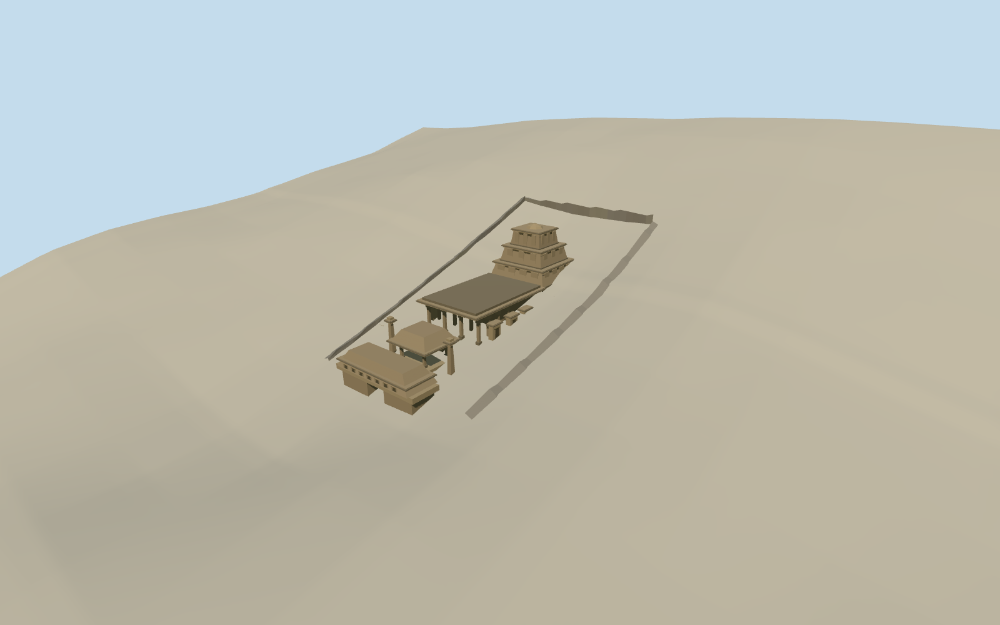

# Kailasa Temple, Ellora

Kailasa Temple carved from the cliff at Ellora, with the main Dravidian tower, rock court, low western gate, Nandi pavilion and the elephant plinth.

Authoring state: **review-in-qa.json**. Current completion evidence is in [qa.json](qa.json) and the [completion ledger](../../../../qualla-structures/batches/qualla-003.PROGRESS.md).

- [Kailasa Temple, Ellora](https://qualla.com/kailasa-temple-ellora/)

Positions of individual reliefs, vestibules, minor shrines and worn carving require interpretation. The measured court and overall vertical forms control the silhouette.

Original elevations over the known court are too coarse and slope through the structure. The model will supply the surveyed excavation as a bounded placement opening and include its floor and matching basalt rim. The original elevation samples and separate original-field preview are preserved.

Outside the Cave 16 court, neighboring caves, extensive interiors and fine inscriptions are outside scope. Individual carved figures are conveyed by general stone relief geometry.

Build: `node content/worldgen/source/places/te/tet/kailasa_temple_ellora/models/generate-kailasa-temple-ellora.mjs`. Add `--check` to verify exact regeneration. 17184 triangles; 4 materials; no embedded photographs.
