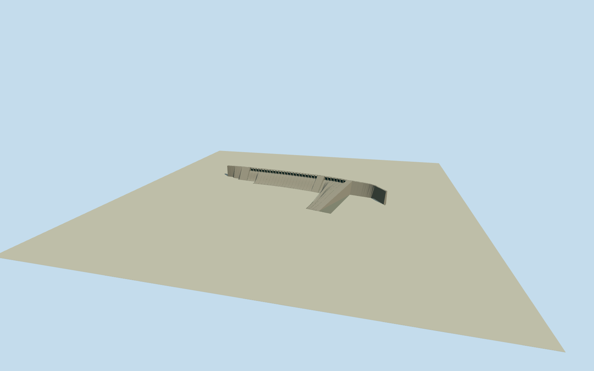

# Sardar Sarovar Dam

Whole main Sardar Sarovar concrete gravity dam: actual34-control native physical perimeter and curved upstreamedge,23service plus7auxiliary radialgates, real openings between tallpiers, continuous9.14m nominalcrestbridge, slopingogee/chutes and intrinsicapron/dividers/abutments. Currentprimary121.92spillway/146.50top elevations; exactpublished2006ownPD concreteprofile photo first, currentinstalledgate/bridge profiles and bankchainages are bounded originalengineering estimates. Separateproject/powerhouses/reservoir/dykes/tempworks excluded.

Authoring state: **review-in-qa.json**. Current completion evidence is in [qa.json](qa.json) and the [completion ledger](../../../../qualla-structures/batches/qualla-002.PROGRESS.md).

- [Sardar Sarovar Dam](https://qualla.com/sardar-sarovar-dam/)

Actual current closed34-control named main-dam waterway envelope, fixednativebboxanchor/heading0 before independentfield/floor/sections/geometry. Upstreamboundary controls4through17 retained as structural plan; nativecartographic edge length1230.2938m differs from operator nominal1210m, not rescaled. Nativeheight138.68 is preserved unchanged; owner engineering elevations distinguish waterlevel from structuralheight.

All34 actual physical main-dam perimeter controls retained in intrinsic lowapron/foundation. Actualcurvedupstreamedge4..17 supplies mainbody/crestplan without rescaling1230.2938m to operatornominal1210m. Crosssection downstreamextent ray-intersects same physicalpolygon. Original bounded bankchainages310..471(aux7) and520..1044.3(service23) use primary nominal161m/524.3m banklengths, not surveyed baychainages. No extrusion of entireproject/reservoir or tall extrusion of whole irregular apron.

Original independent2048m129field16641samples/9rawTerrariumtiles/nativefixedanchor/heading0 frozen before once-only downstream floor-80.2243m (provider absolute65.28549039110847m). Primary structural elevations RL146.50top/121.92spillwaycrest/138.68servicegate/140.22auxgate are converted directly to modelY by subtracting original145.5098m datum; never added above floor. 163m is deepestfoundation height, buried foundation not invented. Gate/piers/bridge/ogee/rail profiles, bankchainages, finish and exact provider-to-IndianRL vertical tie are bounded original estimates. Coarse source field contains deep negative reservoir artifacts; retain them unchanged and contact unverified. No later field/floor/section tuning.

Only exact published AceFighter19 PD-self2006original used: concreteprofile evidence predates completed2017gates/bridge; no temporarycranes/cables/rebar or protectedmodernphoto pixels copied. Currentgateprofile/finish, bankchainages and finehidden details are original bounded engineering estimates, not survey or photogrammetry. All30closedgates retained at allfourLODs; fine ribs/rails simplified withdistance.

163m is greatestheight above deepestfoundation, not exposedheight aboveground. No fictitious underground chambers/powerplant or water surface. Intrinsic footprint is physicalmain dam, not entireprojectrelation.

Original independentfield contains severe negative reservoir artifacts, retainedunchanged; source has no surveyedprovider-to-localRL tie. Contactunverified/previewonly/replacementfalse. Flatground and syntheticneighbors in captures are reviewfixtures.

Build: `node content/worldgen/source/places/te/teu/sardar_sarovar_dam/models/generate-sardar-sarovar-dam.mjs`. Add `--check` to verify exact regeneration. 40678 triangles; 5 materials; no embedded photographs.
