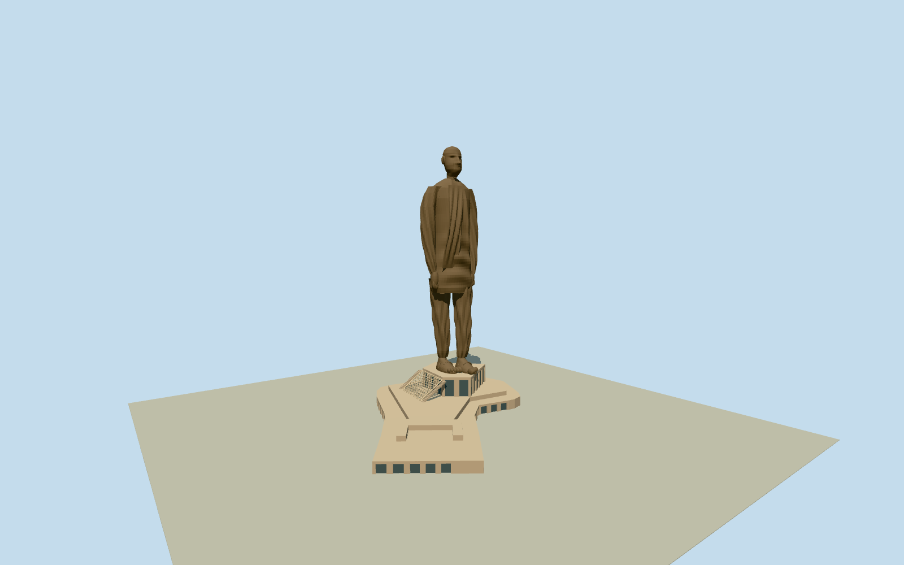

# Statue of Unity

Build the recognizable full sculpted human form, not a generic human mannequin, capsule or extruded photographic silhouette. Match Patel bald head, broad ears/nose/chin, heavy asymmetric draped jacket/scarf, long dhoti folds, lowered hands and narrow walking-leg gap, broad sandaled toes and intrinsic stepped pedestal/real entrance/geometric perforated panel. Use original closed shaped cross sections and sculpted surfaces with canonical bronze metal and stone; all hidden fine wrinkles, exact back pose and fold census remain estimates. Primary 182 m controls statue height; podium vertical section is a separate bounded estimate, and promotional 240/58 m statements are not adopted as a measured local above-entry section. Preserve intrinsic original native outlines. Exclude terrain/island/long bridges/independent buildings. Freeze independent terrain before geometry.

Authoring state: **review-in-qa.json**. Current completion evidence is in [qa.json](qa.json) and the [completion ledger](../../../../qualla-structures/batches/qualla-002.PROGRESS.md).

- [Statue of Unity](https://qualla.com/statue-of-unity/)

Native named Statue of Unity way614681966/Q7604504 establishes identity and anchor. Original pedestal/basement and entry shell ways651184068/842382859/979667347/980067315 retained separately. Native sculpture outline is a projected envelope, not a slab to extrude. Heading135degrees places local +Z toward northeast, consistent with the facing-dam identity; photographic walking/body pose must remain distinct from podium plan. Whole native footprint retained without replacing it with a generic star or rectangular block. Source map contains no surveyed sculptural surface or reliable completed vertical section.

Exact five published CC0 originals individually inspected and native SHA1 matched, no external imagery or photographic/AI bitmap textures. Redscale/monochrome images govern shape; bronze palette is a bounded material interpretation.

Original sculpted cross sections and facial displacements establish bald head/nose/brow/cheeks/ears/chin, draped coat and dhoti, lowered hands, real separated walking legs, sandals/toes. Fine facial likeness/wrinkles, back and exact fold/casting-panel census are simplified medium-fi estimates; no scan or engineering replica claim.

Primary182m controls toe-to-crown sculpture height. Intrinsic podium vertical section26.5m is an explicit above-local-entry estimate; old promotional240m/58m figures are not adopted as a surveyed completed local section. Inner partitions, slab depths, portal census, canopy/ramp/lattice geometry and concealed supports estimated.

Native mapped statue outline is a footprint proxy around the feet, not the full upper-body projected silhouette. Shoulder overhang is original photo-based reconstruction. Four intrinsic native podium/entry outlines retained. Separate long river bridges/mainland buildings, island/river/landscape/people/signs/interiors omitted.

Independent520mfield/4225samples/4rawTerrariumtiles frozen before geometry, unchanged. Urban/vegetation/water returns do not establish surveyed thresholds. Preview replaceFootprint=false and compatible actual host ground contact unverified.

Build: `node packages/worldgen/scripts/generate-authored-places.mjs --ids=statue_of_unity`. Add `--check` to verify exact regeneration. 39752 triangles; 4 materials; no embedded photographs.
