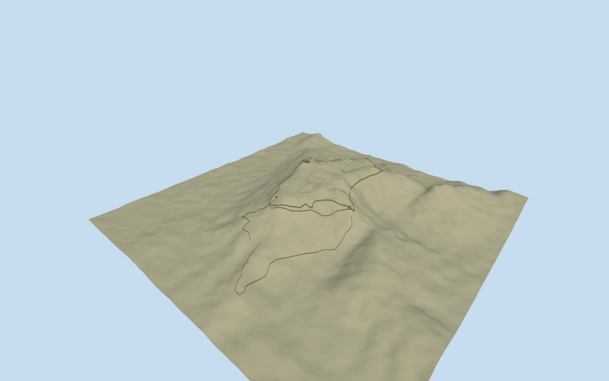

# Asirgarh Fort

Asirgarh Fort on its original Satpura ridge, with the stony upper walls, lower ruined approaches, reservoirs and the twin-minaret Jami Masjid.

Authoring state: **review-in-qa.json**. Current completion evidence is in [qa.json](qa.json) and the [completion ledger](../../../../qualla-structures/batches/qualla-003.PROGRESS.md).

- [Asirgarh Fort](https://qualla.com/asirgarh-fort/)

Current survey geometry anchors the upper line and three reservoirs. Lower west sections, tower sizes and any wall fragments away from the native footprint are approximate reconciliations of the 1880 plan with open elevation data.

The original open elevation cannot resolve the abrupt basalt lip at every point. The model fits foundations to the source surface. Wall losses and unmeasured heights are interpreted.

The summit ensemble includes the mosque exterior as a bounded reconstruction. Religious interiors, the rock-cut temple rooms, unidentified roofless structures, lost barracks and water depths are outside its scope.

Build: `node content/worldgen/source/places/te/tey/asirgarh_fort/models/generate-asirgarh-fort.mjs`. Add `--check` to verify exact regeneration. 11554 triangles; 5 materials; no embedded photographs.
