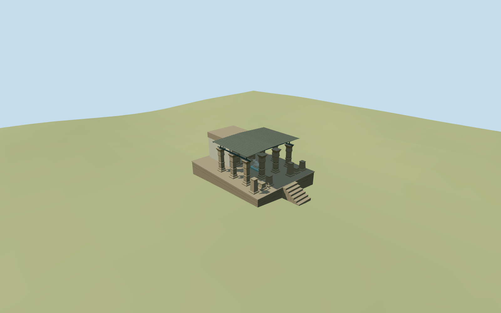

# Ancient Shiva Temple Bhainsdehi

Ancient Shiva Temple Bhainsdehi, pictured2013 standing state: raised coursed stone platform/central approach, open carved square-pier hall with modern shallow sheet shelter, broken front carved stumps, low rear sanctuary with real doorway and receding corbel ceiling. Small original simplified Nandi/lingam silhouettes; no copied religious sculpture, inscriptions or photographic atlas. No invented complete shikhara.

## Evidence and reconstruction

Published dimensions and reconstructed details are separated in spec.json. Primary references:

- [Reference](https://commons.wikimedia.org/wiki/File:15_Century_Shiv_Temple,_Bainsdehi_MP.JPG)
- [Reference](https://commons.wikimedia.org/wiki/File:15_Century_Shiv_Temple_,_Bainsdehi_MP.jpg)
- [Reference](https://commons.wikimedia.org/wiki/File:15_Century_Shiv_Temple,_Bainsdehi_MP-Damaged_Pillars.JPG)
- [Reference](https://commons.wikimedia.org/wiki/File:15th_Century_Bhainsdehi_Shiva_temple_Roof.jpg)

Ancient Shiva Temple Bhainsdehi, pictured2013 standing state: raised coursed stone platform/central approach, open carved square-pier hall with modern shallow sheet shelter, broken front carved stumps, low rear sanctuary with real doorway and receding corbel ceiling. Small original simplified Nandi/lingam silhouettes; no copied religious sculpture, inscriptions or photographic atlas. No invented complete shikhara.

## Model and axes

3,528 triangles; 10,584 vertices; 5 material groups; 426,780 bytes. Native bounds: -3.275, -1.018, -6.175 to 16.275, 7.729, 6.175. Source hash: `sha256:eb7093d445c5a03da93b783c10877980a6b6effc3d497d17f9d252b3353e14db`.

{"x":"east","y":"up","z":"south"}

The geographic proposal uses exact-QID OpenStreetMap evidence. Map-derived orientation and estimated architectural details require real-site visual review; preview eligibility is distinct from geographic/fidelity approval. Map attribution: © OpenStreetMap contributors, ODbL-1.0.

## Reproduce

Run `node packages/worldgen/scripts/generate-additional-landmarks.mjs --ids=N0552` (or add `--check`). The generator preserves manually edited masters by checking their baseline hashes. Import through the standard authored-model workflow with optimization disabled; then capture all QA cameras, including shared-surface views.

## Pending work

- Ancient Shiva Temple Bhainsdehi, pictured2013 standing state: raised coursed stone platform/central approach, open carved square-pier hall with modern shallow sheet shelter, broken front carved stumps, low rear sanctuary with real doorway and receding corbel ceiling. Small original simplified Nandi/lingam silhouettes; no copied religious sculpture, inscriptions or photographic atlas. No invented complete shikhara.
- RosterN0552 originally used townQ759139 at77.63,21.65. Its retained picture/Commons category identifies Ancient Shiva Temple S-MP-4; the same front picture is attached to specific templeQ97100854. That item gives21deg38min58secN,77deg38min7secE: anchor77.6352777778,21.6494444444. Correct the modeled identity toQ97100854 while retaining the original town record here. Standard PMTiles contains town/major roads but no temple POI or building outlines. The12.2x16.4m pictured envelope is an estimate, not mapped geometry. East-facing placement is explicitly approximate with180degree facing uncertainty and roughly40m location uncertainty; no exact-QID footprint or surveyed bearing claim. Local model center is shifted5m east from the coarse reference point to clear native roadMD3515; native road geometry is retained.
- Picture estimates:12.2m wide/16.4m long platform, about1.25m above nearby grade; hall piers3.8m and shelter5m above floor, rear sanctuary5m wide/5.8m deep, low roof4.5m. Main stair2.65m wide/six rises, broken front stumps0.8–2.1m, approximate ten standing piers and six front stumps. Original abstract leaf/band relief and Nandi silhouette only; detailed column inventory, outer sanctuary roof and unseen sides are approximations.
- Original pinned standard6m Mapzen grid and all native roads/ground/water remain unchanged. Level occupied platform just above its sampled ground envelope; narrow buried stone footing and six-step approach to sampled front grade. No broad surrounding slab, terrain flattening, building/ground/water cutout. Coarse DEM cannot resolve archaeological paving or actual threshold heights.
- Four2013 ordinary photographs establish the pictured standing temple and small sanctuary ceiling. Later changes, unseen exterior roof and detailed inventory are approximate. No tall intact shikhara, copied text/sculpture or photo atlas. Specific templeQ97100854 corrects original townQ759139; no mapped footprint or verified bearing exists in the standard extract.

This bundle follows the medium-fi standard. Medium-fi appearance and geographic fit are reviewed separately. Hash-bound visual acceptance is recorded separately after capture inspection.

## Additional geographic data

©OpenStreetMap contributors; Protomaps; Mapzen/USGS terrain.
