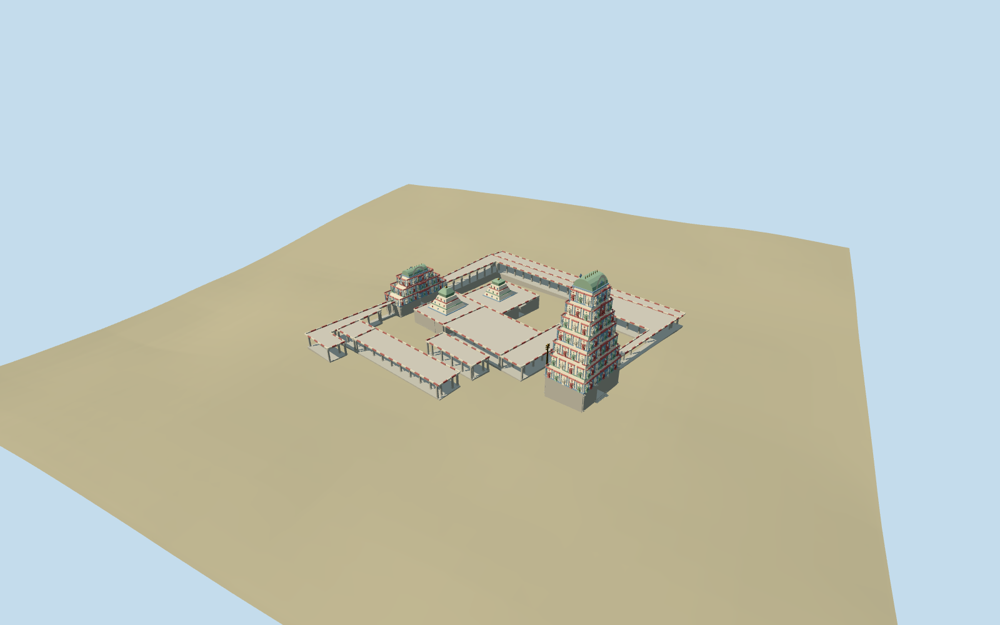

# kapaleeshwarar_temple — Kapaleeshwarar Temple

Reviewed2026-10-19 in one continuous author/build/inspect/fix round.

## Appearance

Inspected52 final current source/shared/medium-fi/native/fallback views in one continuous brief/build/inspect/fix round. Twelve mapped roof/gateway envelopes, tall seven-tier eastern and smaller three-tier western gopurams with granite bases and real east/west through-passages, receding painted bands/niche surrounds, curved barrel crests and arched crest trim/finials. Two inner shrine roof masses, open stone mandapas/perimeter colonnades, striped parapets and brass flagstaff. Figures, miniature shrine frames and crest motifs are original simplified geometry, not copied deity/narrative inventories. Same-round source views prompted larger figures, side ornament, curved crest trim replacing an overly angular motif and an eye-level passage camera. Flagstaff sits in the open approach, outside the covered hall.

## Shared materials and browser levels

Five existing shared256-square graphs: stone_granite for bases/piers/plinths, plaster_lime for muted cream/blue/rose/green painted trim/figures, concrete_plain for flat roofs, metal_bronze_cast for finials/flagstaff and wood_plain for recessed closed shrine leaves. Eight authored roles consolidate to at most five runtime draws, each graph read once. Metric UVs/linear tints, zero embedded images or unique atlas, separate GPU streams and matching CPU/GPU accounting. Four levels990/3960/15836/52892triangles; initial geometry490,112bytes. Unload releases all model geometry.

| Level | Triangles | Bytes | Draws |
| --- | ---: | ---: | ---: |
| skyline | 990 | 104684 | 1 |
| district | 3960 | 385428 | 5 |
| street | 15836 | 1527420 | 5 |
| closeup | 52892 | 5427856 | 5 |

Inspected noon/late, economy/high, whole silhouette, seven-tier tower, true gateway openings, open mandapas/shrine caps, flagstaff, all four levels and transitions. Skyline retains all mapped roof masses, both gateway passages, tier rhythm and inner shrine silhouettes with sparse supports. District restores selected figures and trim; street increases column/sculpture/stripe detail, close adds framed figures on all four tower faces and column mouldings. Some shared detail crops emphasize a portion of the tower; source/native whole views carry full-crest judgment. Flat shared stages can expose terrain-relative footings. Green native fixture ground, procedural neighboring architecture and paths remain host context, not exact temple paving/vegetation.

## Approximate map fit

Named standard PMTiles temple-complex point35185920244763 correlates twelve specific central roof/gateway controls with ordinary pictures; no exact-QID building-footprint match is claimed. Anchor80.26972222,13.03388889; heading0, internal local+x angle+.245rad. East gateway local[62.503,23.940], west[-16.444,18.227], both passages approximately east/west. Replace only the twelve controls with2cm numeric tolerance. All882 independent in-tile building inputs, including the separate southeastern building35184580656517, remain byte-equivalent; original6m urban terrain and77,866.194square meters of native fixture water remain unchanged. Local level ranges have grade-buried plinths/short approaches, open native-ground courts and no broad slab, flattening or ground/water cutout. Four loaded levels retain882 native records; failed load894 originals; eviction releases geometry.

## Limits

Accepted medium-fi standing core from inspected ordinary full color tower2025, monochrome tier detail2013 and courtyard/mandapa2019 pictures, with a historical-looking scan as supplementary colonnade reference only, plus standard PMTiles/Mapzen. The current palette comes from the2025 color view. Tower heights about37m/16m, interior shrine cap forms, sanctum splits, concealed facades/roofs, column grid, sculptural/niche inventory and parapet rhythm remain explicit picture/map-led approximations. Actual deity identities/poses are not claimed by the original simplified figures. No copied narrative/text atlas, roof survey, complete ritual interior or bespoke archive/survey research. Coarse urban DEM does not resolve paved thresholds, temple plinth levels or tank embankments. Independent buildings, tank water, streets, broad paving and vegetation stay host context. Physical-device/dense-city timings remain pending.

## Selected checks

Six Khronos files: zero errors/warnings.234 actual mesh/map-envelope probes; 52 current inspected views. Scene validation/sim30 and strict selected medium-fi audit pass. Source and runtime hashes/material bindings/LOD caps verified.

Rebuild: node packages/worldgen/scripts/generate-additional-landmarks.mjs --ids=kapaleeshwarar_temple; node packages/worldgen/scripts/import-structure-models.mjs --ids=kapaleeshwarar_temple; node packages/tooling/scripts/generate-landmark-lods.mjs --ids=kapaleeshwarar_temple --force.

Source: sha256:ec992d6e8496846f5279e79c435811b4dc5ad1f3013e3f02c8afd58ac298dd3c

Runtime: sha256:b2cfa26e3cb6a3e5efaa5224e76d6a31a96e689e314ea53db2abef864c0a9534

Input: sha256:3b8e1be7a5698424c8672d2e7bfbe057d2f1f4dab880b634b9315faf9612ecfa

## Viewed ordinary pictures

https://commons.wikimedia.org/wiki/File:Main_tower_at_Kapaleeshwarar_Temple.jpg — KurinchiRays; CC BY4.0. Viewed only; no pixels copied.

https://commons.wikimedia.org/wiki/File:Kapaleeshwarar_Temple,_East_Gopuram.jpg — Roehan Rengadurai; CC BY-SA3.0. Viewed only; no pixels copied.

https://commons.wikimedia.org/wiki/File:Chennai,_Arulmigu_Kapaleeswarar,_tempio_di_shiva_01.jpg — Sailko; CC BY3.0. Viewed only; no pixels copied.

https://commons.wikimedia.org/wiki/File:Gopurams_of_Kapaleeshwarar_Temple,_Mylapore,_Chennai,_Tamil_Nadu,_India_(2012).jpg — H. Grobe; CC BY3.0. Viewed only; no pixels copied.
