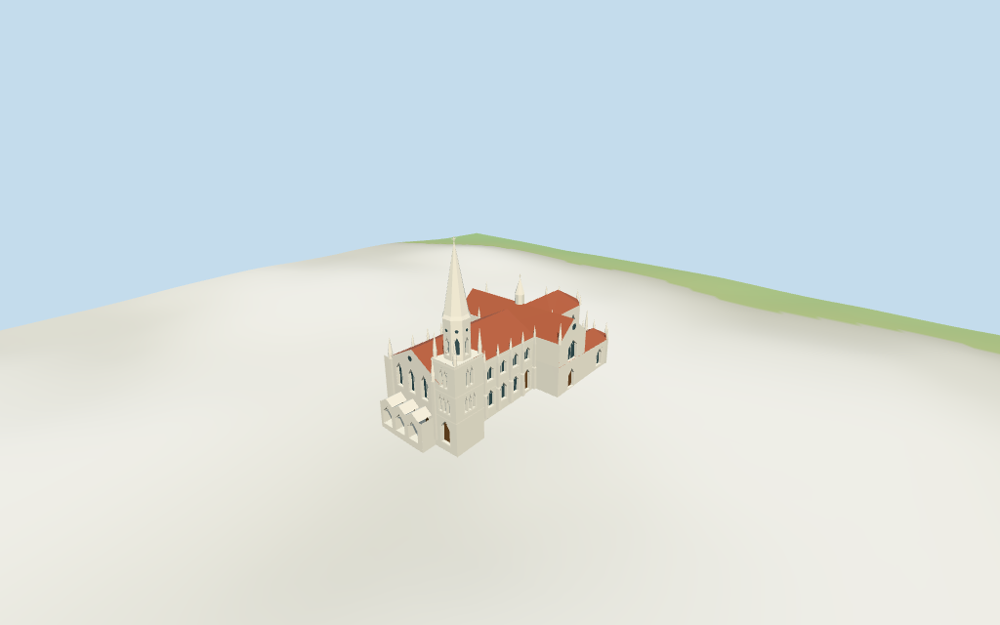

# N0369 — San Thome Basilica review

Reviewed 2026-10-15 against current source/runtime bytes. Accepted for the medium-fi exterior and approximate geographic/terrain scope.

## Built result

Inspected all11 current portable/source-terrain frames. San Thome Basilica has an offset west-south stepped square tower, octagonal upper stage with pointed dark fields/circular oculi, long faceted white needle and cross. The small crossing spire, triple pointed western facade, three small porch gables with real through arches, two tiers of side lancets, stepped buttresses/pinnacles, red roofs, tall transept and three eastern choir/chapel fingers retain the individual exterior. Changed the first common porch roof into three small gables, seated side doors at the estimated entry floor and removed chapel fields hidden beneath the taller transept. Carved statues/parapet tracery and the surrounding town excluded.

Medium-fi exterior from inspected2009 front/reverse-side pictures and one undated elevated south/front picture, plus standard viewer PMTiles/DEM only. The elevated picture crops the main needle tip; complete silhouette follows the first picture. Raw multilingual map metadata is retained exactly. Internal subdivisions, hidden roof joins, north fenestration and every height remain picture/map approximations. Oculi use shallow framed disks, upper tower lancets use closed dark backing, and window tracery uses simple geometric bars. Exact sculpture/reliefs/inscriptions, tiny carved/parapet details, stained-glass artwork, liturgical column, full interior/crypt, flags/fences/palms/parking/adjacent town, surveyed paving/steps/thresholds and certified walking excluded. Physical laptop/phone timing pending.

## Shared materials and placement

Inspected all11 current shared/geographic frames. Four existing cached256-square lime plaster, limestone, flat tile and plain wood graphs serve five merged material groups, with off-white/red linear tints, metric UVs and flat architectural normals. Glazing/oculi/louvre backing are geometric flat PBR colors; no embedded images, bespoke facade textures or baked shadows. Each graph reads once. Unload disposes geometry, leaves zero live model geometries and restores ground. Signed geographic top view follows the current footprint, including the western porch/offset south tower and three eastern fingers. Flat diagnostic ground can mask below-datum footings; source terrain views show approximate contact. Detail views intentionally crop, while whole-model views include the needle tip.

Exact-QID way1115403900/Q733577 matches current PMTiles main35185487492732. Its30-vertex raw plan/tags retain height8m and absent min_height. That whole-building8m tag is clearly incomplete for the pictured high nave/spires and is retained as map metadata, not imposed as an overall roof/height limit. No separately mapped parts or surveyed dimensions are retained. Anchor[80.277782363,13.033613683], heading-0.2536740015731081rad follows the northern long nave edge, signed by western entrance/south offset tower and eastern choir/chapel fingers. Raw plan rotates rigidly without rescale. Quantized0.1mm Boolean inputs subdivide main/porch and joined high walls; all partitions reproduce. All heights are picture estimates: nave/choir/transept eave14.5m, nave/transept ridges19.5m and choir18.5m, low chapels8m/roofs10.5m, main square20m/octagon29m/needle44.4m/cross45.5m, crossing body22m/needle26.4m/cross27.4m. Thirty actual viewer footprint checks cover the main while preserving three neighbors and a west-front patch across six outputs. Standard DEM datum12.720526m, floor offset0.4m, perimeter-1.42..1.24m. Side footings follow terrain and doors use floor+0.2m estimates. Exact courtyard paving, absolute altitude, entry steps/thresholds, cut/fill and walking remain unverified. No road replacement or global flattening.

Inspected all27 current Earth-lighting frames: Economy/High, noon/late, three distances, silhouette, six detail crops, four matched whole-model LODs and four transitions. Skyline retains the offset tall needle, smaller crossing spire, west/tower pinnacles, red roof/chapel form and open porch. District adds shared surfaces, flat pointed fields and coarser buttress/pinnacle rhythm. Street opens door/window recesses and adds large mullions; closeup/master refine arch surrounds/tracery and pinnacle facets. All four matched whole-model views include the entire basilica/cross. Synthetic cottage context and terrain bands are diagnostic fixtures. Fine tracery/carvings, exact stained glass and the hidden north/roof details remain simplified.

## Browser budgets

| Level | Triangles | Bytes | Draws |
| --- | ---: | ---: | ---: |
| skyline | 523 | 53460 | 1 |
| district | 3703 | 340640 | 5 |
| street | 7859 | 694284 | 5 |
| closeup | 8447 | 752248 | 5 |

Initial skyline plus district: **394100 bytes** of geometry. Master: **1016912 bytes / 8447 triangles**. Four cached shared 256² graphs, zero embedded images. Geometry bytes exclude graph definitions/texture generation. Split POSITION/NORMAL streams with equal CPU/GPU totals. Physical device timing pending.

## Verification

- Targeted byte reproduction, source/import/LOD/input/review hashes, recipe index and source inventory/schema match.
- Six Khronos validations: zero errors/warnings/images; four browser budgets pass.
- One raw main with retained8m height/absent min_height, signed frame, Boolean partitions, estimated subplans and standard DEM match.
- **1114 geometry probes** and **30 actual viewer footprint checks** pass.
- Shared graph read-once/unload and hash-bound placement/medium-fi reviews pass.
- Scene validation and 30-tick simulation pass: sha256:9e5f5fa3e3b9bcd344d80ac1ebada9f12bee3bb73ae03cbdcaf62d25f9447e63.
- Inspected **49 current frames**: 11 portable, 11 shared/placement, 27 medium-fi. Cameras/paths/hashes retained; bulk images ignored.

Source hash:sha256:5480b8db6dc807180c25f06f88e56cf9dbcf86cc927f71919b303e72b85e1159. Runtime hash:sha256:4f9147a614c61621101c7ae4698b77a3fac2e2aade47e5b06d3e08ca70f9a570. Input hash:sha256:56f7a3988d999d5d345c1057cc03105656eb673a131aa7acd3d1c8e39f11eccc.

Commands: targeted generate/import/LOD/register-landmark-previews --ids=N0369; generate-additional-landmarks.mjs --ids=N0369 --check; capture-next-1000-models.mjs --ids=N0369 --reflections --antialias --fit-shadows; capture-landmark-library.mjs --ids=N0369 --reflections --adaptive-clipping --bounded-placement; capture-medium-fi.mjs --ids=n0369_san_thome_basilica --reflections; molen validate; molen sim run --ticks 30 --hash. Routine full source checkpoint covers N0360–N0379.

## Limits

- Exact-QID way1115403900/Q733577 matches current PMTiles main35185487492732. Its30-vertex raw outline/tags retain height8m and absent min_height. The8m whole-building tag is inconsistent with the pictured spires and high nave; it is retained as coarse map metadata, not used as an overall roof or spire limit. No surveyed dimensions are retained. All heights are picture estimates: nave/choir/transept eave14.5m, nave ridge19.5m/transept19.5m/choir18.5m, lower chapel wall8m/roofs10.5m, west-south tower square20m/octagon29m/needle44.4m/cross45.5m, smaller crossing tower22m/needle26.4m/cross27.4m. Raw outline rotates rigidly; internal subplans and Boolean inputs quantized0.1mm subdivide/approximate it without rescale. Rear chapel/roof joins, north fenestration, carving and thresholds remain approximate.
- Standard viewer DEM datum 12.720526m; display offset 0.4m, raw mapped perimeter terrain -1.42..1.24m. Side-only foundations follow coarse terrain, doorway floor+0.2m is an estimate. Exact courtyard paving, entry steps/thresholds, absolute altitude and walking unverified. No global flattening or road replacement.
- Medium-fi exterior from three inspected front/reverse-side/elevated pictures and standard viewer PMTiles/DEM only. Heights, internal subplans/roof joins, north facade and thresholds are approximate. Exact statues/reliefs/text, tiny tracery/parapets, stained-glass art, liturgical column, full interiors/crypt, flags/fences/palms/parking/town and surveyed paving/steps/walking excluded. Oculi are framed flat geometric disks; upper tower fields use closed dark backing rather than verified bell-room interiors. Physical device timing pending.
- Skyline keeps the offset main tower/needle, smaller crossing spire, west pinnacles and roof/chapel form with open porch. District adds shared surfaces, flat pointed facade fields and coarser buttress/pinnacle rhythm. Street opens door/window/porch recesses and adds large mullions; closeup/master refine arch surrounds/tracery and pinnacle facets. Synthetic neighbors are review fixtures.

Readiness accepts this exterior scope. The 1,000-candidate goal remains incomplete.
