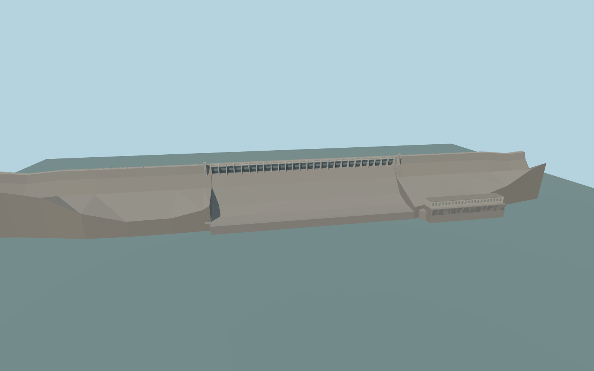

# Nagarjuna Sagar Dam

Nagarjuna Sagar’s mapped masonry dam, 26 radial crest gates, flanking stair towers, high abutments and north-bank generating hall.

Rebuild: `node packages/worldgen/scripts/generate-nagarjuna-sagar-dam.mjs`;append `--check` for exact source bytes. Select import/LOD/placement with `--ids=nagarjuna_sagar_dam`. Detailed source and four browser tiers are separate ignored GLB outputs.

The standard Terrarium upstream sample is 160.12 m and the downstream channel is 70.64 m. The production sampler estimates 159.88–160.65 m upstream and 70.38–72.09 m downstream in the retained windows.

The modeled 1,352 m concrete dam follows its retained exact mapped centerline. The remote embankments remain in native terrain.

Current dry photographs establish the radial gates, long chute, stair towers and cream powerhouse. Structural sections, equipment, apron and abutment dimensions are approximate.

The three crest bridge fragments are clipped only across the modeled deck. Both outer approaches and the separate NH565 bridge remain in native transportation.

Original geometry:repository license. Map:© OpenStreetMap contributors,ODbL-1.0;Protomaps. Standard terrain:terrain-grid.json. Ordinary pictures stay local and are not redistributed or used as textures. Current acceptance:qa.json.
