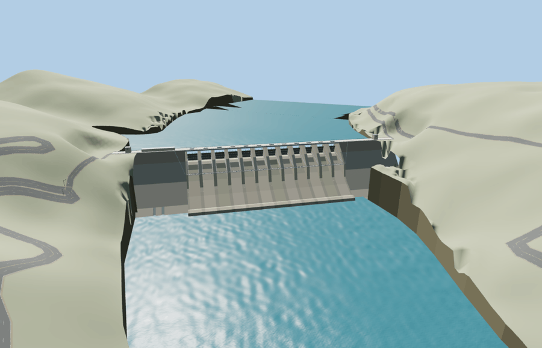

# Srisailam Dam

The 511 m crossing has twelve curved radial gate leaves, tapered piers, a continuous cross-braced maintenance walk, a separately framed deck, individual chutes and a common apron. Two lower recesses interrupt the solid right wing. The separate right-bank powerhouse follows its mapped plan.

The viewer renders the reservoir at the representative 269.75 m full-pool stage and the Krishna tailwater at 190 m. The twelve gate bays, chute, lip and the right-bank powerhouse remain visible. The authored crest deck replaces both mapped bridge fragments and joins the native approaches at 275.54 m.

The Earth fixture replaces two overlapping crest-road fragments and the mapped powerhouse footprint. It preserves nine independent road records and the other mapped building. Failed loading restores the mapped crest road and powerhouse. Eviction restores the ground and releases the model geometry.

| Detail level | Triangles | Download bytes | Draws |
| --- | ---: | ---: | ---: |
| skyline | 994 | 78,652 | 5 |
| district | 2,442 | 184,424 | 5 |
| street | 7,634 | 583,676 | 5 |
| closeup | 11,066 | 851,380 | 5 |

Skyline and district total 263,076 bytes. Six GLBs pass Khronos validation and contain zero embedded images. Five shared material graphs bind in the viewer. The review covers 80 renders and 455 geographic samples.

The tailwater, local bank grades and powerhouse platform are representative exterior estimates. Some outer shoreline edges remain sharp in the coarse terrain. The model depicts static gates and covers the right-bank plant exterior.

The host supplies the matching Protomaps feature IDs and terrain samples fine enough to resolve the graded shoulders.

[Mapped site frame](map-frame.json) · [Terrain and water fit](site-fit.json) · [QA evidence](qa.json)
