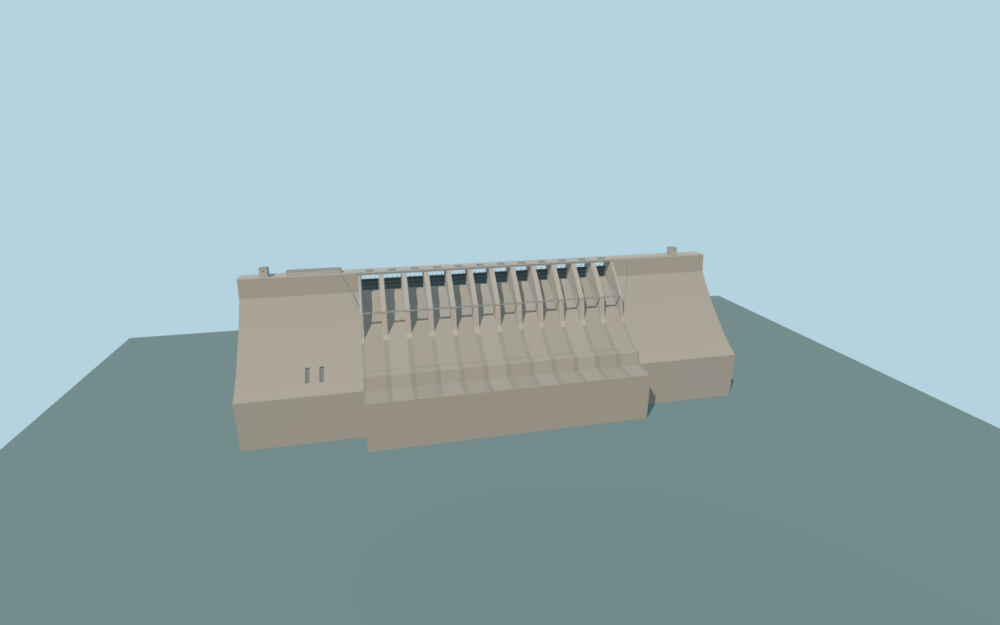

# Srisailam Dam

Srisailam Dam’s 511 m gravity crossing, twelve closed radial gate assemblies, tapered spillway piers, steel maintenance walk, stilling apron, solid wings and the right-bank powerhouse.

Rebuild: `node packages/worldgen/scripts/generate-srisailam-dam.mjs`;append `--check` for exact source bytes. Select import/LOD/placement with `--ids=srisailam_dam`. Detailed source and four browser tiers are separate ignored GLB outputs.

The signed vertical origin is 250.053237 m. The crest is fixed at 275.54 m, sill at 252.98 m and foundation at 132.28 m. The design fixture uses 269.75 m full pool and an illustrative 190 m tailwater.

The crest and powerhouse plan follow the retained PMTiles map. The apron section, wing outlets, gate machinery and powerhouse elevation are exterior approximations based on the reference photos and standard terrain.

Standard terrain contains spurious deep negative elevations near the crossing and provides stages of 252.82 m upstream and 179.68 m downstream. Native bank, base and water fit remain pending.

The model depicts the dry closed-gate configuration. Left-bank generating chambers and internal conduits are underground and outside the exterior model.

Original geometry:repository license. Map:© OpenStreetMap contributors,ODbL-1.0;Protomaps. Standard terrain:terrain-grid.json. Ordinary pictures stay local and are not redistributed or used as textures. Current acceptance:qa.json.
