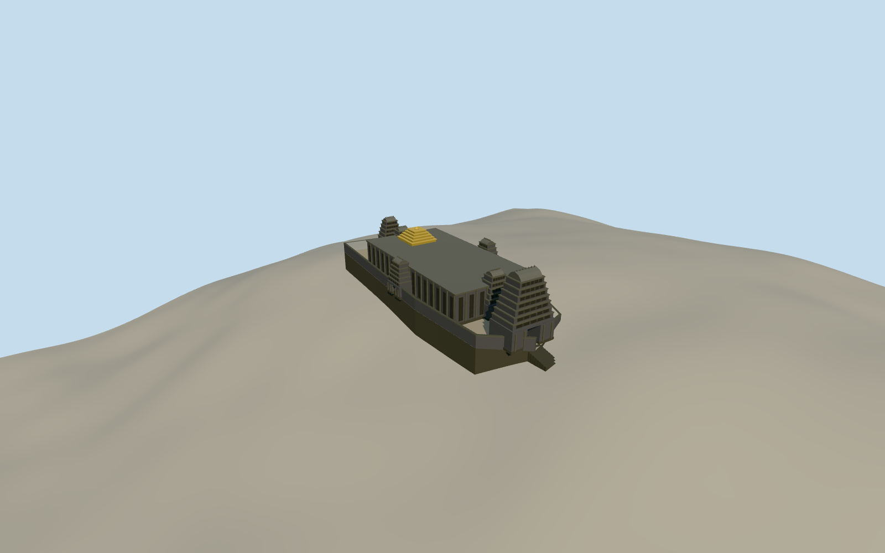

# Sri Lakshmi Narasimha Swamy Temple, Yadagirigutta

The rebuilt black-stone Lakshmi Narasimha Swamy Temple at Yadagirigutta, with a seven-tier eastern gate, broad stone hall, upper enclosure and the gilded vimana over the sacred cave.

Authoring state: **review-in-qa.json**. Current completion evidence is in [qa.json](qa.json) and the [completion ledger](../../../../qualla-structures/batches/qualla-003.PROGRESS.md).

- [Sri Lakshmi Narasimha Swamy Temple, Yadagirigutta](https://qualla.com/sri-lakshmi-narasimha-swamy-temple-yadagirigutta/)

The post-2022 core is registered to the named hilltop way. The existing Qualla location is about 450 m south and is retained in the story data.

The main gateway is 22 m above the temple deck and the mukha mandapam is 202 by 103 feet. Other tower sizes, precise door openings, deck heights, outer alignment and ornament are interpreted.

Dark dressed stone and the gilded upper shrine identify the standing silhouette. Original geometric relief stands in for detailed iconography. The cave interior and broader retaining-wall apron are outside the model scope.

The original elevation field contains the site slopes at provider resolution. It does not resolve the exact modern floor, terrace retaining work, or cave.

Build: `node content/worldgen/source/places/tg/tg0/sri_lakshmi_narasimha_swamy_temple_yadagirigutta/models/generate-sri-lakshmi-narasimha-swamy-temple-yadagirigutta.mjs`. Add `--check` to verify exact regeneration. 13269 triangles; 6 materials; no embedded photographs.
