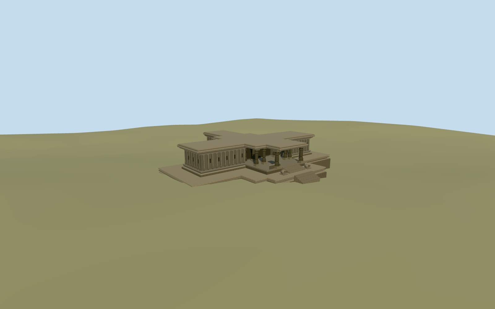

# Thousand Pillar Temple

Low Kakatiya granite triple shrine in Hanumakonda with a star-stepped podium, sculpted walls, and an open entrance porch supported by carved columns.

Authoring state: **review-in-qa.json**. Current completion evidence is in [qa.json](qa.json) and the [completion ledger](../../../../qualla-structures/batches/qualla-003.PROGRESS.md).

- [Thousand Pillar Temple](https://qualla.com/thousand-pillar-temple/)

The model covers the three linked shrines, southern porch and temple podium. The separately restored Kalyana Mandapa is outside this model.

Modern vector geometry supplies the plan and the 1910 survey records exterior dimensions. Heights, projections and positions of individual carving details are approximate.

The temple exterior simplifies pierced grilles, sculpted figures, lathe-turned pillars and the eroded edges of the original stonework.

Build: `node content/worldgen/source/places/tg/tg0/thousand_pillar_temple/models/generate-thousand-pillar-temple.mjs`. Add `--check` to verify exact regeneration. 9452 triangles; 5 materials; no embedded photographs.
