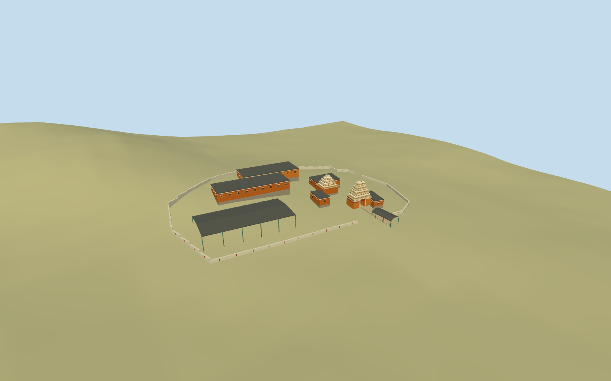

# Sita Ramachandraswamy Temple, Bhadrachalam

February 2024 exterior of Bhadrachalam’s hilltop Rama temple, with cream stepped towers, orange precinct walls and covered approach.

Authoring state: **review-in-qa.json**. Current completion evidence is in [qa.json](qa.json) and the [completion ledger](../../../../qualla-structures/batches/qualla-003.PROGRESS.md).

- [Sita Ramachandraswamy Temple, Bhadrachalam](https://qualla.com/sita-ramachandraswamy-temple-bhadrachalam/)

The visuals represent 20 February 2024, before the public redevelopment launched in 2026. The dated model is withheld from the default modern map.

The ground comes from unchanged Terrarium elevations. Steps and the upper terraces are modeled from the visible forms, with widths, placement and levels estimated.

Roof records are supporting geometry. Tower base positions, facade and carved motifs, material colors and roof sections are estimates. Later construction, separate major wedding hall and the temple interior are outside scope.

Build: `node content/worldgen/source/places/tg/tg1/sita_ramachandraswamy_temple_bhadrachalam/models/generate-sita-ramachandraswamy-temple-bhadrachalam.mjs`. Add `--check` to verify exact regeneration. 9274 triangles; 6 materials; no embedded photographs.
