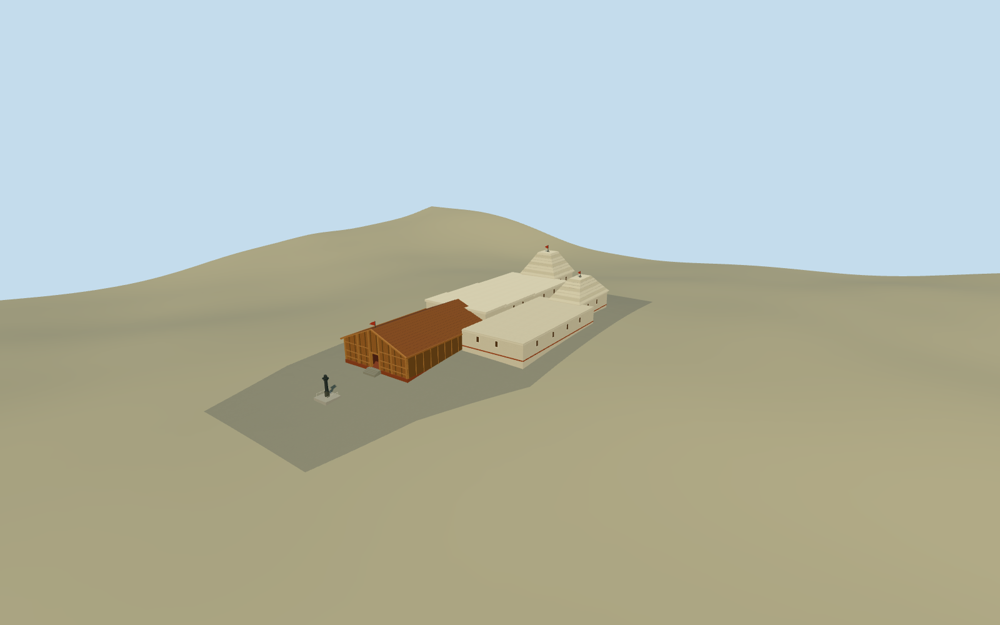

# Danteshwari Temple

East-facing historic Danteshwari Temple with terracotta timber hall, two white stepped shrine roofs and the Garuda pillar.

Authoring state: **review-in-qa.json**. Current completion evidence is in [qa.json](qa.json) and the [local 100 ledger](../../../../qualla-structures/batches/PROGRESS.md).

- [Danteshwari Temple](https://qualla.com/danteshwari-temple/)

The model represents the main historic temple and adjoining shrine. The distant three-arch road gateway and temporary visitor facilities are outside this footprint.

The named rings bind the walls. Metrical heights, inner bay divisions, plinth elevation and the height of the adjoining white shrine are estimated from the public-domain photographs and architectural survey.

The Garuda pillar top and historic ornament are simplified. Contemporary printed signs, ropes and movable objects are omitted.

Build: `node content/worldgen/source/places/tg/tg3/danteshwari_temple/models/generate-danteshwari-temple.mjs`. Add `--check` to verify exact regeneration. 3302 triangles; 6 materials; no embedded photographs.
