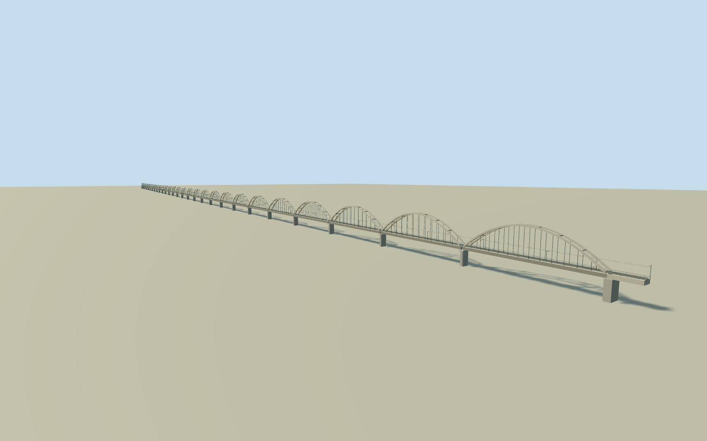

# Godavari Arch Bridge

Whole surviving Godavari Arch Bridge/Q2012032 exterior on exact nativeway56683928 east/west abutment alignment, complete approximately2.76km mapped endpoint extent with28 twin concrete parabolic bowstring spans, vertical hangers/lateral concrete Vierendeel struts, concrete tie-box railway deck/open underside/pale piers and end abutments, single broad-gauge track/simple intrinsic maintenance edges and sparse electrification. All28 structural spans retained; internal repeat positions and architectural sections estimated within native ends. Exclude separate parallel abandoned Havelock steel-truss/masonry-pier bridge97471765/Q15263787 visible in foreground of source, separate southern road/rail GodavariBridge/Q2736879, small detached approach bridge56683933 beyond endpoint, river/water/ground slab/city/people/boats/trees/private interiors. No one-span/facade-only reduction or transplanted neighbor geometry.

Authoring state: **review-in-qa.json**. Current completion evidence is in [qa.json](qa.json) and the [completion ledger](../../../../qualla-structures/batches/qualla-002.PROGRESS.md).

- [Godavari Arch Bridge](https://qualla.com/godavari-arch-bridge/)

Whole native2762.416m alignment/Q2012032/way56683928 and both original endpoints retained. Primary engineer28x97.552m pattern centered with15.48m original end allowances. All28 twin concrete parabolic spans, separate hangers/lateral Vierendeel struts/tie deck/open underside/piers/abutments/single1676mm gauge track/intrinsic maintenance edges and sparse catenary; no facade-only or single-span reduction.

One exact3872x2592 Hariya1234 2011-05-12 Own/PD-own Qualla original individually inspected/nativeSHA1matched. Separate oldHavelock steel-through-truss/masonry piers overlap foreground of photo and are excluded; separate road/approach bridges excluded. Other nominalPD image has creator/grant ambiguity and is unused. Primary BBR/KDM text only; no protected drawings/images/textures/borrowed meshes/copied people/artwork/license-policy-verifier changes.

Photo is sunset and hides much of new deck/piers behind old bridge. Daylight palette/arch-rise20m and rib sections/width/vertical deck level/pier supports/end offsets/rails/maintenance/catenary details are bounded original medium-fi estimates.12 hanger positions per rib modeled; dense sleepers/posts reduced intentionally byLOD. Skyline preserves28 paired arch silhouettes/native ends/deck/piers but omits fine hangers/track/struts; district retains partial hanger and lateral rhythm. No as-built survey or engineering structural analysis claimed.

Independent4000m/129x129/16641-value field/25raw source tiles/PNG frozen before deck/floor/arch/pier decisions unchanged. Original source includes river low/urban artifacts and is not bathymetry or current water/rail elevation. Source and host contact unresolved/replacementfalse; isolated/shared flat appearance separate. No terrain fitting/flattening/reacquisition or river/ground slab.

Build: `node packages/worldgen/scripts/generate-authored-places.mjs --ids=godavari_arch_bridge`. Add `--check` to verify exact regeneration. 62988 triangles; 3 materials; no embedded photographs.
