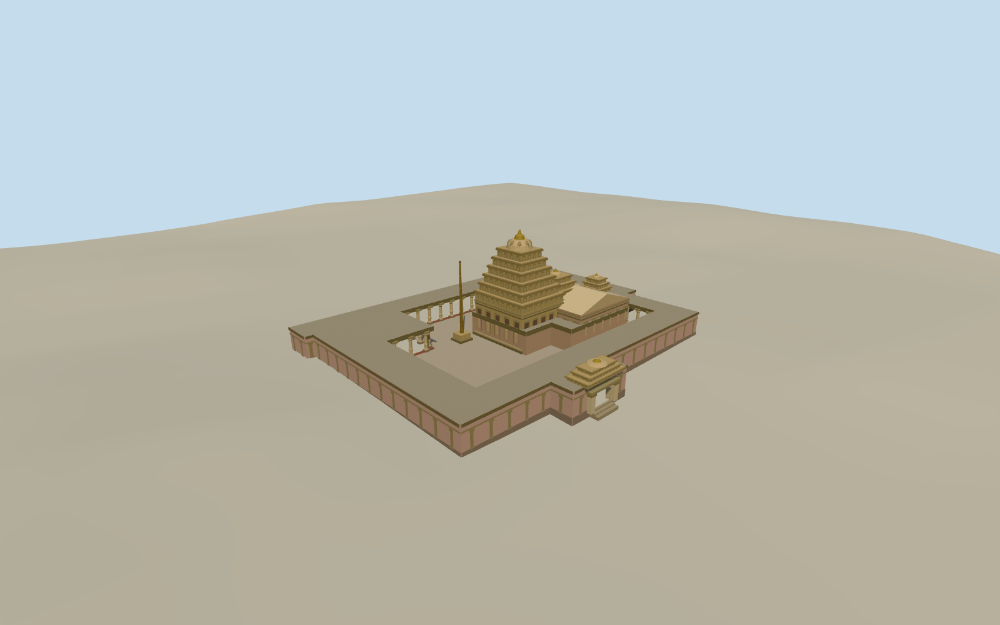

# Sri Kurmanathaswamy Temple, Srikurmam

The July 2021 Sri Kurmanathaswamy Temple in Srikurmam with a carved stone sanctum tower, brass flagstaff, connected halls and an open courtyard inside the roofed precinct.

Authoring state: **review-in-qa.json**. Current completion evidence is in [qa.json](qa.json) and the [completion ledger](../../../../qualla-structures/batches/qualla-003.PROGRESS.md).

- [Kurmanathaswamy Temple, Srikurmam](https://qualla.com/kurmanathaswamy-temple-srikurmam/)

The July 2021 model covers the mapped temple and courtyard ranges. Heights, roof subdivisions, column spacing and individual relief figures are interpreted from the cleared views. Ornament is simplified at medium fidelity. Detached structures, the tank pavilion, tortoise enclosure and interior shrine contents are excluded.

Original source elevation samples are preserved. The modeled court pavement and entry threshold are approximate. Ground contact varies slightly around the precinct perimeter.

Build: `node content/worldgen/source/places/tg/tg5/kurmanathaswamy_temple_srikurmam/models/generate-srikurmam-temple.mjs`. Add `--check` to verify exact regeneration. 16652 triangles; 5 materials; no embedded photographs.
