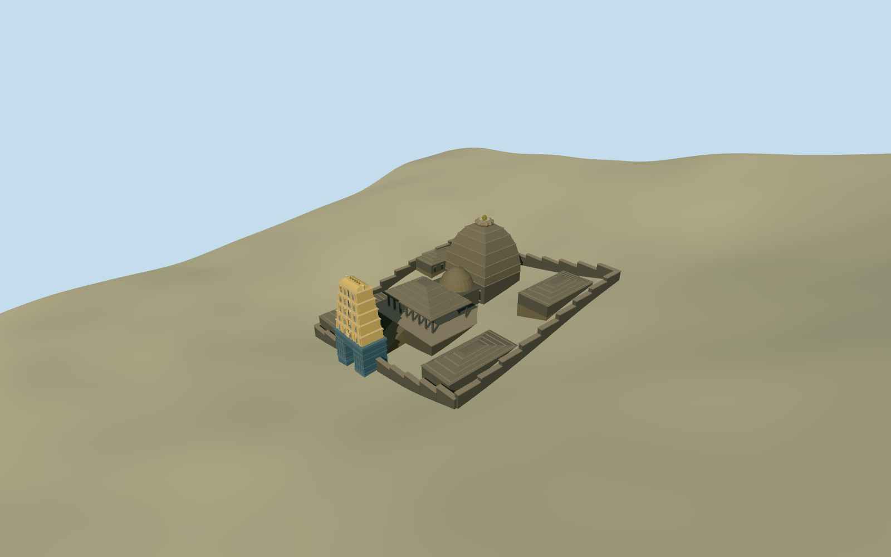

# Varaha Lakshmi Narasimha Temple, Simhachalam

The west-facing blue and cream Raja Gopuram, granite shrine and its curved tower, pillared halls and roofed court enclosure at Simhachalam.

Authoring state: **review-in-qa.json**. Current completion evidence is in [qa.json](qa.json) and the [local 100 ledger](../../../../qualla-structures/batches/PROGRESS.md).

- [Varaha Lakshmi Narasimha Temple, Simhachalam](https://qualla.com/varaha-lakshmi-narasimha-temple-simhachalam/)

The enclosure, central building footprint and four courtyard ranges are mapped. The tower, colonnade and entrance proportions are estimated from the two published photographs and architectural descriptions.

The west gopuram is centered on the temple axis. The photo GPS establishes the general approach and approximate viewing distance. Local survey dimensions are unavailable.

Individual stone carvings, religious figures and inscriptions are simplified. Interiors and detached approach facilities remain outside the model scope.

Build: `node content/worldgen/source/places/tg/tg5/varaha_lakshmi_narasimha_temple_simhachalam/models/generate-varaha-lakshmi-narasimha-temple-simhachalam.mjs`. Add `--check` to verify exact regeneration. 7365 triangles; 6 materials; no embedded photographs.
