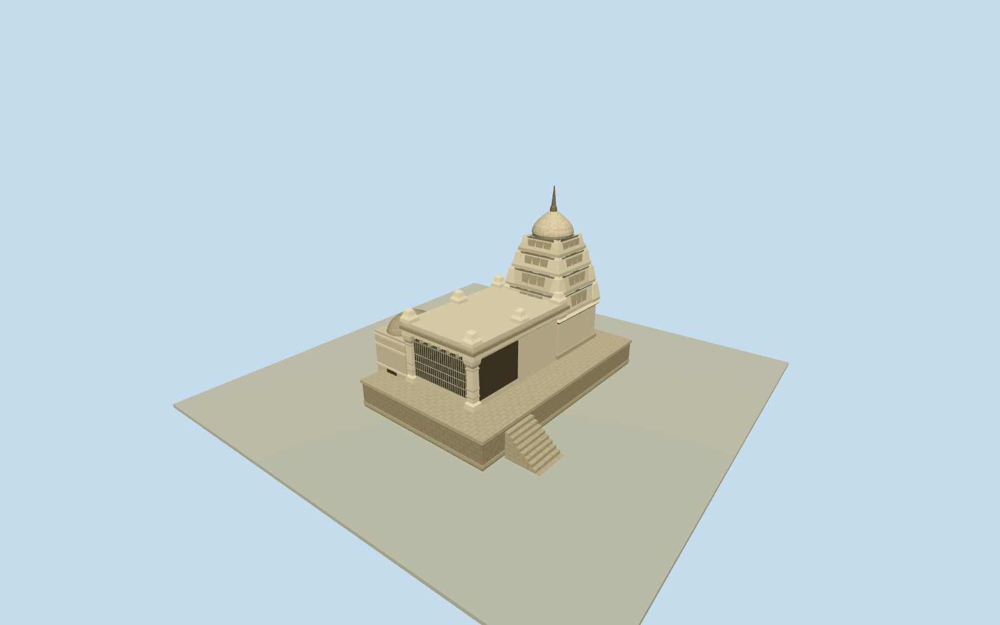

# Rajiv Lochan Temple

The pale Rajiv Lochan shrine, four-tiered tower and domed finial above a raised hall and paired side stairs.

Authoring state: **review-in-qa.json**. Current completion evidence is in [qa.json](qa.json) and the [completion ledger](../../../../qualla-structures/batches/qualla-003.PROGRESS.md).

- [Rajiv Lochan Temple](https://qualla.com/rajiv-lochan-temple/)

The model shows the main Rajiv Lochan temple in its documented 2005 condition. It includes the sanctuary, mandapa, raised platform, entry steps and immediately attached structure visible in the photograph.

The archaeological inventory provides the platform and sanctuary dimensions. The aerial map outline constrains the approximate position and axis. Height, individual reliefs, cement repairs and far-side details remain estimated.

The original source DEM provides the site relief. The stair thresholds and repaired plinth surfaces are below its effective resolution.

Build: `node content/worldgen/source/places/tg/tgd/rajiv_lochan_temple/models/generate-rajiv-lochan-temple.mjs`. Add `--check` to verify exact regeneration. 3208 triangles; 5 materials; no embedded photographs.
