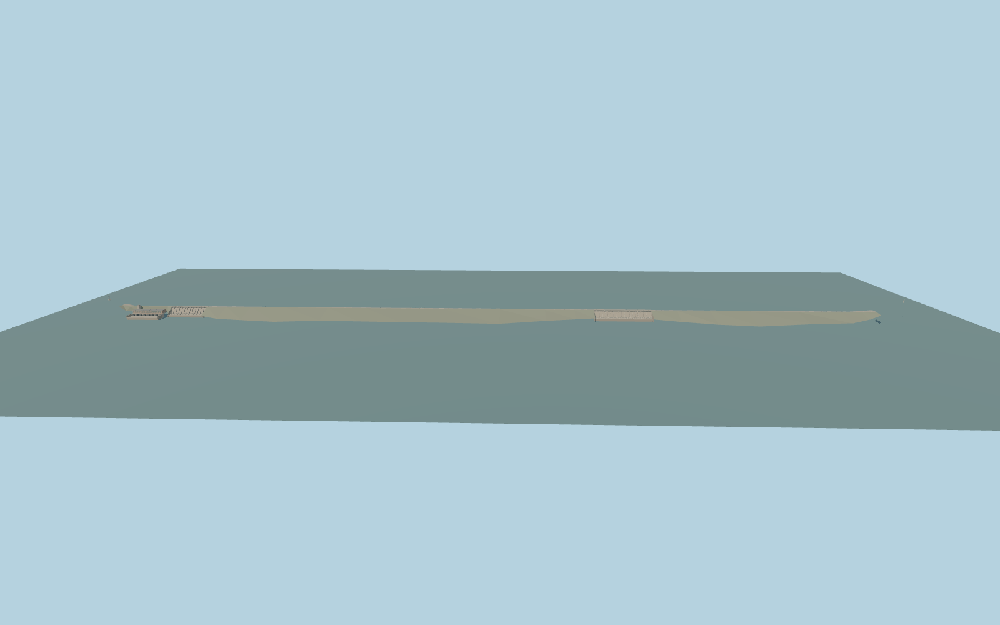

# Hirakud Dam

Hirakud’s roughly 4.8 km main crest, southwest and northeast gate banks, central embankment, Burla generating hall and the two terminal minars.

Rebuild: `node packages/worldgen/scripts/generate-hirakud-dam.mjs`;append `--check` for exact source bytes. Select import/LOD/placement with `--ids=hirakud_dam`. Detailed source and four browser tiers are separate ignored GLB outputs.

Standard Terrarium samples set the reservoir anchor at 188.00 m and the downstream model plane at 153.42 m. Production water samples returned 188.59–188.65 m upstream and 152.89–155.83 m downstream.

The exterior includes the approximately 4.8 km main crest, both gate banks, Burla generating hall and the two end viewpoints. Remote perimeter dikes remain in native terrain.

Gate pitch, lower port layout, terrace footprints and equipment dimensions are visually interpreted. Native PMTiles has no distinct water polygon for the small Burla outlet basin.

The fixture retains all standard height values, including isolated anomalous samples away from the occupied works. It uses the two mapped Mahanadi reaches. The model masks only the mapped Burla building and occupied ground.

Original geometry:repository license. Map:© OpenStreetMap contributors,ODbL-1.0;Protomaps. Standard terrain:terrain-grid.json. Ordinary pictures stay local and are not redistributed or used as textures. Current acceptance:qa.json.
