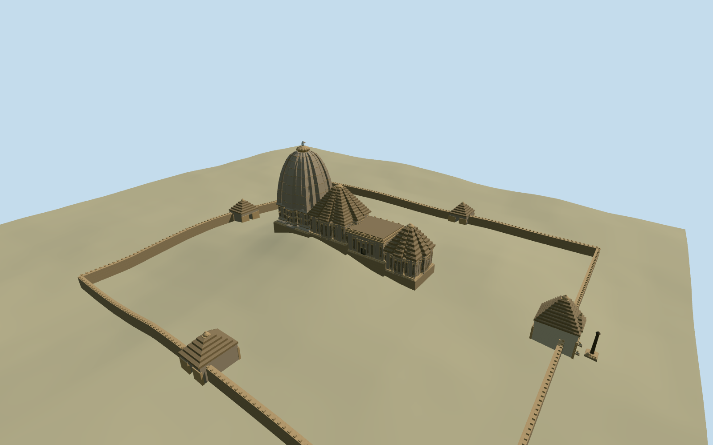

# Jagannath Temple, Puri

Standing Jagannath Temple, with a curving five-part stone spire, stepped halls and walled entries across the precinct in Puri.

Authoring state: **review-in-qa.json**. Current completion evidence is in [qa.json](qa.json) and the [completion ledger](../../../../qualla-structures/batches/qualla-003.PROGRESS.md).

- [Jagannath Temple, Puri](https://qualla.com/jagannath-temple-puri/)

Outer walls and gate centers follow mapped geometry. The main halls use an approximate registration of the 1872 survey across the east and west gates; hall corners, offsets and remodeling are not a current survey.

The approximately 65 m overall height follows the temple administration measurement above ground. Individual hall roof heights and decorative stonework, metal wheel, flag and stone gate sculpture are expressed at medium detail.

Terrain is an unchanged sampled Terrarium field. Architectural plinths and steps are modeled separately; precise threshold and terrace datums are estimated.

The four main halls and outer precinct are included. Interior rooms, minor shrines, the inner enclosure and newer amenities are outside this model scope.

Build: `node content/worldgen/source/places/tg/tgt/jagannath_temple_puri/models/generate-jagannath-temple-puri.mjs`. Add `--check` to verify exact regeneration. 35248 triangles; 5 materials; no embedded photographs.
