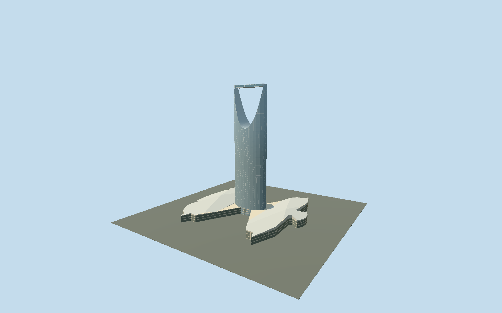

# Kingdom Centre

Complete elliptical blue-grey tower with open inverted arch, curved crossbridge and both sloping-roof podium wings.

## Evidence and reconstruction

Published dimensions and reconstructed details are separated in spec.json. Primary references:

- [Reference](https://www.arup.com/en-us/projects/kingdom-centre/)
- [Reference](https://omrania.com/project/kingdom-center/)
- [Reference](https://www.architectmagazine.com/project-gallery/kingdom-centre/)
- [Reference](https://www.openstreetmap.org/way/264745922)

No third-party geometry, photograph or bitmap texture is embedded. Shared surface graphs come from the central library; vertex tints carry model colors. Glazing uses PBR materials; transparent surfaces are declared per model.

## Model and axes

16,667 triangles; 49,823 vertices; 4 material groups; 1,996,456 bytes. Native bounds: -140.057, 0.000, -137.499 to 140.057, 302.301, 137.498. Source hash: `sha256:e941d6d0fa344a4f9631145ed04be03d814d45e05b065f2b971784b2f14b1e34`.

{"up":"+Y","longitudinal":"+X east-northeast","front":"+Z south-southeast; four doors not surveyed","origin":"Mapped ground-contact podium center"}

The geographic proposal uses exact-QID OpenStreetMap evidence. Map-derived orientation and estimated architectural details require real-site visual review; preview eligibility is distinct from geographic/fidelity approval. Map attribution: © OpenStreetMap contributors, ODbL-1.0.

## Reproduce

Run `node packages/worldgen/scripts/generate-signature-towers.mjs --ids=N0166` (or add `--check`). The generator preserves manually edited masters by checking their baseline hashes. Import through the standard authored-model workflow with optimization disabled; then capture all QA cameras, including shared-surface views.

## Pending work

- Preserved217710-triangle/21120500byte original master is reproducible from unchanged global recipe. Reviewed exterior retains exact mapped elliptical tower, independently curved skybridge/end piers and full spreading shopping/conference podium.302.3m top published byCVU,302m engineer and300m architect rounded; CVU41floors/290.4m observatory retained as published facts, not imposed on detailed facade grid. Catenary205m center/2.1shape parameter and skybridge296.5–302.3m floors are reconstructed; bridge200feet architect length describes observation walkway, not exact full map envelope. Tower glazing is drawn once with full-length strips, aggregate rows and opaque PBR. Added pale faceted sloping roofs on both separately clipped mapped podium wings, reconstructed27m apex and15.75m eaves follow architect aerial and street photographs; not surveyed roof dimensions. Podium levels remain three physical facade bands despite four-level map tag. Exact doors, branded lettering, interior trusses, basement, rooftop recreation equipment/pool and night lighting excluded. No copied photograph used as texture; canonical256px granite/paintedmetal graphs shared, zero embedded images. Original speculative roof planters removed rather than intersecting new roof. Terrain slope and physical device performance unmeasured.

This bundle follows the medium-fi standard. Medium-fi appearance and geographic fit are reviewed separately. Hash-bound visual acceptance is recorded separately after capture inspection.
