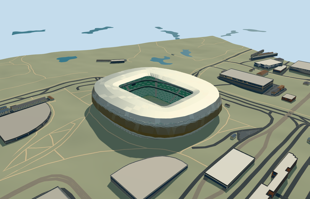

# education_city_stadium — Education City Stadium

Reviewed 2026-10-20 in one continuous author/build/inspect/fix round.

## Appearance

Inspected48 current portable/shared/medium-fi/native-Doha views in the same ordinary-picture/PMTiles/build/inspect/fix pass. Own rounded stadium body/open rounded rectangle, folded silver diamond shell/four recessed zigzag ventilation strips/scalloped lower hem, recessed concrete/glazed services/entries/individual supports/concourse decks, connected pale rolled roof/renderable underside/deep inner truss/radial lattice, three green-white seating bands/two closed dark box belts/open neutral football floor and supported displays/lights/goals are present. Corrected roof-frame contact offsets before captures. No missing facade or duplicate native stadium. Terrace patches simplify individual seats; no copied lettering/emblems/event art. Synthetic context is separate from native geographic fit. Metallic surfaces are reviewed with sky reflections; the initial unreflected medium-fi captures were replaced before acceptance.

## Shared materials and browser levels

Six existing256-square graphs: concrete_plain, metal_painted, metal_stainless_beadblasted, metal_expanded_diamond, window_grid and fabric_canvas. Concrete supports recessed services/decks/columns/floor; tinted paint supplies tiers/trim/frames/neutral marks/screens; beadblasted stainless supplies folded shell and roof, expanded-diamond shared mesh approximates recessed ventilation strips, window-grid closed lower glazing, canvas turf grain. Seven near draws because roof and wall slots share stainless; zero embedded images/unique atlas/copied photograph pixels. Each graph is read once nearby. Metric repeats/linear tints/separate POSITION and NORMAL uploads/equal reported CPU and GPU geometry bytes verified. Opaque glazing/mesh/metal panel material is a shared visual approximation, not exact optical/perforation/alloy certification.

| Level | Triangles | Bytes | Draws |
| --- | ---: | ---: | ---: |
| skyline | 776 | 74404 | 1 |
| district | 3634 | 339700 | 7 |
| street | 14618 | 1393448 | 7 |
| closeup | 54682 | 5165456 | 7 |

Inspected24 current sky-reflected noon/late Economy/High street/block/skyline/silhouette/matched-level/transition views. All four levels retain own rounded envelope/open field/internal field axis/pale roof/green-white three-band bowl. Near levels refine staggered diamond folds/four vent strips/actual terrace treads/aisles/closed belts/radial truss lattice/local supports/entries; far levels coarsen subpixel repetitions. Skyline plus district414104bytes, below3MB phone/6MB laptop initial targets. Synthetic procedural context is not geographic evidence. Physical ordinary-laptop/phone/tablet/dense-city timings remain pending. Levels776/3634/14618/54682 triangles; at most seven draws.

## Approximate map fit

Exact-QID OSMway684135642 identifies Education City Stadium; owned native52776567624776 supplies approximately247x214m rounded body and126.001943x85.520121m field-surround opening. Own anchor[51.42445653676987,25.310854323885607]/heading0/native east-south; internal X[.3558180684308382,.9345552429782561]/Z[-.9345552429782561,.3558180684308382] follows actual opening. A working10m rounded-corner aperture adapts the coarse native four-point opening from pictures; lower bowl uses93percent surround, distinct from neutral105x68m pitch. Owned parent completely removed/zero residual record or area. All67 independent resident inputs of68 originals/180 wider records, original6m samples/native roads/55517.7462682132m2 source water unchanged; all179 wider independent footprints including kiosk35185554946153 are outside mask.50mm vertex guards/adaptive overlapping decomposition seams stay within owned mask. Original datum20.038046261168848m/individual outer support contacts/occupied floor and bounded opening inside90percent body handle coarse terrain. Failure retains68 originals/original ground; every level unload restores ground/water/zero live geometry. No entire campus/golf/plaza platform or water/outside elevation edits.

## Limits

Four ordinary architect-gallery photographs actually viewed: interior panorama, silver folded/vented facade close view, overhead roof/opening and campus/golf oblique exterior. Primary page names Fenwick Iribarren Architects but no individual photographer/exposure date; undated photographs include site works and do not certify later/current condition. Viewed only; no pixels/logos/temporary pitch equipment/event artwork copied. No qualified architectural height in retained facts/native parent. Working field5m below anchor datum, shell hem5..7m/bulge18m/upper fold31m/outer roof42..43m/inner roof39m, field-relative galleries10/18/26m and tiers1.4..12/15..22/25..37m are picture-led estimates.10m aperture corners/staggered facet/vent/entrance/row/light inventory and20degree/2m fine facing remain approximate.0.32m roof skin/0.28m shell back/deep6.5m aperture truss provide connected visual geometry, not engineering detail. Original DEM/local support contacts/bounded opening are visual fit controls, not a terrain survey or excavation plan. Shared opaque steel/mesh/glazing/canvas do not reproduce exact alloys/perforation/transmission. No hidden furnished rooms/active cooling/access or engineering certification. Native independent campus/golf buildings/roads/water remain separate; physical ordinary-laptop/phone/tablet/dense-city timing remains pending.

## Selected checks

Six Khronos files: zero errors/warnings.27096 actual mesh/material/contact checks; 48 current inspected views. Scene validation/sim30 and strict selected medium-fi audit pass. Source/runtime/LOD hashes and material bindings verified.

Rebuild: node packages/worldgen/scripts/generate-additional-landmarks.mjs --ids=education_city_stadium; node packages/worldgen/scripts/import-structure-models.mjs --ids=education_city_stadium; node packages/tooling/scripts/generate-landmark-lods.mjs --ids=education_city_stadium --force.

Source: sha256:65c05bab20dea25ac89a9fc84f07d9f07bdc9b9d4e38e40c26ac59eeaf351707

Runtime: sha256:e544e00d50f607845ba847c1c69c9d1f1ac62129ca639bf119b40defc0e06dea

Input: sha256:fd7cc2d5f9899455122848c6b1d2cbbf4979299f393775acd6d50fe4009aaced

## Viewed ordinary pictures

https://www.fenwickiribarren.com/project/education-city-stadium/ — https://www.fenwickiribarren.com/wp-content/uploads/2024/03/fia_education_city_stadium_01-1920x799.jpg; Fenwick Iribarren Architects project gallery; individual photographer not named on inspected page; Copyright retained by rights holder; viewed only/no photograph pixels copied. Viewed only; no pixels copied.

https://www.fenwickiribarren.com/project/education-city-stadium/ — https://www.fenwickiribarren.com/wp-content/uploads/2024/03/fia_education_city_stadium_02-1920x1088.jpg; Fenwick Iribarren Architects project gallery; individual photographer not named on inspected page; Copyright retained by rights holder; viewed only/no photograph pixels copied. Viewed only; no pixels copied.

https://www.fenwickiribarren.com/project/education-city-stadium/ — https://www.fenwickiribarren.com/wp-content/uploads/2024/03/fia_education_city_stadium_03.jpg; Fenwick Iribarren Architects project gallery; individual photographer not named on inspected page; Copyright retained by rights holder; viewed only/no photograph pixels copied. Viewed only; no pixels copied.

https://www.fenwickiribarren.com/project/education-city-stadium/ — https://www.fenwickiribarren.com/wp-content/uploads/2024/03/fia_education_city_stadium_04.jpg; Fenwick Iribarren Architects project gallery; individual photographer not named on inspected page; Copyright retained by rights holder; viewed only/no photograph pixels copied. Viewed only; no pixels copied.
