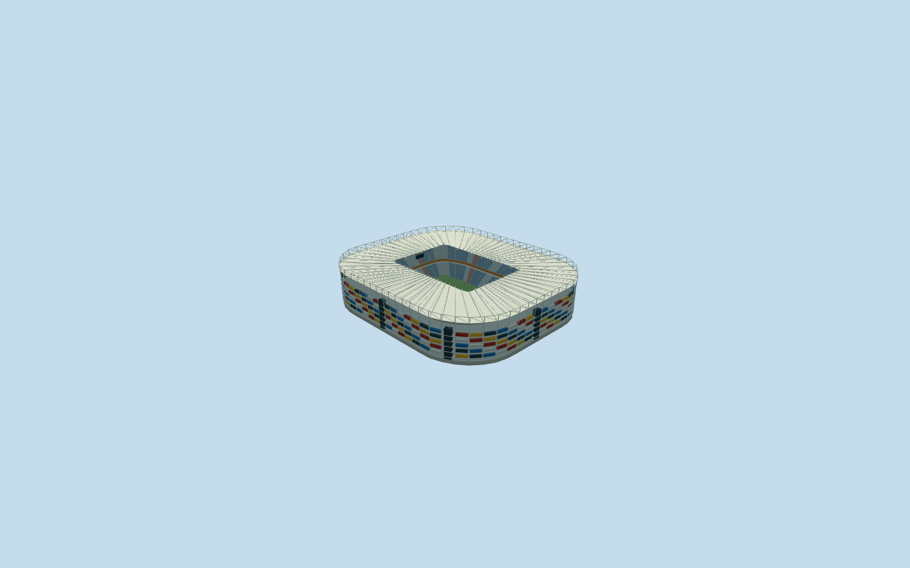
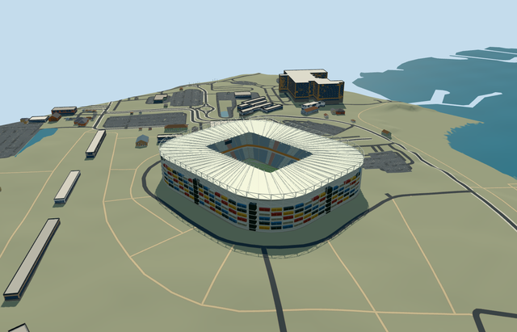

# N0714 — Stadium 974

Reviewed 2026-10-20 in one continuous author/build/inspect/fix round.

## Appearance

Inspected48 current portable/shared/medium-fi/native-map frames plus a full-sized context frame in the same ordinary-picture/map/build/inspect/fix pass. Specific rounded rectangular stadium/open central football field; complete pale roof ring with matching closed skins/renderable underside, exposed steel cantilever/rim frame; multicolor closed corrugated container stacks, open facade bays, dark circulation blades/flight approximations, five closed connected concourse decks and local-contact columns; blue/pale blue/red two-tier seating/aisles/orange central concourse belt; neutral football floor/markings/goals and roof-hung neutral displays/lights. Corrected deck/support continuity, each column contact and container-to-frame setback during this pass. Broad roof and rectangular opening follow native geometry; no generic oval replacement, missing side, field roof or harbor/plaza mesh.

## Shared materials and browser levels

Five existing256-square material graphs: concrete_plain, metal_painted, metal_corrugated, metal_standing_seam and fabric_canvas. Concrete supplies foundations/decks/tiers/circulation flights; tinted paint supplies steel/seat sectors/orange belt/markings/screens; shared corrugated metal supplies red/blue/yellow/white/dark closed containers; standing-seam approximates the pale roof; canvas grain approximates turf. Five near draws, no embedded images/unique atlas/copied photo pixels. Physical shared repeats/linear palette tints; each nearby graph read once. Separate POSITION/NORMAL uploads and equal reported CPU/GPU geometry bytes; eviction releases model geometry. Finishes and corrugation are reusable medium-fi approximations, not individually surveyed container markings or roof panels.

| Level | Triangles | Bytes | Draws |
| --- | ---: | ---: | ---: |
| skyline | 974 | 90620 | 1 |
| district | 3842 | 341428 | 5 |
| street | 14216 | 1299604 | 5 |
| closeup | 45542 | 4260144 | 5 |

Inspected24 current context/mode/silhouette/matched-level/transition frames, noon/late and Economy/High. Four levels retain mapped rounded rectangular outline, full roof ring/open field, colored facade rhythm and two-tier bowl. Near levels refine closed decks, frames/braces/rafters, door seams, rows and circulation-flight approximations. Levels974/3842/14216/45542triangles; initial skyline plus district432048bytes, at most five draws. Distant levels deliberately coarsen container/core inventory and rows, not a survey of all974containers. Synthetic neighbors are not map-fit evidence. Physical ordinary-laptop/phone/dense-city timing measurements remain pending. Levels974/3842/14216/45542 triangles; at most five draws.

## Approximate map fit

Exact-QID retained OSMway984031641/native parent52776571354982 identify the individual stadium. Own anchor[51.566408425569534,25.288804329163867], globalheading0/native east-south; internal X[0,1]/Z[-1,0] follows the north-south field axis and117.436007x82.340180m native roof opening. Approximately237.57x203.00m envelope is not pitch size. Picture-led container/entry allocation retains20degree/2m fine-facing uncertainty. Only the stadium parent replaced, zero remainder/visible duplicate shell. All65 independent resident building inputs of66 originals/85 wider records, original6m terrain/native roads and2504432.618920902m2 shoreline water retained unchanged. Each column crosses its own retained terrain contact. Bounded opening within90percent body/common supported floor handles coarse DEM intrusion; no original sample edit, outside flattening or water cutout. Failure keeps original ground/66 buildings, every level unloads with restored ground/water and zero live model geometry. No neighboring tower/harbor/plaza reconstruction.

## Limits

Three ordinary pictures actually inspected: QFA expanded container facade, IStructE2022 awards aerial and pitch/bowl interior. QFA currently lists the venue and2025 matches; standard20261014 PMTiles retains its mapped shell. These support placement but do not certify present condition or later changes. QFA photograph undated/IStructE2022 submission era. All photos viewed only, copyright retained/no pixels copied. No qualified heights: roof40..41.4m/upper frame46m, seating28m, blades31.5m and stacks3/8.5/14/19.5/25m are picture-led estimates. Container12m lengths/2.6m heights, colors/exact count/stack inventory, circulation steps and hidden room layouts/brace/light/seat/portal inventory are approximate. No claim to survey all974containers, demounting machinery, concealed service interiors, access slopes, structural capacities or as-built foundations. Anchor6.454082649728356m and per-column offsets are coarse standard-DEM visualization contacts, not a terrain survey; bounded ground opening is not an inferred excavation. Neutral105x68m football excludes crowd/event artwork/sponsors/live screens. Shared roof/paint/corrugation/canvas finishes are approximate. Physical phone/laptop/dense-city performance remains unmeasured.

## Selected checks

Six Khronos files: zero errors/warnings.3744 actual mesh/material/contact checks; 48 current inspected views. Scene validation/sim30 and strict selected medium-fi audit pass. Source/runtime/LOD hashes and material bindings verified.

Rebuild: node packages/worldgen/scripts/generate-additional-landmarks.mjs --ids=N0714; node packages/worldgen/scripts/import-next-1000-models.mjs --ids=N0714; node packages/tooling/scripts/generate-landmark-lods.mjs --ids=N0714 --force.

Source: sha256:f3e750a9097fb52afd6a28dc0219971b8c9d5f5803bbf7f109159b7fc71ef50d

Runtime: sha256:a0ac2699e280bfc37186fd8defeefdbe0b0bae797b7219c60d372abf5ff1d685

Input: sha256:4cf19d0e669ad536f9fa1cdf7e000ceacee4f2c83062b64884c0a73e097db1c5

## Viewed ordinary pictures

https://www.qfa.qa/en/stadium-venue/stadium-974 — Stadium Gallery: 6965058d6d35d_w3MncK_9740.png; Qatar Football Association; photographer not separately named; Copyright retained; viewed only, no pixels copied. Viewed only; no pixels copied.

https://www.istructe.org/structural-awards/projects/2022/stadium-974/ — Aerial view of Stadium 974; IStructE2022 project gallery; photographer not separately named; Copyright retained; viewed only, no pixels copied. Viewed only; no pixels copied.

https://www.istructe.org/structural-awards/projects/2022/stadium-974/ — View of the pitch at Stadium 974; IStructE2022 project gallery; photographer not separately named; Copyright retained; viewed only, no pixels copied. Viewed only; no pixels copied.
