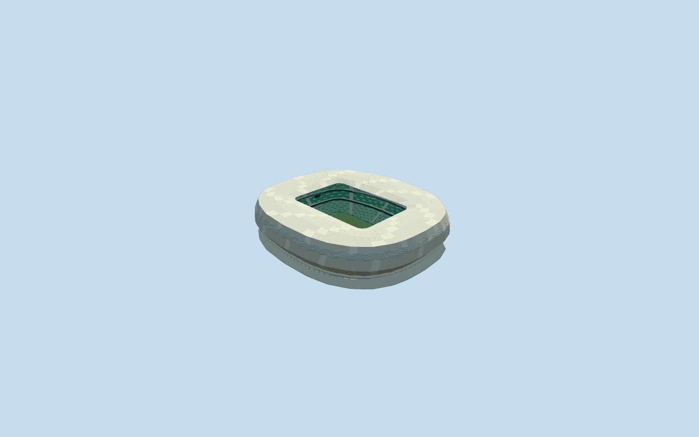

# Education City Stadium

Specific Education City Stadium: own rounded mapped body and rounded rectangular aperture, closed folded silver diamond shell with staggered facet rows/four recessed zigzag ventilation strips/lower scalloped hem and recessed glazed/service entries/individual supports and concourse decks, connected rolled pale metallic roof with large diamond tone approximations/renderable underside/deep inner aperture truss/radial lattice, three green/white seating bands/two closed dark inter-tier belts/open sunken neutral football floor and supported end displays/lights/marks/goals. Six existing shared concrete/paint/beadblasted-stainless/expanded-diamond/window-grid/canvas graphs. No unique texture atlas, copied seat logos/event art, whole campus/golf landscape slab, hidden furnished rooms or active cooling simulation.

## Evidence and reconstruction

Published dimensions and reconstructed details are separated in spec.json. Primary references:

- [Reference](https://www.fenwickiribarren.com/project/education-city-stadium/)

Specific Education City Stadium: own rounded mapped body and rounded rectangular aperture, closed folded silver diamond shell with staggered facet rows/four recessed zigzag ventilation strips/lower scalloped hem and recessed glazed/service entries/individual supports and concourse decks, connected rolled pale metallic roof with large diamond tone approximations/renderable underside/deep inner aperture truss/radial lattice, three green/white seating bands/two closed dark inter-tier belts/open sunken neutral football floor and supported end displays/lights/marks/goals. Six existing shared concrete/paint/beadblasted-stainless/expanded-diamond/window-grid/canvas graphs. No unique texture atlas, copied seat logos/event art, whole campus/golf landscape slab, hidden furnished rooms or active cooling simulation.

## Model and axes

54,682 triangles; 164,046 vertices; 7 material groups; 6,566,276 bytes. Native bounds: -114.927, -5.400, -124.764 to 113.014, 43.000, 129.536. Source hash: `sha256:65c05bab20dea25ac89a9fc84f07d9f07bdc9b9d4e38e40c26ac59eeaf351707`.

{"x":"east","y":"up","z":"south"}

The geographic proposal uses exact-QID OpenStreetMap evidence. Map-derived orientation and estimated architectural details require real-site visual review; preview eligibility is distinct from geographic/fidelity approval. Map attribution: © OpenStreetMap contributors, ODbL-1.0.

## Reproduce

Run `node packages/worldgen/scripts/generate-additional-landmarks.mjs --ids=N0719` (or add `--check`). The generator preserves manually edited masters by checking their baseline hashes. Import through the standard authored-model workflow with optimization disabled; then capture all QA cameras, including shared-surface views.

## Pending work

- Specific Education City Stadium: own rounded mapped body and rounded rectangular aperture, closed folded silver diamond shell with staggered facet rows/four recessed zigzag ventilation strips/lower scalloped hem and recessed glazed/service entries/individual supports and concourse decks, connected rolled pale metallic roof with large diamond tone approximations/renderable underside/deep inner aperture truss/radial lattice, three green/white seating bands/two closed dark inter-tier belts/open sunken neutral football floor and supported end displays/lights/marks/goals. Six existing shared concrete/paint/beadblasted-stainless/expanded-diamond/window-grid/canvas graphs. No unique texture atlas, copied seat logos/event art, whole campus/golf landscape slab, hidden furnished rooms or active cooling simulation.
- Exact-QID OSMway684135642 identifies stadium; native parent52776567624776 supplies own approximately247x214m rounded shell/126.001943x85.520121m rectangular aperture control. Own anchor[51.42445653676987,25.310854323885607]/heading0/native east-south; internal X[0.3558180684308382,0.9345552429782561]/Z[-0.9345552429782561,0.3558180684308382] follows own aperture, rather than reference point or neighboring buildings. Working10m aperture-corner radius rounds the coarse four-point map opening from ordinary photographs; lower bowl uses93percent aperture surround, separate from neutral105x68m pitch. Source native outer/opening coordinates remain retained. Facet/vent/entrance/portal inventory and fine20degree/2m facing remain approximate.
- No qualified architectural height in retained facts or native parent. Working anchor-ground-relative field-5m is an explicit visualization excavation estimate; shell hem5..7m, bulge18m/upper fold31m/roof42..43m, inner roof39m/deep aperture truss6.5m, gallery5/13/21m and three tiers field-relative1.4..12/15..22/25..37m are picture-led allocations, not a survey. Rounded aperture10m corners/four vent strips/staggered facet grid/support/row/portal and light diamond tone inventories are approximations. Shared opaque beadblasted stainless/expanded mesh/glazing/canvas do not certify exact panel alloys/perforation/reflectance/transmission. Architect photographs are undated and include site works; current condition/later changes are not inferred.
- Original standard6m Mapzen samples/native roads/water/independent campus and golf-course building inputs remain unchanged. Anchor datum defines modelY0; working field is5m below it, each outer support retains own original contact. Occupied retaining floor and bounded opening within90percent body/common supported floor handle coarse ground without original-sample/outside/water edits. This is a visual sunken-bowl allocation, not surveyed excavation. Only the stadium native parent is replaced; no entire campus/golf/plaza platform. Failure/unload retain or restore original ground/native context.

This bundle follows the medium-fi standard. Medium-fi appearance and geographic fit are reviewed separately. Hash-bound visual acceptance is recorded separately after capture inspection.
