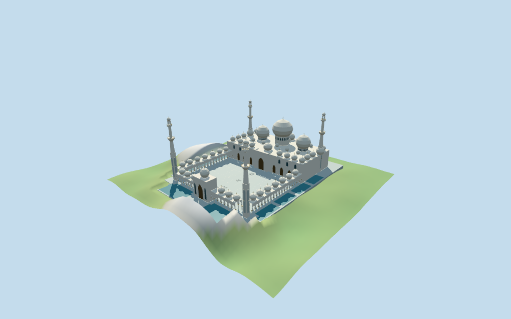

# Sheikh Zayed Mosque

Individual medium-fi Sheikh Zayed Mosque:white mapped main hall/three large onion domes/secondary mapped caps,four staged107m-working minarets/open lanterns,open mapped courtyard,keyhole colonnades/paired gold-capital columns,east framed gateway,pointed parapets,marble platform and12 separate mapped reflecting pools. Three shared256² marble/wood/bronze graphs,six merged groups,four browser levels. Raw dome tags retained alongside explicit picture-estimated gallery/small cap/tower partitions;fine decoration,current finish and exact site joins unverified.

## Evidence and reconstruction

Published dimensions and reconstructed details are separated in spec.json. Primary references:

- [Reference](https://en.wikipedia.org/wiki/File:Sheikh_Zayed_Mosque_view.jpg)
- [Reference](https://en.wikipedia.org/wiki/File:Water_mirror_and_columns_in_Sheikh_Zayed_Mosque.jpg)
- [Reference](https://en.wikipedia.org/wiki/File:Front_of_Sheikh_Zayed_Mosque.jpg)
- [Reference](https://en.wikipedia.org/wiki/File:Inner_court_yard_of_Shekh_Zayed_Mosque.jpg)

Three existing shared256² marble,wood and bronze graphs;six merged groups including local glazing and pool water. Walls,domes and paving share marble with original linear tints. Gold palm capitals/finials share bronze. Metric UVs;zero embedded images,baked lighting,unique facade art or copied lettering/floral artwork.

## Model and axes

52,759 triangles; 158,277 vertices; 6 material groups; 6,334,796 bytes. Native bounds: -158.000, -10.819, -103.000 to 148.000, 107.779, 103.000. Source hash: `sha256:b6a5ce708afd5161d6f04ca6356517cae0fd4832bd4119c1e2e9f1f11032ebff`.

{"x":"east main gateway/opposite west prayer hall","y":"up","z":"south side"}

Standard viewer DEM datum12.964911m;whole perimeter-4.29 to48.13m relative to datum. Floor0.779m is median perimeter sample plus0.35m. The east edge has a coarse48m rise inconsistent with the photographed flat site. A visible-model cutout covers only the modeled platform and12 pools;its estimated outline follows their envelope and excludes nearby visitor buildings. Model-owned paving replaces that terrain;the review heightmap lowers the same area with one3.6m-cell margin,while the original grid remains in pmtiles-fit.json. Pools retain individual mapped rings at a common estimated platform level,not surveyed water levels. Exact outside joins,ground,court,pool,door/street contact,altitude and walking unverified. No road replacement or broader terrain modification.

## Reproduce

Run `node packages/worldgen/scripts/generate-additional-landmarks.mjs --ids=N0424` (or add `--check`). The generator preserves manually edited masters by checking their baseline hashes. Import through the standard authored-model workflow with optimization disabled; then capture all QA cameras, including shared-surface views.

## Pending work

- Retained exact relation/1635169 /Q695604 identifies Sheikh Zayed Mosque. Current PMTiles whole52776559768417 and42 separately mapped dome parts retain all raw ring/hole points and properties. Twelve nearby water components retain independent source rings;remote pool component5 is excluded rather than connected. Anchor[54.474907668,24.412415962] and heading0.218126738584rad unchanged,no horizontal rescale. Native−X west prayer hall/large dome group,+X east entrance/court,+Z south,−Z north. Pictures resolve facing with about3° working uncertainty. Dome centers/radii,compound and court holes follow map controls. Four minaret bases follow the compound corner projections near[-75,±82] and[109,±80];minaret stage profiles,arcade cadence,hall portal,roof partitions and smaller unmapped caps are picture-estimated with about3m horizontal uncertainty. Nearby visitor buildings,roads,car parks,landscape and remote Wahat Al Karama remain host content.
- Retained facts have no numerical heights/widths/lengths. Whole PMTiles height33m and dome-part heights43/50/65/85m are retained verbatim as nominal tags,not surveyed elevations. Working central finial85m,side large finials65m,secondary50m-tag dome tips50m,main hall roof33m. Repeated small43m dome tags conflict with low-gallery picture proportions;working gallery17m/gallery cap tips30m/hall minor cap tips46m are estimates and do not overwrite those tags. Four minaret tips107m are an approximate picture-led working maximum,not independently surveyed. Square shaft0–49m,octagonal transition49–68m,large first balcony68–73m,round upper stage73–91m,second balcony91–94m,open lantern94–101m and cap/finial101–107m. Detailed ornament,unseen courtyard faces/current finish,interiors and exact site joins remain unverified.
- Standard viewer DEM datum12.964911m;whole perimeter-4.29 to48.13m relative to datum. Floor0.779m is median perimeter sample plus0.35m. The east edge has a coarse48m rise inconsistent with the photographed flat site. A visible-model cutout covers only the modeled platform and12 pools;its estimated outline follows their envelope and excludes nearby visitor buildings. Model-owned paving replaces that terrain;the review heightmap lowers the same area with one3.6m-cell margin,while the original grid remains in pmtiles-fit.json. Pools retain individual mapped rings at a common estimated platform level,not surveyed water levels. Exact outside joins,ground,court,pool,door/street contact,altitude and walking unverified. No road replacement or broader terrain modification.
- Individual medium-fi exterior from four actually inspected2013/2018 facade/court/colonnade/minaret pictures and standard viewer PMTiles/DEM. Dome centers/radii and pool components follow retained controls;4minarets,cadence,heights and smaller unmapped caps estimated. Keyhole galleries/open lanterns are exterior voids;main-hall/gate fields terminate closed,no enclosed interior/free traversal claim. Fine carving,calligraphy,floral artwork,inlay,grilles,exact82dome inventory and current finish omitted or approximate. Synthetic Mediterranean-style context and physical-device timing unverified. Adjacent visitor buildings,roads,car parks,landscape and remote Wahat Al Karama excluded.

This bundle follows the medium-fi standard. Medium-fi appearance and geographic fit are reviewed separately. Hash-bound visual acceptance is recorded separately after capture inspection.

## Additional geographic data

©OpenStreetMap contributors;Protomaps;Mapzen/USGS terrain tiles.
