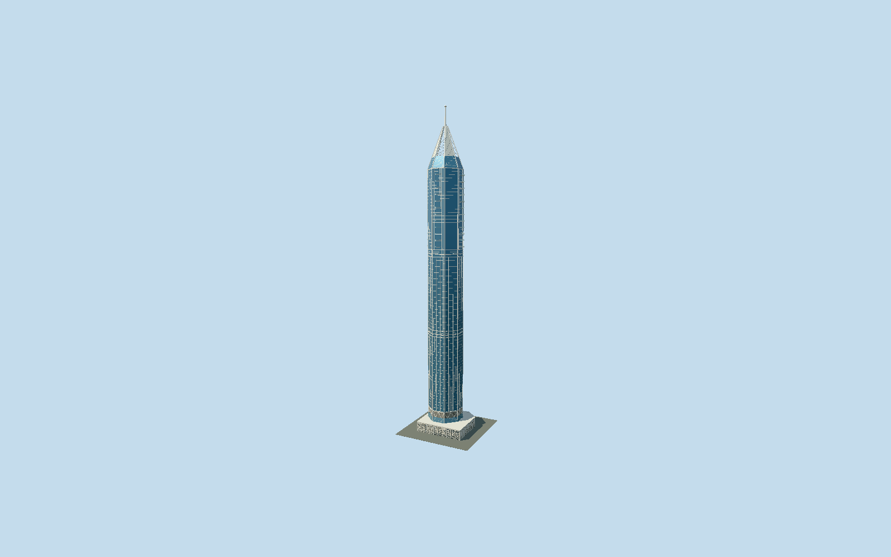

# 23 Marina

Dubai’s white-and-blue octagonal residential tower with mapped offset shaft, three facade zones,48 triangular duplex balconies with plunge basins, an open four-canopy crown, slender capped mast and decorated fan/lattice podium.

## Evidence and reconstruction

Published dimensions and reconstructed details are separated in spec.json. Primary references:

- [Reference](https://www.hafeezcontractor.com/projects/23-marina-dubai)
- [Reference](https://www.skyscrapercenter.com/building/23-marina/247)
- [Reference](https://www.openstreetmap.org/way/186351097)
- [Reference](https://www.openstreetmap.org/way/907717855)
- [Reference](https://www.openstreetmap.org/way/186351102)

No third-party geometry, photograph or bitmap texture is embedded. Shared surface graphs come from the central library; vertex tints carry model colors. Glazing uses PBR materials; transparent surfaces are declared per model.

## Model and axes

59,039 triangles; 167,001 vertices; 4 material groups; 6,723,204 bytes. Native bounds: -29.821, 0.000, -28.665 to 29.822, 392.400, 28.665. Source hash: `sha256:c8636650140cd56ba016d9a6e200de0a7a7e3d28cf1cba74c89566cde6e69a08`.

{"up":"+Y","longitudinal":"+X southeast","front":"-Z northeast reconstructed podium entry","origin":"Mapped asymmetric podium street frame"}

Fresh OSM API on 2026-10-10 confirms exact Q216264 podium 186351097, independent octagonal shaft 907717855 and mast 186351102; all geometry matches map-parts. Signed heading -0.72546838218 puts +X southeast and +Z southwest. The independently offset shaft/mast and asymmetric fifth podium edge fix the registration phase; an unsigned long axis alone would not. Architect completed photos show diagonal broad blue facets alternating with native cardinal balcony faces and open four-canopy crown. Door bay on native -Z (northeast) podium front remains photograph-based reconstruction, not a surveyed entrance point; no doorway-bearing claim. Source Y=0 is reconstructed street datum and tip 392.4 m follows CVU record rather than inconsistent 39/393/395 m map tags. Accept 2 m footprint / 1 degree reconstruction allowance; automatic footprint replacement disabled.

## Reproduce

Run `node packages/worldgen/scripts/generate-signature-towers.mjs --ids=23_marina` (or add `--check`). The generator preserves manually edited masters by checking their baseline hashes. Import through the standard authored-model workflow with optimization disabled; then capture all QA cameras, including shared-surface views.

## Pending work

- Original 452069-triangle, 52876084-byte master remains exactly reproducible from unchanged recipe. Reviewed source/four browser levels retain independently mapped asymmetric podium, offset octagonal shaft/mast, white/blue facade zones and belts, 48 triangular terrace slabs, open four-canopy crown, braced slots and 392.4 m capped mast. Whole backing planes, continuous seam strips and two-faced flat strips for narrow near trim and crossed skyline strips replace separately framed cells. Close-up/street reconstruct the podium lattice with aggregated coarse six-petal motifs with hexagonal close-up and four-sided street petal loops rather than every tiny original petal; district keeps two solid outer fan ribs per bay, sparse beams and averaged lattice colour but omits pool basins and terrace top rails; skyline keeps white vertical corner frames, averages podium/trim colour and omits small screens, rails, pool basins, collars, canopy louvers and thin X bracing. Near terrace guards and static plunge basins remain explicit. Two canonical shared graphs approximate gray stone and white coated metal; four near draw groups, zero images. Exact floor/panel schedule, canopy datum, ornamental spacing, pool dimensions and door bay are reconstructions from architect photos. Architect introductory 380 m wording differs from final 393 m factbox and current CVU 392.4 m; completed dimension controls tip. Lobby interiors, landscaping, lettering and swimming simulation excluded. Finite along-ray 1.5/.75/.3/.1 m allowances exclude omitted/aggregated thin screens, mullions, rails and collars; no global surface-distance, physical-device or surveyed-grade claim.

This bundle follows the medium-fi standard. Medium-fi appearance and geographic fit are reviewed separately. Hash-bound visual acceptance is recorded separately after capture inspection.
