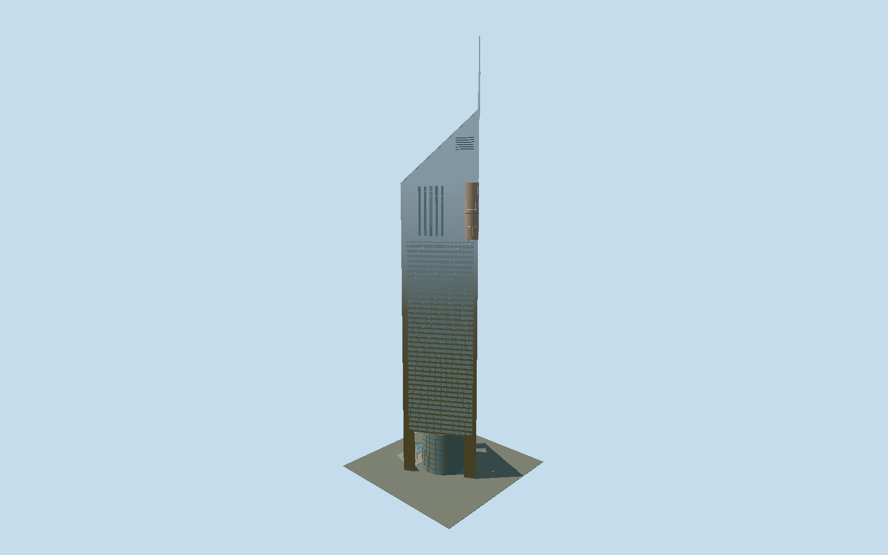

# Jumeirah Emirates Towers Hotel

A separately registered triangular Emirates tower with three open base piers, eight-storey glass drum, bowed outer curtain wall, horizontal ribbon facades, copper-glass beacon, slit-window upper floors and sloping glazed roof with a rectangular pinnacle.

## Evidence and reconstruction

Published dimensions and reconstructed details are separated in spec.json. Primary references:

- [Reference](https://norrgroup.com/jumeirah-emirates-towers-office/)
- [Reference](https://www.multiplex.global/projects/emirates-towers/)
- [Reference](https://www.turnerconstruction.com/projects/emirates-towers)
- [Reference](https://modularsa.com/wp-content/uploads/2021/01/The_Architecture_of_the_United_Arab_Emirates.pdf)
- [Reference](https://www.investindubai.gov.ae/fr/dubai-for-events/venues/-/media/venues/files/jumeirah-emirates-towers/floorplan.pdf)
- [Reference](https://www.jumeirah.com/en/stay/dubai/jumeirah-emirates-towers)
- [Reference](https://www.servcorp.ae/en/serviced-offices/locations/dubai/emirates-tower/)

No third-party geometry, photograph or bitmap texture is embedded. Shared surface graphs come from the central library; vertex tints carry model colors. Glazing uses PBR materials; transparent surfaces are declared per model.

## Model and axes

55,472 triangles; 158,820 vertices; 3 material groups; 6,385,556 bytes. Native bounds: -37.021, 0.000, -28.269 to 32.543, 309.000, 28.269. Source hash: `sha256:82a28e16c0b876ef6c88fe796bced55c10214699559ede43fc432871b35fc309`.

{"up":"+Y","front":"+X toward inward apex and mast","outerLobby":"-X opposite the mast"}

Fresh2026-10-10 Jumeirah operator structured coordinates[55.281903,25.217773] identify the western hotel entrance independently of swapped map tags. The labelled2018 owner terrace plan page7 distinguishes hotel/west and office/east; architect-contributed site plan printed67 and hotel lobby plan printed74 corroborate the outer west-northwest arrival side. Raw way393391114 retains conflicting office Q845182/commercial/54floor/355m tags under explicit Q1049027 hotel override. Fresh2026-10-10 map geometry matches the original independent source-local ring exactly. Three triangle corners retain centroid[55.2823759,25.217581566666667] and directed heading-0.5679485566001423. Native+X follows the inward east-southeast high roof/apex/mast, -X the outer west-northwest glass lobby, +Z south-southwest. The published55.5m triangle governs the authored model over approximate54m map sides: accept1m principal triangle/1degree bearing allowance. Reconstructed bow projects5.5m beyond rear chord; canopy/apron project farther, and are attached unsurveyed exterior elements. GroundY0 is an unsurveyed reconstructed entrance datum. Shared retail/parking podium, office tower, changing landscape and neighboring Museum of the Future are excluded. No footprint replacement.

## Reproduce

Run `node packages/worldgen/scripts/generate-signature-towers.mjs --ids=jumeirah_emirates_towers_hotel` (or add `--check`). The generator preserves manually edited masters by checking their baseline hashes. Import through the standard authored-model workflow with optimization disabled; then capture all QA cameras, including shared-surface views.

## Pending work

- Unchanged original buildEmirates(true) source reproduces337608triangles/31153696bytes exactly. Reviewed hotel retains55.5m equilateral shaft, three open triangular piers and an eight-floor circular drum,41 reconstructed3.6m ribbon courses, bowed outer curtain wall, recessed glazing/projected sills, five upper slits on each side, copper cylindrical beacon, sloping glass roof between two metal gables and rectangular mast to309m. Attached arrival canopy/three revolving-door casings/small apron and reconstructed side steps remain. Continuous shared stainless panels replace painted/stainless duplicate groups and repeated2cm panel-joint beams; tiny mast joints are omitted. Opaque reflective glazing approximates real clear drum; tinted stainless approximates aluminium. Skyline preserves principal tower/base/crown/roof/mast with five-floor ribbons/six-sided bow/coarse drum, omitting canopy/apron/steps/doors, framing and maintenance arms. District restores entry/steps, four drum belts, three-floor ribbons and sparse roof grid. Street restores every ribbon/eight drum belts and continuous curved mullion strips, sills/louvres/maintenance arms. Close-up adds dense glazing/beacon frames/roof lattice. Book printed64 gives305m hotel, contractor Multiplex309m/56floors; current architect360m is a complex/office rounded statement. Original309m follows contractor, not agreement among sources. Intermediate31.8/176/215/263.3m datums, bowed radius, pitches and entrance dimensions remain photographic reconstructions. The triangular canopy and door casings are a stylized approximation, not the literal curved skylit hotel lobby/terraced podium in the plans. Interiors/full shared shopping/parking complex/landscaping are excluded. Physical-device/dense-city timings, curb/terrain fit and global geometry error bounds are unmeasured.

This bundle follows the medium-fi standard. Medium-fi appearance and geographic fit are reviewed separately. Hash-bound visual acceptance is recorded separately after capture inspection.
