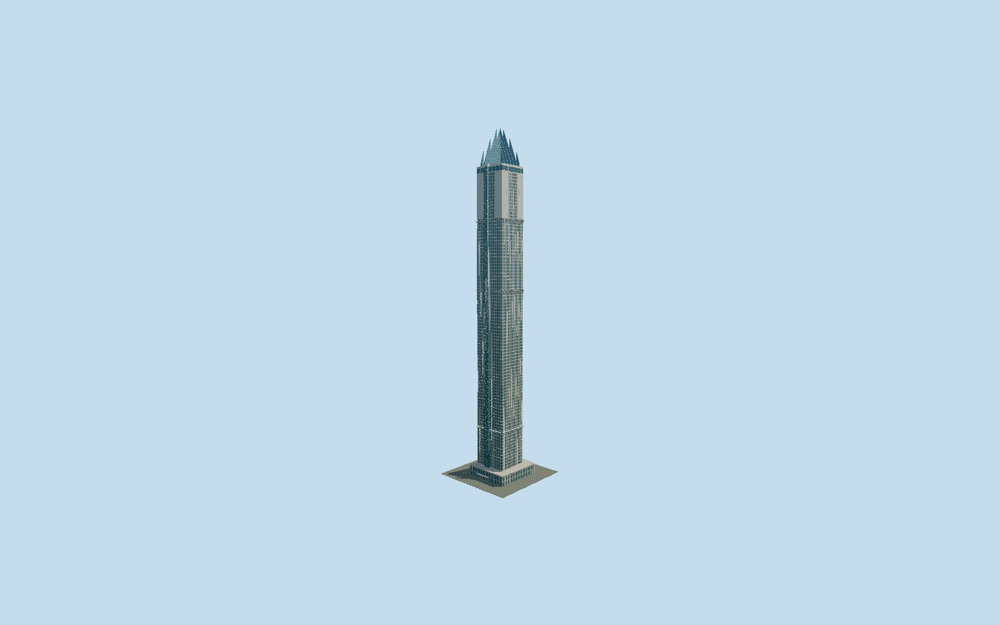

# Marina 101

Detailed425m Marina101 with two-tone aluminum piers and recessed glazing, three flared light-dish bands, sea-side paired panoramic lift, pale upper wings, four separate stepped blue pinnacles and granite street podium.

## Evidence and reconstruction

Published dimensions and reconstructed details are separated in spec.json. Primary references:

- [Reference](https://www.neb.ae/project/marina-101/)
- [Reference](https://sheffieldholdings.com/web/images/pages_uploaded_image/51481_Marina-101-Brochure.pdf)
- [Reference](https://cdnc.heyzine.com/files/uploaded/v2/d6e20aacb4cba4734ed48ff6ac644422f417d324.pdf)
- [Reference](https://www.tavconstruction.com/eng/TAV-Construction-Brochure-October2025.pdf)
- [Reference](https://www.skyscrapercenter.com/dubai/marina-101/207)
- [Reference](https://www.flickr.com/photos/npobre/49981386642/)
- [Reference](https://www.openstreetmap.org/way/195527261)
- [Reference](https://www.openstreetmap.org/way/1074877791)

No third-party geometry, photograph or bitmap texture is embedded. Shared surface graphs come from the central library; vertex tints carry model colors. Glazing uses PBR materials; transparent surfaces are declared per model.

## Model and axes

63,994 triangles; 186,202 vertices; 4 material groups; 7,473,896 bytes. Native bounds: -32.754, 0.000, -32.000 to 24.866, 425.019, 33.949. Source hash: `sha256:47b051c85342cbc4ac0f03856bb36fcb599649183119a3d247c894cf93e13cf1`.

{"up":"+Y","longAxis":"+X northeast toward Dubai","shortAxis":"+Z southeast toward Sheikh Zayed Road; -Z sea"}

Fresh2026-10-10 exact-Q1165269 shaft195527261 and surrounding podium1074877791 match both independently preserved raw source rings exactly. Developer2014 floor plans actually inspected on pages9–10 explicitly label Dubai/AbuDhabi and SEA/SZR and show paired lift on SEA facade towardDubai end, independently resolving the180degree map ambiguity. Original anchor[55.148624441,25.089056291] and heading0.864924013745 retain native+X northeast/Dubai, -X southwest/AbuDhabi, -Z northwest/sea and +Z southeast/SheikhZayedRoad. Native liftx2.7/z-22.117 follows this signed facade. Primary425m supersedes raw432m height while raw tags remain unchanged. Principal41.284×38.135m shaft is preserved; podium is separately projected from its raw ring. Three flared bands and attached seaward canopy project beyond shaft. Accept1m principal plan/1degree bearing allowance; projection rounding residual under1mm is not survey precision. GroundY0 is unsurveyed approximate podium/street contact. Portal, intermediate podium heights and door details are photographic approximations; no independently mapped doorway bearing is claimed. No footprint replacement; adjacentMarinaPinnacle/Sulafa, public streets, basements, interiors and landscaping excluded.

## Reproduce

Run `node packages/worldgen/scripts/generate-signature-towers.mjs --ids=marina_101` (or add `--check`). The generator preserves manually edited masters by checking their baseline hashes. Import through the standard authored-model workflow with optimization disabled; then capture all QA cameras, including shared-surface views.

## Pending work

- Unchanged buildMarina101 original reproduces233064triangles/24689924bytes exactly. Reviewed source retains separately mapped granite podium,41.284×38.135m rectangular shaft, two-tone14bay piers and94 reconstructed courses, recessed opaque vision glass, pale upper wings, three rows of physically flared light dishes, projecting paired panoramic lift/diagonal bracing, four separate folded blue crown tips plus413/400m shoulder folds and inset service ties. Continuous vertical glazing and flat mullions replace repeated window cells. Projected sill leading-edge strips and flat crown seams replace repeated beam shells; tiny podium masonry joints omitted. All24closed crown blades remain; narrow central cruciform slot stays open. Skyline keeps full closed podium/shaft, paired projecting lift, three continuous flare silhouettes and all four tips/shoulder folds, with eight-course ribbons; porch/windows, internal lift/crown ties and panel seams omitted. District restores podium windows/seaward porch, four sampled flare piers and six-bay lift bracing intervals, four-course ribbon cadence. Street restores14flare piers, every ribbon datum, coarse window frames, wing ribs, alternate lift ties and sparse crown seams. Near restores per-bay two-tone spandrels/reveals/projected sills, fine crown seams/wing ribs/full lift ties and translucent vestibule doors. Canonical painted-metal tint approximates aluminium; opaque glass approximates double glazing.425m peak/370.9m occupied/45m crown are primary;94window-course count and13/61/232/316/380m datums, exact crown shoulder shapes, liftwidth/baypitches and portal positions are reconstructed. FabricatorPDF page20 is an unrelated AbuDhabi structure despite its mislabeledMarina101title and is excluded; only page19 Dubai crown/lift drawing is used. Developer renderings are cross-checked with contractor construction photo and2020completed crown, not claimed as as-built surveys. Opening/occupancy, current defects, interior/basement/site landscape are excluded. Physical-device/dense-city timings, surveyed curb fit and global geometric bounds are unmeasured.

This bundle follows the medium-fi standard. Medium-fi appearance and geographic fit are reviewed separately. Hash-bound visual acceptance is recorded separately after capture inspection.
