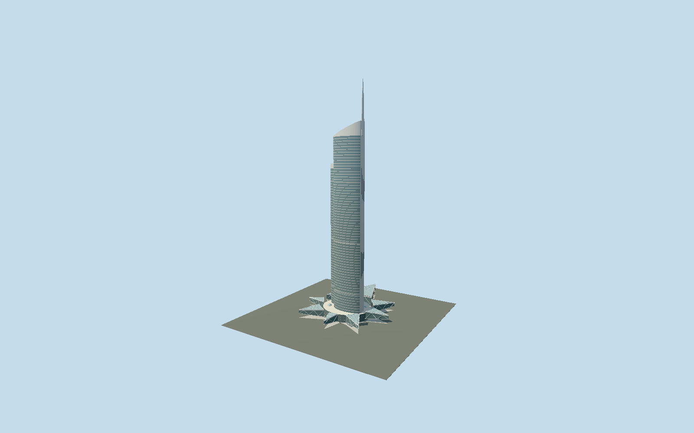

# Almas Tower

Paired clipped-ellipse glazed shafts, different sloping crowns and elliptical mast over eight projecting diamond podium wings.

## Evidence and reconstruction

Published dimensions and reconstructed details are separated in spec.json. Primary references:

- [Reference](https://www.atkinsrealisusn.com/~/media/Files/R/Renaissance/download-centre/en/technical-journals/technical-journal-06.pdf)
- [Reference](https://accgroup.com/our_projects/almas-towers-dubai/)
- [Reference](https://www.skyscrapercenter.com/building/almas-tower/298)
- [Reference](https://www.openstreetmap.org/way/1137607706)

No third-party geometry, photograph or bitmap texture is embedded. Shared surface graphs come from the central library; vertex tints carry model colors. Glazing uses PBR materials; transparent surfaces are declared per model.

## Model and axes

16,066 triangles; 43,982 vertices; 4 material groups; 1,778,964 bytes. Native bounds: -75.323, 0.000, -103.055 to 73.890, 360.000, 67.818. Source hash: `sha256:367f12b99de48d407b466b1f9de703e57916f7ae627b069e7128f0b72cba268c`.

{"up":"+Y","longitudinal":"+X southeast, image-right in Atkins plans","front":"+Z southwest, image-down in Atkins plans","origin":"Signed engineer-plan tower center at the podium entry datum"}

Fresh OSM API on 2026-10-10 confirms unchanged name-confirmed Almas podium 1137607706 and malformed shaft 1491743595. Retain the existing signed eight-tip engineer-plan fit without reflection, heading -0.669655293352136. Native +X points southeast, +Z southwest; largest diamond-exchange petal on -Z points northeast. Lower ellipse is north of the taller southern ellipse and its mast lies at the clipped +X end. Published 64 by 42 m shaft geometry overrides the inconsistent mapped shaft. Podium projection residual is under 0.002 m, while primary drawing/map registration has 2.092 m per-coordinate RMS and about 5% scale disagreement. Accept 3 m drawing registration / 1 degree reconstruction allowance; no surveyed doorway, grade or survey-quality control claim. Entry Y=0 and automatic footprint replacement disabled. Below-entry terraced landscape is excluded.

## Reproduce

Run `node packages/worldgen/scripts/generate-signature-towers.mjs --ids=N0175` (or add `--check`). The generator preserves manually edited masters by checking their baseline hashes. Import through the standard authored-model workflow with optimization disabled; then capture all QA cameras, including shared-surface views.

## Pending work

- Original 245998-triangle, 21729692-byte master remains exactly reproducible from the unchanged global recipe. Reviewed source and four browser levels preserve two offset clipped ellipse shafts, different sloping crowns, silver end blades, complete 81 m elliptical two-section mast reaching 360 m, all eight mapped podium wings with closed roofs/soffits and raking supports. Replace individual framed glass cells with continuous opaque glazing, long facade strips and selected near wing trusses. Skyline/district omit fine frames and aggregate facade bands; native shaft/mast facet allowances 1.5 / 0.75 / 0.3 / 0.1 m exclude intentionally omitted decorative frames. Rooflights are repaired from flat discs to faceted glass domes; approximate 3.2 m base radius and 15.4 m apex are photographic reconstructions, not engineering dimensions. Published 64 by 42 m typical plan, 279 m plant datum, 18.6 / 20.85 m exchange datums and 81 m mast follow Atkins. Contractor secondary 240 m / 54-floor and 65-floor main description differs from current CVU 68 above-ground floors; external shaft massing follows the engineer. Signed map/drawing registration retains 2.092 m RMS and about 5% scale disagreement. Individual glazing pitch, minor louvres, secondary wing slopes, dome curvature and exact entrance thresholds are reconstructed. Three canonical shared 256 px graphs; no embedded images or copied photographic textures. Folded ground slab down to basement levels, terraced water feature below entry, parking, interiors, fine signage and night LEDs are excluded. No terrain-grade or physical phone/laptop performance claim.

This bundle follows the medium-fi standard. Medium-fi appearance and geographic fit are reviewed separately. Hash-bound visual acceptance is recorded separately after capture inspection.
