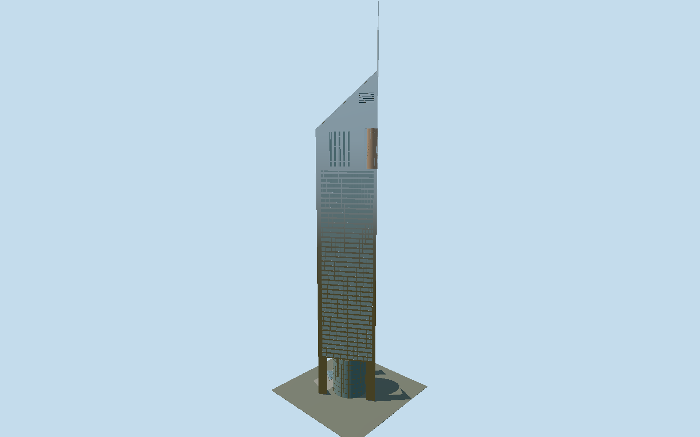

# Emirates Office Tower

A separately registered triangular Emirates tower with three open base piers, eight-storey glass drum, bowed outer curtain wall, horizontal ribbon facades, copper-glass beacon, slit-window upper floors and sloping glazed roof with a rectangular pinnacle.

## Evidence and reconstruction

Published dimensions and reconstructed details are separated in spec.json. Primary references:

- [Reference](https://norrgroup.com/jumeirah-emirates-towers-office/)
- [Reference](https://www.multiplex.global/projects/emirates-towers/)
- [Reference](https://www.turnerconstruction.com/projects/emirates-towers)
- [Reference](https://modularsa.com/wp-content/uploads/2021/01/The_Architecture_of_the_United_Arab_Emirates.pdf)
- [Reference](https://www.investindubai.gov.ae/fr/dubai-for-events/venues/-/media/venues/files/jumeirah-emirates-towers/floorplan.pdf)
- [Reference](https://www.jumeirah.com/en/stay/dubai/jumeirah-emirates-towers)
- [Reference](https://www.servcorp.ae/en/serviced-offices/locations/dubai/emirates-tower/)

No third-party geometry, photograph or bitmap texture is embedded. Shared surface graphs come from the central library; vertex tints carry model colors. Glazing uses PBR materials; transparent surfaces are declared per model.

## Model and axes

61,098 triangles; 155,050 vertices; 3 material groups; 6,317,336 bytes. Native bounds: -37.021, 0.000, -28.073 to 32.352, 355.000, 28.073. Source hash: `sha256:b617a9862d77c6e5de2fc604eede6efa1680aef0d99f9831b2676edd81b58582`.

{"up":"+Y","front":"+X toward inward apex and mast","outerLobby":"-X opposite the mast"}

Fresh2026-10-10 office-tenant Servcorp structured coordinates[55.283546,25.21768] independently identify the eastern shaft. The labelled2018 owner terrace plan distinguishes office/east and hotel/west, corroborated by the architect-contributed book site plan printed67 and completed photos. Eastern way393391115 retains conflicting hotel Q1049027/name:en tags; raw tags are preserved and explicit Q845182 office identity override is retained. Fresh raw footprint is exact against the independent original source-local baseline, including its collinear extra vertex; projection differs by under1mm. Three true triangle vertices retain centroid[55.28363353333333,25.2176177] and directed heading2.6255014113716246, with native+X toward the west-northwest high roof/apex/mast and-X toward the outer east-southeast glass lobby. Native+Z points north-northeast. The published55.5m equilateral side governs geometry over the approximate mapped54m side; accept1m principal-triangle/1degree bearing allowance. The original reconstructed bowed outer curtain wall projects5.5m beyond its straight rear chord, and entrance canopy/apron project farther; these are declared attached exterior elements, not surveyed raw footprint matches. Neither fresh mapped entrance belongs to this tower. GroundY0 is an unsurveyed reconstructed entrance datum; shared retail/parking podium and the other tower are excluded. No footprint replacement.

## Reproduce

Run `node packages/worldgen/scripts/generate-signature-towers.mjs --ids=N0194` (or add `--check`). The generator preserves manually edited masters by checking their baseline hashes. Import through the standard authored-model workflow with optimization disabled; then capture all QA cameras, including shared-surface views.

## Pending work

- The unchanged original buildEmirates office recipe reproduces343268triangles/31623800bytes exactly. Reviewed source retains the55.5m equilateral shaft, three open triangular piers around an eight-floor circular drum,40ribbon floor datums, physically bowed outer curtain wall, recessed ribbons and projecting sills, five tall crown slits per side, copper-tinted cylindrical beacon, sloping glass roof between two metal gables, two-stage rectangular mast to355m and attached arrival canopy/apron with three reconstructed revolving-door casings. Repeated2cm panel-joint beams, tiny mast joints and per-panel face subdivisions are omitted; continuous shared stainless panels replace painted-metal/stainless duplicate surface groups. Shared stainless tinted silver approximates aluminium, and opaque glass approximates reflective vision glass and the real clear drum. Skyline has sparse five-floor ribbons, six-segment bow, one-floor coarse drum, five crown slits and triangular roof/mast; canopy/apron, door casings, fine curtain mullions, beacon frame bands and maintenance arms are omitted. District restores canopy/apron/doors, four drum belts, three-floor ribbons, twelve-segment bow and sparse diagonal roof grid. Street restores every floor datum, eight drum belts, facade mullions, denser bow/roof sampling, slits, sill projections and maintenance arms. Close-up adds dense drum glazing, beacon bands and fine roof grid. Original intermediate base/crown datums, bow/radius, panel/mullion pitches and canopy/door dimensions remain photo reconstructions; only overall published height, side, floor-to-floor pitch and major forms/counts are primary. Current architect NORR rounds total height360m and counts52office floors; contractor gives354m/54floor office, while architect-contributed book uses355m/54. Selected original355m is retained; no forced agreement is claimed. Common retail complex, interiors, landscaping and neighboring Museum of the Future are excluded. Actual physical-device/dense-city timings and surveyed entrance/curb fit remain unmeasured.

This bundle follows the medium-fi standard. Medium-fi appearance and geographic fit are reviewed separately. Hash-bound visual acceptance is recorded separately after capture inspection.
