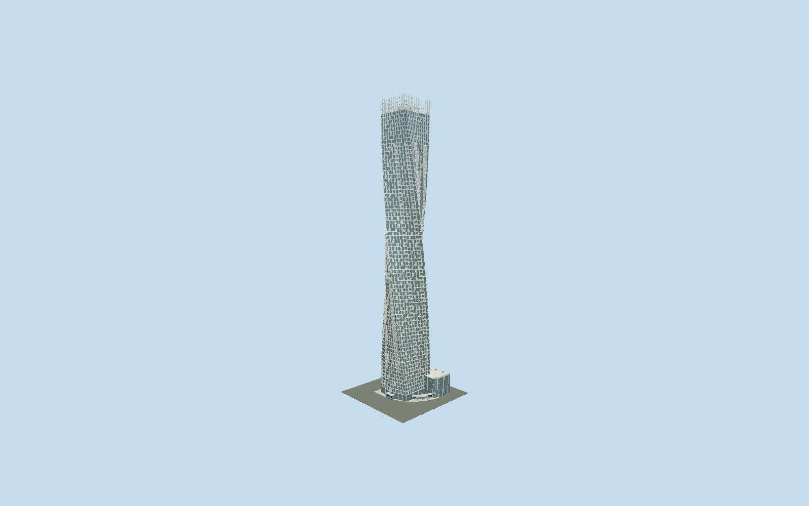

# Cayan Tower

SOM helical residential tower with a shallow chevron floorplate,90-degree clockwise twist,73 nominal residential levels and two upper mechanical courses, deeply recessed balconies,30–60% open round-metal shading screens, open steel crown, glazed six-level podium and rooftop pools.

## Evidence and reconstruction

Published dimensions and reconstructed details are separated in spec.json. Primary references:

- [Reference](https://www.som.com/projects/cayan-tower/)
- [Reference](https://www.som.com/news/soms-cayan-tower-opens/)
- [Reference](https://www.cayan.net/projects/cayantower/)
- [Reference](https://www.cayan.net/live/wp-content/uploads/2022/03/cayantower-floor-plans.pdf)
- [Reference](https://www.cayan.net/live/wp-content/uploads/2022/03/cayantower-brochure.pdf)
- [Reference](https://www.architectmagazine.com/design/buildings/cayan-tower-designed-by-skidmore-owings-merrill_o/)
- [Reference](https://www.usmodernist.org/AJ/A-2013-11.pdf)
- [Reference](https://www.skyscrapercenter.com/building/cayan-tower/464)
- [Reference](https://www.openstreetmap.org/way/195527255)

No third-party geometry, photograph or bitmap texture is embedded. Shared surface graphs come from the central library; vertex tints carry model colors. Glazing uses PBR materials; transparent surfaces are declared per model.

## Model and axes

49,408 triangles; 145,402 vertices; 4 material groups; 5,833,168 bytes. Native bounds: -24.180, 0.000, -25.737 to 34.025, 306.400, 35.025. Source hash: `sha256:cb25105c825500022f8c2cf01757daee3f720b34afec2db23e0a4e26a307698b`.

{"up":"+Y","longAxis":"+X northeast toward attached parking podium","shortAxis":"+Z southeast; clockwise shaft twist viewed from above"}

Fresh2026-10-10 exactQ391648 way195527255 matches independently preserved original mapped rectangle within.001m numeric projection rounding. Original anchor[55.1451708,25.08684565] and heading0.882804659892 retain native+X northeast attached-podium side and +Z southeast. Actually inspected SOM site/floor plans in ArchitectNovember2013 printed185, full cached page image186, with north arrow upper-right and independent parking/retail block page-right. This signs the180degree rectangle ambiguity; completed SOM photographs confirm podium attachment and lower Marina versus upper Gulf orientation. Native quarter-turn is clockwise in north-up x/z map view; shallow opposed chevron kinks retained. Raw73floors/306.4m identity preserved; architect75includes reconstructed upper courses. Tower envelope is registration, not literal chevron ground footprint. Attached six-level podium and curved arcade outline are reconstructed from primary plan scale, not an independently surveyed mapped footprint. Allow2m principal-shaft and5m reconstructedpodium plan approximation,2degree bearing allowance, without survey-precision claim. Y0 approximate entranceapron; west/southwest portal is stylized, not an independently mapped doorway. No footprint replacement. Promenade outside own-site arcade, bridge/neighbors, basements, interiors and full landscape excluded.

## Reproduce

Run `node packages/worldgen/scripts/generate-signature-towers.mjs --ids=N0202` (or add `--check`). The generator preserves manually edited masters by checking their baseline hashes. Import through the standard authored-model workflow with optimization disabled; then capture all QA cameras, including shared-surface views.

## Pending work

- Original buildCayan remains unchanged and byte-reproduces489408triangles/46634692bytes including one256square canonical perforated-metal fallback. Independent reviewed source preserves90degree clockwise chevron helix,75reconstructed3.8m courses above6.7m lobby, recessed balcony bays/deep sills, staggered shared round-hole shading screens,306.4m open lattice crown/setback mechanical drum/gantry and separate northeast six-level glazedpodium with two roof pools, planting/curved arcade/portal. Sampledbays3.1m replaceoriginal2.7m; flat pier/transom strips/one-surface sill leading-edge plus jamb returns replace repeated closedbeam shells; tiny slab seams/screen framing omitted. Original within-course no-sideways-column rule retained near; coarselevels use smooth helix. Balconies/terrace guards become opaque blue approximations within fourdrawgroups. Granite graph approximates paving, concrete servicecore, shrubs/trunks; paintedmetal approximates ACP and visionpalette approximatesglazing/water. Source/runtime retain one small canonical256square perforation fallback for portable inspection, not a unique texture; worldviewer uses sharedgraph once. Browser derivatives use shared screen graph UV/MASK with no embedded bitmap. Skyline uses3course shape sampling,closedshaft/base/podium and open six-cornercrown/mechanicaldrum, omits entry/pools/vegetation/glazingframes/screens. District restores full podium/pools/arcade/portal with8coursebandedshaft and sampled widebays, omits screens/balconies/finecrown. Street restores2course shaft rhythm/screens at5.4m bays; near all75courses/3.1mbays/recessedbalconies/transoms/fullcrown andbraces. Primary73owner/75architectfloorcounts preserved separately;307m roundedarchitectheight versus306.4m registry retained, selecting306.4. Chevron/podium metric dimensions, facade schedules, roofcourse heights, gantryequipment and pool/portal detail are reconstructions. Physical-device/dense-city timings, surveyedcurb and globalerrorbounds unmeasured.

This bundle follows the medium-fi standard. Medium-fi appearance and geographic fit are reviewed separately. Hash-bound visual acceptance is recorded separately after capture inspection.
